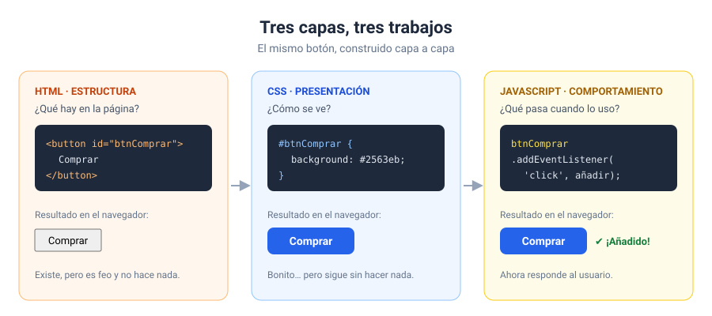
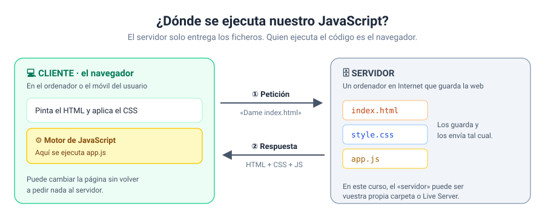
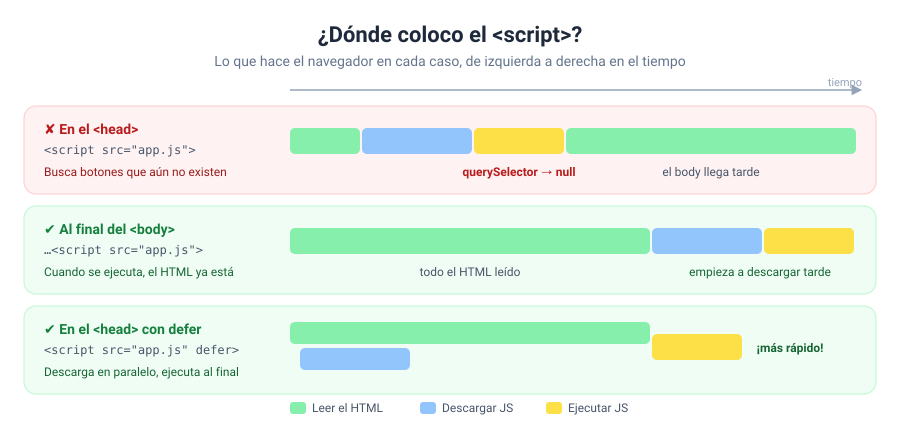
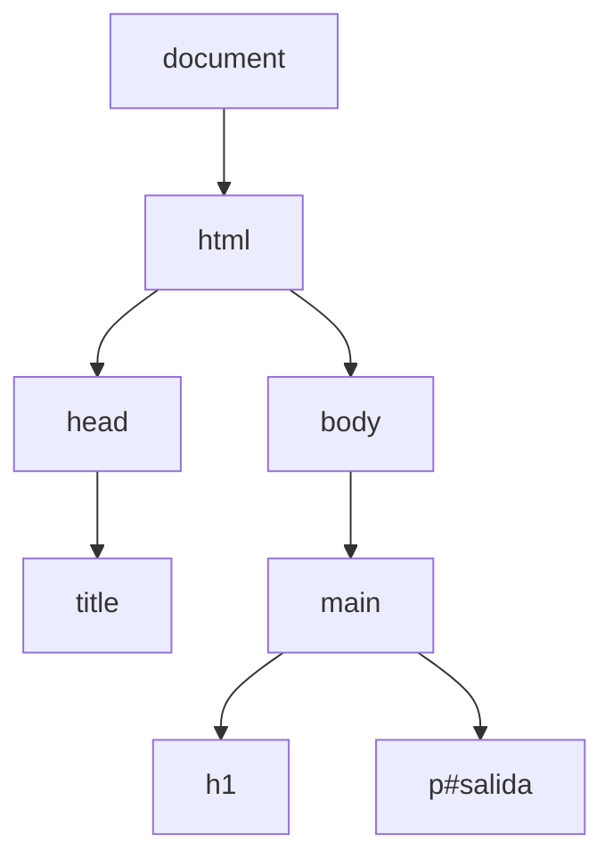
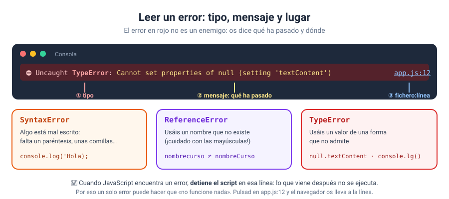
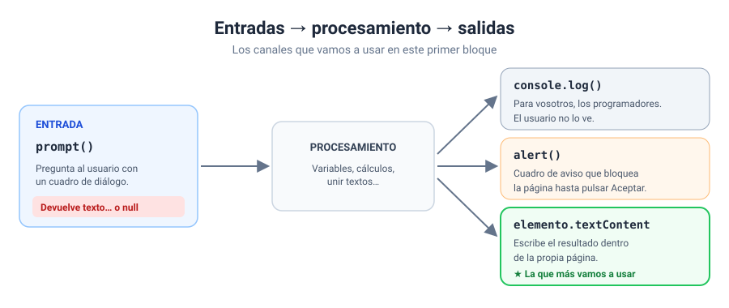

# Bloque 01 · Introducción

[← Volver al temario](../TEMARIO.md) · [Ir al bloque 02 →](../02-fundamentos-del-lenguaje/)

Empezamos. En este primer bloque no os voy a pedir que programéis nada complicado. Lo que quiero es que entendáis **dónde vive JavaScript**, cómo se conecta con una página y cómo comprobar que está funcionando. Parece poca cosa, pero la mitad de los atascos del primer mes vienen de aquí: un fichero mal enlazado, un script que se ejecuta antes de tiempo o un error en la consola que nadie ha leído.

Al terminar este bloque sabréis:

- Explicar qué hace JavaScript en una página y en qué se diferencia de HTML y CSS.
- Enlazar un fichero `app.js` a un `index.html` y elegir bien dónde colocar el `<script>`.
- Usar la consola del navegador para ver mensajes y leer errores.
- Pedir un dato al usuario con `prompt()` y mostrar resultados con `console.log()`, `alert()` y `textContent`.

---

## 1. ¿Qué es JavaScript?

JavaScript es un lenguaje de programación que se usa para que las páginas web sean interactivas: botones que hacen algo al pulsarlos, menús que se despliegan, formularios que avisan de un error… [1]

Ya conocéis las otras dos piezas de una página. Os las pongo juntas con un mismo botón para que veáis qué aporta cada una:



| Capa | Pregunta que responde | Si falta… |
| --- | --- | --- |
| HTML | ¿Qué hay en la página? | No hay nada que mostrar |
| CSS | ¿Cómo se ve? | Se ve, pero con el aspecto por defecto del navegador |
| JavaScript | ¿Qué pasa cuando el usuario hace algo? | Se ve bien, pero no reacciona |

Una aclaración para no liarnos con el nombre: JavaScript **no tiene nada que ver con Java**. Se parecen en el nombre y poco más, igual que un coche y un cochecito de bebé.

---

## 2. JavaScript en el cliente

JavaScript puede ejecutarse en dos sitios. MDN distingue entre JavaScript *de lado del cliente*, que trabaja con el navegador y con la página, y JavaScript *de lado del servidor*, que trabaja, por ejemplo, con bases de datos [1]. En este curso nos quedamos en el cliente.



Fijaos en el reparto de papeles. El servidor guarda los ficheros y los envía cuando el navegador los pide. Ya está. Quien **ejecuta** vuestro `app.js` es el navegador, en el ordenador o en el móvil de quien visita la web. Por eso JavaScript puede cambiar la página al instante, sin recargarla: todo ocurre en la máquina del usuario.

> [!NOTE]
> Durante el curso, ese «servidor» será vuestra propia carpeta: abrís `index.html` con doble clic y el navegador carga los ficheros desde el disco. Más adelante usaremos Live Server, que hace de servidor en vuestro ordenador.

---

## 3. Cómo se añade JavaScript a una página

Hay tres formas de meter JavaScript en una página. Os las enseño todas para que las reconozcáis cuando las veáis por ahí, pero en el curso solo vamos a usar una.

### 3.1. Script interno

El código va escrito dentro de una etiqueta `<script>` en el propio HTML:

```html
<script>
    console.log('Hola desde el HTML');
</script>
```

Funciona, pero mezcla estructura y comportamiento en el mismo fichero.

### 3.2. Script externo ✔

El código va en su propio fichero, y el HTML solo lo enlaza:

```html
<script src="app.js"></script>
```

Esta es **la forma que vamos a usar en todo el curso**. Cada lenguaje en su fichero: `index.html`, `style.css` y `app.js`. Cuando la etiqueta tiene `src`, va vacía; lo que escribierais dentro se ignoraría [2].

### 3.3. Código dentro de atributos ✘

```html
<button onclick="saludar()">Saludar</button>
```

Lo vais a encontrar en tutoriales antiguos. MDN lo marca como mala práctica: ensucia el HTML y obliga a repetir el atributo en cada elemento [3]. En el bloque 07 aprenderéis la forma buena, con `addEventListener`.

---

## 4. ¿Dónde coloco el `<script>`?

Aquí está la primera trampa del curso. El navegador lee el HTML **de arriba abajo**. Cuando encuentra un `<script>` normal, se para, lo descarga, lo ejecuta y solo entonces sigue leyendo [2]. Si vuestro script busca un botón que está más abajo en el HTML, todavía no existe.



| Posición | ¿Funciona? | Por qué |
| --- | --- | --- |
| En el `<head>`, sin nada más | ✘ | Se ejecuta antes de que exista el `<body>`: `querySelector` devuelve `null` |
| Al final del `<body>` | ✔ | Cuando se ejecuta, todo el HTML ya está leído |
| En el `<head>` con `defer` | ✔ | Se descarga mientras se lee el HTML y se ejecuta al terminar [2] |

```html
<!-- Opción 1: al final del body -->
<body>
    …
    <script src="app.js"></script>
</body>

<!-- Opción 2: en el head con defer -->
<head>
    <script src="app.js" defer></script>
</head>
```

Las dos opciones buenas aparecen en los ejercicios. Os toca reconocerlas y saber por qué funcionan. El ejercicio 02 está dedicado precisamente a provocar el error y arreglarlo.

### Un adelanto: el DOM

Cuando el navegador lee el HTML, construye en memoria un árbol con todos los elementos de la página. Ese árbol se llama **DOM** (*Document Object Model*) y es lo que JavaScript puede leer y modificar [4]:



Para trabajar con un elemento primero hay que localizarlo. Lo haremos con `document.querySelector()`, que recibe un selector CSS y devuelve el primer elemento que lo cumple, o `null` si no encuentra ninguno [5]:

```javascript
const salida = document.querySelector('#salida');
```

El DOM tiene su propio bloque, el 06. De momento os basta con esta línea.

---

## 5. Las herramientas de desarrollo

Todos los navegadores modernos traen unas herramientas para programadores. En Windows y Linux se abren con `F12` o con `Ctrl` + `Mayús` + `I` [6]. Desde hoy, **las tenéis abiertas siempre que programéis**. Sin excepciones.

Las dos pestañas que más vais a usar ahora mismo:

- **Consola**: muestra los mensajes de `console.log()` y, sobre todo, los errores en rojo.
- **Elementos** (o *Inspector*): muestra el DOM en vivo. Si JavaScript cambia un texto, lo veréis cambiar aquí.

### Leer un error



Un mensaje de error tiene tres partes. Acostumbraos a buscarlas siempre:

```
Uncaught TypeError: Cannot set properties of null (setting 'textContent')     app.js:12
         ─────────  ───────────────────────────────────────────────────────    ────────
           tipo                          mensaje                               fichero:línea
```

Cuando JavaScript encuentra un error, **detiene el script** en ese punto [7]. Lo que venga después no se ejecuta. Por eso un solo error puede hacer que «no funcione nada».

Los tres tipos que más vais a ver al principio:

| Error | Qué suele significar | Ejemplo típico |
| --- | --- | --- |
| `SyntaxError` | Algo está mal escrito: falta un paréntesis, unas comillas… | `console.log('Hola);` |
| `ReferenceError` | Usáis un nombre que no existe | `nombrecurso` en lugar de `nombreCurso` [8] |
| `TypeError` | Usáis un valor de una forma que no admite | `null.textContent`, `console.lg()` [9] |

El ejercicio 08 es una caza de errores para que practiquéis esto con calma.

---

## 6. Entradas y salidas

Todo programa, por pequeño que sea, sigue el mismo esquema: **recibe datos, los procesa y muestra un resultado**. En este bloque usamos estos canales:



### 6.1. Entrada: `prompt()`

```javascript
const nombre = prompt('¿Cómo te llamas?', 'invitado');
```

Muestra un cuadro con una pregunta y una caja de texto. El segundo argumento es el valor que aparece escrito por defecto. Y aquí viene lo importante: devuelve **siempre un texto**, o `null` si el usuario pulsa Cancelar [10].

> [!IMPORTANT]
> Aunque el usuario escriba `5`, `prompt()` devuelve `'5'`, un texto. Si vais a hacer cuentas, convertidlo antes con `Number()` [11]. Si no, `'2' + '2'` os dará `'22'`. Lo veréis en el ejercicio 07.

### 6.2. Salida para vosotros: `console.log()`

```javascript
console.log('El valor de nombre es:', nombre);
```

Escribe en la consola [12]. El usuario no la ve; es vuestra herramienta para comprobar qué está pasando. También existen `console.warn()` y `console.error()`, que muestran el mensaje destacado como aviso o como error.

### 6.3. Salida que interrumpe: `alert()`

```javascript
alert('¡Bienvenidos!');
```

Muestra un cuadro de aviso y **espera** a que el usuario lo cierre [13]. Mientras tanto, el programa está parado. Lo usaremos en las primeras pruebas y lo abandonaremos en cuanto lleguen los eventos.

### 6.4. Salida en la página: `textContent`

```javascript
salida.textContent = `¡Hola, ${nombre}!`;
```

Sustituye el texto de un elemento [14]. Es la salida que más vais a usar en todo el curso, porque el resultado queda integrado en la página.

Existe otra propiedad parecida, `innerHTML`, que interpreta las etiquetas HTML que le pasáis. Tened cuidado con ella: si el texto viene del usuario, puede colar código en vuestra página. MDN la señala como una vía para ataques de *cross-site scripting* (XSS) [15]. Mi regla: **textos del usuario, siempre con `textContent`**. El ejercicio 05 os enseña el peligro en directo.

### 6.5. Plantillas de texto

En los ejemplos habéis visto textos entre comillas invertidas con `${…}` dentro. Son **plantillas de texto**: lo que va entre `${` y `}` se sustituye por su valor [16].

```javascript
const saludo = `¡Hola, ${nombre}!`;          // plantilla
const saludo2 = '¡Hola, ' + nombre + '!';    // lo mismo, uniendo trozos con +
```

Las comillas invertidas están en la tecla que hay a la derecha de la `P` en el teclado español.

---

<!-- ampliación -->
## 7. Un primer vistazo a `style`: cambiar el aspecto

Hasta ahora JavaScript cambiaba **textos**. También puede cambiar el **aspecto** de un elemento, a través de su propiedad `style`, que da acceso a sus estilos en línea [17]:

```javascript
const caja = document.querySelector('#caja');

caja.style.width = '200px';            // ancho
caja.style.height = `${alto}px`;       // alto, con una plantilla de texto
caja.style.backgroundColor = 'tomato'; // color de fondo
```

Tres detalles que conviene tener claros desde el principio:

| Detalle | Por qué |
| --- | --- |
| Las propiedades se escriben en *camelCase* | En CSS es `background-color`; en JavaScript, `backgroundColor`, porque el guion se leería como una resta |
| El valor es **un texto con su unidad** | `'200px'`, no `200`. Sin unidad, el navegador ignora el cambio |
| Se aplica como estilo en línea | Equivale a escribir `style="width: 200px"` en la etiqueta: gana a las reglas del `style.css` |

En el bloque 06 veréis una forma mejor de cambiar el aspecto, con clases (`classList`). Por ahora, `style` os permite ver enseguida que JavaScript también manda en el diseño.

### 7.1. HTML generado con plantillas de texto

Cuando lo que hay que pintar son varias etiquetas, se puede construir el HTML en un texto con comillas invertidas y asignarlo con `innerHTML` [15] [18]:

```javascript
resultado.innerHTML = `
    <ul>
        <li>Área: <strong>${area}</strong></li>
        <li>Perímetro: <strong>${perimetro}</strong></li>
    </ul>`;
```

Recordad lo que visteis en el ejercicio 05: `innerHTML` **interpreta** las etiquetas. Usadlo solo con datos que controláis vosotros, como estos números calculados; nunca con un texto que haya escrito el usuario.

---

## 8. La plantilla de trabajo en este bloque

En este bloque los programas se ejecutan **de arriba abajo, una sola vez**, al cargar la página. Todavía no hay eventos, así que la plantilla de cada `app.js` es la versión corta:

```javascript
// estructura del programa principal
const IVA = 0.21;

// constantes al DOM
const salida = document.querySelector('#salida');

// entradas
const precio = Number(prompt('Precio del producto:', '100'));

// procesamiento
const total = precio + precio * IVA;

// salidas
salida.textContent = `Total con IVA: ${total} €`;
```

En el bloque 07 aparecerán los escuchadores de eventos y la plantilla crecerá a su forma completa. Lo tenéis explicado en la [introducción del curso](../README.md#5-la-plantilla-de-trabajo).

---

## 9. Ejercicios

Cada ejercicio es una carpeta independiente con `index.html`, `style.css` y `app.js`. El enunciado está al principio de `app.js`. Abrid siempre la consola antes de empezar.

| Nº | Ejercicio | Qué practicáis | Solución |
| --- | --- | --- | --- |
| 01 | [¡Hola, consola!](ejercicios/ejercicio_01/) | Enlazar `app.js`, `console.log()`, `textContent`, número frente a texto | [Ver](soluciones/ejercicio_01/) |
| 02 | [El script que llegó demasiado pronto](ejercicios/ejercicio_02/) | Script en el `<head>`, `null`, atributo `defer` | [Ver](soluciones/ejercicio_02/) |
| 03 | [Del script interno al fichero externo](ejercicios/ejercicio_03/) | Separar el JavaScript del HTML | [Ver](soluciones/ejercicio_03/) |
| 04 | [Los tres canales de salida](ejercicios/ejercicio_04/) | `console.log()`, `alert()`, `textContent`, `console.warn()`, `console.error()` | [Ver](soluciones/ejercicio_04/) |
| 05 | [textContent frente a innerHTML](ejercicios/ejercicio_05/) | Diferencias y riesgo de XSS | [Ver](soluciones/ejercicio_05/) |
| 06 | [Mi primera entrada con prompt()](ejercicios/ejercicio_06/) | `prompt()`, plantillas de texto, `document.title`, el caso `null` | [Ver](soluciones/ejercicio_06/) |
| 07 | [prompt() siempre devuelve texto](ejercicios/ejercicio_07/) | `typeof`, `Number()`, concatenar frente a sumar, `NaN` | [Ver](soluciones/ejercicio_07/) |
| 08 | [Caza de errores en la consola](ejercicios/ejercicio_08/) | Leer `TypeError` y `ReferenceError` y corregirlos | [Ver](soluciones/ejercicio_08/) |
| 09 | [Rellenar una tabla con `prompt()`](ejercicios/ejercicio_09/) | Varias entradas, `textContent` en celdas, el `null` de Cancelar | [Ver](soluciones/ejercicio_09/) |
| 10 | [Una caja a medida](ejercicios/ejercicio_10/) | `style.width`, `style.height`, `style.backgroundColor`, unidades | [Ver](soluciones/ejercicio_10/) |
| 11 | [Rectángulo: HTML con plantillas](ejercicios/ejercicio_11/) | `Number()`, cálculos, `innerHTML` con una plantilla de varias líneas | [Ver](soluciones/ejercicio_11/) |

Recordad el método: primero lo intentáis vosotros, con la consola abierta. La solución, después. Cada carpeta de solución tiene un `README.md` donde os explico el porqué de cada línea.

---

[← Volver al temario](../TEMARIO.md) · [Ir al bloque 02 →](../02-fundamentos-del-lenguaje/)

### Fuentes y Documentación Oficial

1. [Introducción — Guía de JavaScript (MDN Web Docs)](https://developer.mozilla.org/es/docs/Web/JavaScript/Guide/Introduction)
2. [`<script>` HTML script element (MDN Web Docs)](https://developer.mozilla.org/en-US/docs/Web/HTML/Reference/Elements/script)
3. [What is JavaScript? — Inline JavaScript handlers (MDN Web Docs)](https://developer.mozilla.org/en-US/docs/Learn_web_development/Core/Scripting/What_is_JavaScript)
4. [Modelo de Objetos del Documento (DOM) (MDN Web Docs)](https://developer.mozilla.org/es/docs/Web/API/Document_Object_Model)
5. [Document: querySelector() method (MDN Web Docs)](https://developer.mozilla.org/en-US/docs/Web/API/Document/querySelector)
6. [What are browser developer tools? (MDN Web Docs)](https://developer.mozilla.org/en-US/docs/Learn_web_development/Howto/Tools_and_setup/What_are_browser_developer_tools)
7. [What went wrong? Troubleshooting JavaScript (MDN Web Docs)](https://developer.mozilla.org/en-US/docs/Learn_web_development/Core/Scripting/What_went_wrong)
8. [ReferenceError: "x" is not defined (MDN Web Docs)](https://developer.mozilla.org/en-US/docs/Web/JavaScript/Reference/Errors/Not_defined)
9. [TypeError: "x" is (not) "y" (MDN Web Docs)](https://developer.mozilla.org/en-US/docs/Web/JavaScript/Reference/Errors/Unexpected_type)
10. [Window: prompt() method (MDN Web Docs)](https://developer.mozilla.org/en-US/docs/Web/API/Window/prompt)
11. [Number (MDN Web Docs)](https://developer.mozilla.org/es/docs/Web/JavaScript/Reference/Global_Objects/Number)
12. [console: log() static method (MDN Web Docs)](https://developer.mozilla.org/en-US/docs/Web/API/console/log_static)
13. [Window: alert() method (MDN Web Docs)](https://developer.mozilla.org/en-US/docs/Web/API/Window/alert)
14. [Node: textContent property (MDN Web Docs)](https://developer.mozilla.org/en-US/docs/Web/API/Node/textContent)
15. [Element: innerHTML property — Security considerations (MDN Web Docs)](https://developer.mozilla.org/en-US/docs/Web/API/Element/innerHTML)
16. [Plantillas literales (plantillas de cadenas) (MDN Web Docs)](https://developer.mozilla.org/es/docs/Web/JavaScript/Reference/Template_literals)
17. [HTMLElement: style property (MDN Web Docs)](https://developer.mozilla.org/en-US/docs/Web/API/HTMLElement/style)
18. [Template literals (MDN Web Docs)](https://developer.mozilla.org/en-US/docs/Web/JavaScript/Reference/Template_literals)
