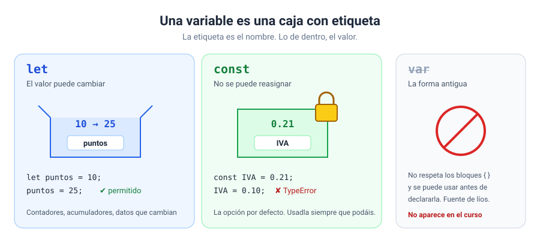
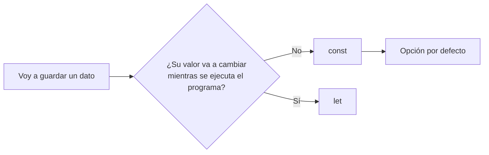
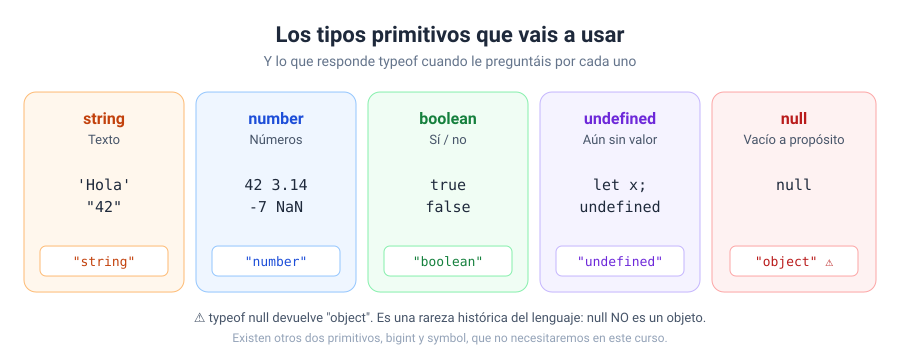
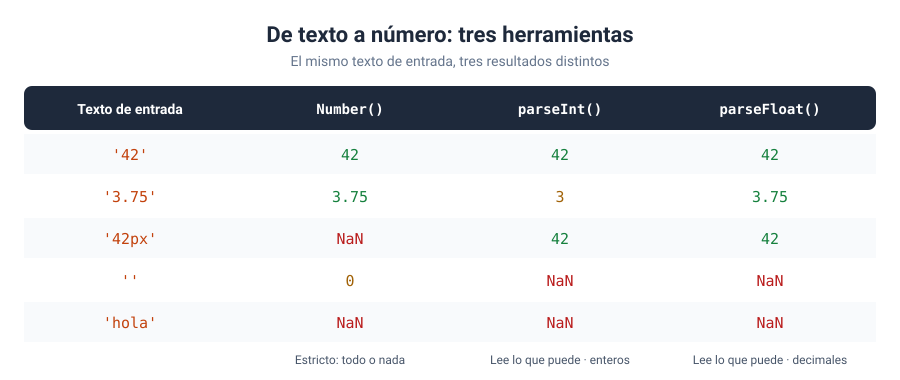
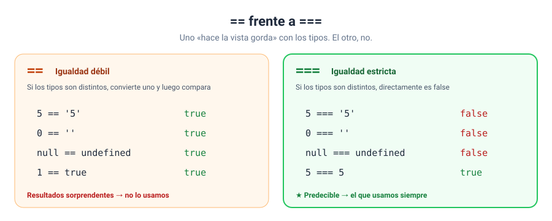

# Bloque 02 · Fundamentos del lenguaje

[← Bloque 01](../01-introduccion/) · [Volver al temario](../TEMARIO.md) · [Ir al bloque 03 →](../03-control-de-flujo/)

En el bloque anterior visteis dónde vive JavaScript. Ahora toca aprender a hablarlo. En este bloque os voy a enseñar las piezas con las que se construye cualquier programa: **guardar datos, saber de qué tipo son, operar con ellos y compararlos**. Es la gramática del lenguaje. Sin ella, todo lo que venga después se tambalea.

Al terminar este bloque sabréis:

- Declarar variables y constantes con `let` y `const`, y elegir bien entre las dos.
- Poner nombres que se entienden y que JavaScript acepta.
- Reconocer los tipos de datos primitivos y comprobarlos con `typeof`.
- Usar los operadores aritméticos y de asignación.
- Convertir textos en números sin llevaros sorpresas.
- Comparar valores con `===` y entender por qué no usamos `==`.
- Redondear y generar números aleatorios con `Math`.

---

## 1. Variables y constantes

Un programa necesita recordar cosas: el nombre del usuario, un precio, cuántos puntos lleva en un juego. Para eso están las variables. Pensad en ellas como **cajas con una etiqueta**: la etiqueta es el nombre y lo que hay dentro es el valor.



### 1.1. `let`: valores que cambian

```javascript
let puntos = 0;
puntos = 10;      // ✔ se puede reasignar
puntos = 25;      // ✔ las veces que haga falta
```

`let` declara una variable con ámbito de bloque que se puede reasignar [1]. Fijaos en que `let` solo se escribe la primera vez. Para cambiar el valor, basta con el nombre y el `=`.

### 1.2. `const`: valores que no cambian

```javascript
const IVA = 0.21;
IVA = 0.10;       // ✘ TypeError: Assignment to constant variable.
```

`const` crea una referencia de solo lectura: el identificador no se puede reasignar [2]. Si lo intentáis, JavaScript lanza un `TypeError` [3]. Y otra diferencia con `let`: una constante hay que inicializarla en el momento de declararla.

### 1.3. ¿Y `var`?

Lo vais a ver en código antiguo y en muchos tutoriales. `var` no respeta los bloques `{ }` como `let` y `const` [4] y se puede usar antes de la línea en la que se declara, lo que da lugar a errores difíciles de encontrar. En este curso **no lo usamos**.

### 1.4. ¿`let` o `const`?

Mi regla es muy sencilla:



**Empezad siempre con `const`.** Si después descubrís que el valor tiene que cambiar, lo cambiáis a `let`. Así, cuando alguien lea vuestro código y vea un `let`, sabrá que ese valor va a moverse.

---

## 2. Cómo nombrar las variables

### 2.1. Las reglas (obligatorias)

Un nombre de variable debe empezar por una letra, un guion bajo (`_`) o un dólar (`$`). Después puede llevar también dígitos [5]. Y JavaScript distingue entre mayúsculas y minúsculas: `total` y `Total` son dos variables distintas [5].

| Nombre | ¿Válido? | Motivo |
| --- | --- | --- |
| `precioTotal` | ✔ | |
| `_temporal` | ✔ | Puede empezar por `_` |
| `nota2` | ✔ | Los dígitos pueden ir después |
| `2nota` | ✘ | No puede empezar por un dígito |
| `precio total` | ✘ | No puede llevar espacios |
| `precio-total` | ✘ | El guion se interpretaría como una resta |
| `let` | ✘ | Es una palabra reservada del lenguaje |

### 2.2. Las convenciones (muy recomendables)

En JavaScript las variables se escriben en ***camelCase***: todo junto, la primera palabra en minúscula y la primera letra de cada palabra siguiente en mayúscula [6]: `precioConIva`, `numeroDeAlumnos`, `btnEnviar`.

Y lo más importante: **nombres que expliquen lo que guardan**.

| Mal | Bien |
| --- | --- |
| `x` | `edad` |
| `pt` | `precioTotal` |
| `dato1`, `dato2` | `nombre`, `apellido` |
| `b` | `btnCalcular` |

Dentro de seis meses no os acordaréis de qué era `pt`. Os lo garantizo.

---

## 3. Tipos de datos primitivos

Cada valor tiene un tipo, y el tipo decide qué podéis hacer con él. JavaScript tiene siete tipos primitivos [5]. En este curso vais a trabajar con cinco:



| Tipo | Para qué | Ejemplos |
| --- | --- | --- |
| `string` | Texto, siempre entre comillas | `'Hola'`, `"42"`, `` `Hola ${nombre}` `` |
| `number` | Números, enteros o decimales | `42`, `3.14`, `-7`, `NaN` |
| `boolean` | Sí o no | `true`, `false` |
| `undefined` | Variable que aún no tiene valor | `let x;` |
| `null` | «Aquí no hay nada», puesto a propósito | `null` |

### 3.1. Preguntar el tipo: `typeof`

```javascript
typeof 'Hola'    // "string"
typeof 42        // "number"
typeof true      // "boolean"
typeof undefined // "undefined"
typeof null      // "object"  ⚠
```

`typeof` devuelve un texto con el nombre del tipo [7]. Y sí, la última línea es correcta: `typeof null` devuelve `"object"` [7]. Es una rareza histórica del lenguaje. `null` no es un objeto; simplemente, no le preguntéis a `typeof` por él.

### 3.2. `NaN`, el número que no es un número

`NaN` significa *Not a Number*. Aparece cuando una operación numérica no puede dar un resultado válido, como `Number('hola')`. Tiene dos particularidades: es de tipo `number` y **no es igual a nada, ni siquiera a sí mismo** [8]. Para detectarlo se usa `Number.isNaN(valor)`.

---

## 4. Operadores

### 4.1. Aritméticos

| Operador | Operación | Ejemplo | Resultado |
| --- | --- | --- | --- |
| `+` | Suma | `7 + 2` | `9` |
| `-` | Resta | `7 - 2` | `5` |
| `*` | Multiplicación | `7 * 2` | `14` |
| `/` | División | `7 / 2` | `3.5` |
| `%` | Resto de la división | `7 % 2` | `1` |
| `**` | Potencia | `7 ** 2` | `49` |

Los dos últimos son los que menos conocéis. El **resto** (`%`) devuelve lo que sobra de una división entera [9]: es la forma clásica de saber si un número es par (`n % 2` da `0`). No tiene nada que ver con los porcentajes, aunque use el mismo símbolo. La **potencia** (`**`) eleva el primer número al segundo [10].

### 4.2. De asignación

Son atajos para modificar una variable a partir de su propio valor [11]:

| Atajo | Equivale a |
| --- | --- |
| `x += 5` | `x = x + 5` |
| `x -= 5` | `x = x - 5` |
| `x *= 5` | `x = x * 5` |
| `x /= 5` | `x = x / 5` |
| `x++` | `x = x + 1` |
| `x--` | `x = x - 1` |

`++` suma uno y `--` resta uno [12]. Todos reasignan la variable, así que solo funcionan con `let`.

### 4.3. El `+` con textos

El `+` es el único operador aritmético con doble personalidad: si alguno de los dos lados es un texto, **une** en lugar de sumar.

```javascript
2 + 2         // 4
'2' + '2'     // "22"
'Nota: ' + 7  // "Nota: 7"
```

Y `+=` también funciona con textos: es la técnica del **acumulador**, que consiste en ir añadiendo trozos a un texto que empieza vacío. La veréis en el ejercicio 04.

### 4.4. Plantillas de texto

Las conocéis del bloque 01. Os recuerdo dos ventajas frente a unir con `+` [13]:

```javascript
// 1. Insertan valores con ${…}, incluso operaciones
const resumen = `Total: ${precio * cantidad} €`;

// 2. Admiten saltos de línea reales
const ticket = `Producto: ${producto}
Cantidad: ${cantidad}`;
```

---

## 5. Conversión de tipos

Este apartado os va a ahorrar muchas horas de «¿por qué me sale 22?». Todo lo que escribe el usuario, ya sea con `prompt()` o en un formulario, **llega como texto**. Si vais a operar con números, hay que convertir.



| Función | Cómo trabaja |
| --- | --- |
| `Number(texto)` | Estricta: el texto entero tiene que ser un número; si no, `NaN`. El texto vacío lo convierte en `0` [14] |
| `parseInt(texto, 10)` | Lee dígitos de izquierda a derecha hasta que encuentra algo que no lo es. Devuelve un entero, o `NaN` si el primer carácter no sirve [15] |
| `parseFloat(texto)` | Igual que `parseInt`, pero admite decimales [16] |
| `String(valor)` | El camino contrario: convierte cualquier valor en texto |

> [!TIP]
> Mi recomendación para los datos del usuario: `Number()`. Precisamente porque es estricta. Si alguien escribe `12abc`, prefiero un `NaN` que me avise a un `12` que lo deje pasar sin decir nada. Dejad `parseInt` y `parseFloat` para textos que sabéis que traen unidades, como `'42px'`.

Y una costumbre: convertid **en el momento de leer**.

```javascript
const edad = Number(prompt('¿Cuántos años tienes?'));
```

A partir de esa línea, `edad` ya es un número y os olvidáis del problema.

---

## 6. Comparaciones

Comparar dos valores devuelve siempre un `boolean`: `true` o `false`. Estos resultados serán la base de las decisiones del bloque 03.

| Operador | Significado | Ejemplo | Resultado |
| --- | --- | --- | --- |
| `===` | Igual (valor y tipo) | `5 === 5` | `true` |
| `!==` | Distinto (valor o tipo) | `5 !== '5'` | `true` |
| `>` | Mayor que | `7 > 3` | `true` |
| `<` | Menor que | `7 < 3` | `false` |
| `>=` | Mayor o igual | `5 >= 5` | `true` |
| `<=` | Menor o igual | `4 <= 5` | `true` |

### 6.1. `==` frente a `===`



`==` intenta convertir los dos valores al mismo tipo antes de comparar [17]. `===` no convierte nada: si los tipos son distintos, el resultado es `false` [18]. ¿El problema de `==`? Que sus conversiones dan resultados poco intuitivos, como `0 == ''` → `true`.

> [!IMPORTANT]
> En este curso comparamos **siempre** con `===` y `!==`. Si necesitáis comparar un texto con un número, convertid vosotros primero: `Number(texto) === 5`.

---

## 7. El objeto `Math` y el redondeo

`Math` es un objeto que JavaScript trae de serie con constantes y funciones matemáticas [19]:

| Método | Qué hace | Ejemplo |
| --- | --- | --- |
| `Math.round(x)` | Redondea al entero más cercano | `Math.round(4.5)` → `5` |
| `Math.floor(x)` | Redondea hacia abajo | `Math.floor(4.9)` → `4` |
| `Math.ceil(x)` | Redondea hacia arriba | `Math.ceil(4.1)` → `5` |
| `Math.max(a, b, …)` | Devuelve el mayor | `Math.max(3, 8, 1)` → `8` |
| `Math.min(a, b, …)` | Devuelve el menor | `Math.min(3, 8, 1)` → `1` |
| `Math.random()` | Decimal aleatorio desde 0 (incluido) hasta 1 (excluido) [20] | `0.4821…` |
| `Math.PI` | El número π | `3.14159…` |

### 7.1. Un número entero aleatorio

La fórmula que os vais a llevar a todas partes:

```javascript
// entero aleatorio entre 1 y max, ambos incluidos
const numero = Math.floor(Math.random() * max) + 1;
```

Un dado de seis caras es `Math.floor(Math.random() * 6) + 1`. En el ejercicio 08 os la explico paso a paso.

### 7.2. Mostrar decimales: `toFixed()`

```javascript
const total = 47.1537;
total.toFixed(2)   // "47.15"
```

`toFixed()` escribe el número con los decimales que le pidáis [21]. Perfecto para mostrar precios. Pero ojo aquí: **devuelve un texto** [21]. Usadlo solo en la salida, nunca para seguir calculando.

---

## 8. La plantilla de trabajo en este bloque

Seguimos con programas lineales, igual que en el bloque 01: se ejecutan una vez, de arriba abajo. La plantilla es la misma:

```javascript
// estructura del programa principal
const IVA = 0.21;

// constantes al DOM
const salida = document.querySelector('#salida');

// entradas
const precio = Number(prompt('Precio:', '100'));

// procesamiento
const total = precio + precio * IVA;

// salidas
salida.textContent = `Total: ${total.toFixed(2)} €`;
```

Fijaos en cómo encaja todo lo de este bloque: `const` por defecto, nombres en *camelCase*, conversión al leer y `toFixed()` solo en la salida.

---

## 9. Ejercicios

| Nº | Ejercicio | Qué practicáis | Solución |
| --- | --- | --- | --- |
| 01 | [Ficha de personaje](ejercicios/ejercicio_01/) | `let` frente a `const`, reasignar, error al cambiar una constante | [Ver](soluciones/ejercicio_01/) |
| 02 | [Detective de tipos](ejercicios/ejercicio_02/) | Tipos primitivos, `typeof`, las rarezas de `null` y `NaN` | [Ver](soluciones/ejercicio_02/) |
| 03 | [Calculadora de operadores](ejercicios/ejercicio_03/) | `+ - * / % **`, dividir entre cero | [Ver](soluciones/ejercicio_03/) |
| 04 | [Marcador de videojuego](ejercicios/ejercicio_04/) | `+= -= *= /= ++ --`, acumulador de texto, `\n` | [Ver](soluciones/ejercicio_04/) |
| 05 | [Ticket de compra](ejercicios/ejercicio_05/) | Plantillas de varias líneas, IVA, `toFixed()` | [Ver](soluciones/ejercicio_05/) |
| 06 | [Laboratorio de conversiones](ejercicios/ejercicio_06/) | `Number()`, `parseInt()`, `parseFloat()`, `String()` | [Ver](soluciones/ejercicio_06/) |
| 07 | [== frente a ===](ejercicios/ejercicio_07/) | Igualdad débil y estricta, el caso de `NaN` | [Ver](soluciones/ejercicio_07/) |
| 08 | [Dividir la cuenta del restaurante](ejercicios/ejercicio_08/) | `Math.ceil`, redondeo al céntimo, `Math.random()` | [Ver](soluciones/ejercicio_08/) |

Lo de siempre: consola abierta, primero vosotros y la solución después.

---

[← Bloque 01](../01-introduccion/) · [Volver al temario](../TEMARIO.md) · [Ir al bloque 03 →](../03-control-de-flujo/)

### Fuentes y Documentación Oficial

1. [let (MDN Web Docs)](https://developer.mozilla.org/es/docs/Web/JavaScript/Reference/Statements/let)
2. [const (MDN Web Docs)](https://developer.mozilla.org/es/docs/Web/JavaScript/Reference/Statements/const)
3. [TypeError: invalid assignment to const "x" (MDN Web Docs)](https://developer.mozilla.org/en-US/docs/Web/JavaScript/Reference/Errors/Invalid_const_assignment)
4. [var (MDN Web Docs)](https://developer.mozilla.org/es/docs/Web/JavaScript/Reference/Statements/var)
5. [Gramática y tipos (MDN Web Docs)](https://developer.mozilla.org/es/docs/Web/JavaScript/Guide/Grammar_and_types)
6. [Camel case (MDN Web Docs)](https://developer.mozilla.org/en-US/docs/Glossary/Camel_case)
7. [typeof (MDN Web Docs)](https://developer.mozilla.org/es/docs/Web/JavaScript/Reference/Operators/typeof)
8. [NaN (MDN Web Docs)](https://developer.mozilla.org/es/docs/Web/JavaScript/Reference/Global_Objects/NaN)
9. [Resto (%) (MDN Web Docs)](https://developer.mozilla.org/es/docs/Web/JavaScript/Reference/Operators/Remainder)
10. [Exponenciación (**) (MDN Web Docs)](https://developer.mozilla.org/es/docs/Web/JavaScript/Reference/Operators/Exponentiation)
11. [Expresiones y operadores (MDN Web Docs)](https://developer.mozilla.org/es/docs/Web/JavaScript/Reference/Operators)
12. [Incremento (++) (MDN Web Docs)](https://developer.mozilla.org/es/docs/Web/JavaScript/Reference/Operators/Increment)
13. [Plantillas literales (plantillas de cadenas) (MDN Web Docs)](https://developer.mozilla.org/es/docs/Web/JavaScript/Reference/Template_literals)
14. [Number (MDN Web Docs)](https://developer.mozilla.org/es/docs/Web/JavaScript/Reference/Global_Objects/Number)
15. [parseInt() (MDN Web Docs)](https://developer.mozilla.org/es/docs/Web/JavaScript/Reference/Global_Objects/parseInt)
16. [parseFloat() (MDN Web Docs)](https://developer.mozilla.org/es/docs/Web/JavaScript/Reference/Global_Objects/parseFloat)
17. [Comparación (==) (MDN Web Docs)](https://developer.mozilla.org/es/docs/Web/JavaScript/Reference/Operators/Equality)
18. [Igualdad Estricta (===) (MDN Web Docs)](https://developer.mozilla.org/es/docs/Web/JavaScript/Reference/Operators/Strict_equality)
19. [Math (MDN Web Docs)](https://developer.mozilla.org/es/docs/Web/JavaScript/Reference/Global_Objects/Math)
20. [Math.random() (MDN Web Docs)](https://developer.mozilla.org/en-US/docs/Web/JavaScript/Reference/Global_Objects/Math/random)
21. [Number.prototype.toFixed() (MDN Web Docs)](https://developer.mozilla.org/en-US/docs/Web/JavaScript/Reference/Global_Objects/Number/toFixed)
