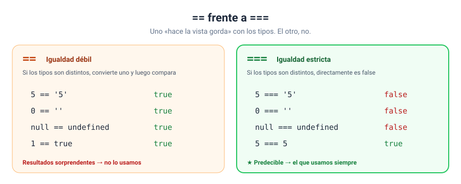

# Solución · Ejercicio 07 · == frente a ===

[← Volver al enunciado](../../ejercicios/ejercicio_07/) · [← Volver al bloque](../../README.md)

## Qué pedía el ejercicio

Comparar seis parejas de valores con `==` y con `===` y entender de dónde salen las diferencias.

## Los resultados

| Pareja | `==` | `===` |
| --- | --- | --- |
| `5` y `'5'` | `true` | `false` |
| `0` y `''` | `true` | `false` |
| `0` y `false` | `true` | `false` |
| `null` y `undefined` | `true` | `false` |
| `'1'` y `true` | `true` | `false` |
| `NaN` y `NaN` | `false` | `false` |

¿Cuántos acertasteis con `==`? Si fallasteis alguno, no os preocupéis. Ese es precisamente el problema de `==`.

## Qué hace cada operador

**`==` (igualdad débil):** si los dos valores son de tipos distintos, intenta convertirlos a un mismo tipo y **después** compara [1]. Al comparar un número con un texto, convierte el texto en número [1]. Por eso:

- `5 == '5'` → convierte `'5'` en `5` → `true`.
- `0 == ''` → convierte `''` en `0` (lo visteis en el ejercicio 06) → `true`.

Y tiene una regla especial: `null == undefined` da `true` [1].

**`===` (igualdad estricta):** si los tipos son distintos, el resultado es `false`, sin convertir nada [2]. Solo da `true` cuando el tipo y el valor coinciden.



## ¿Por qué usamos siempre `===`?

Porque es **predecible**. Con `===` sabéis el resultado sin tener que recordar las reglas de conversión de `==`, que son muchas y algunas bastante retorcidas. Si necesitáis comparar un número con un texto, convertid primero vosotros, de forma explícita, y comparad después con `===`:

```javascript
Number(textoUsuario) === 5
```

## El caso de `NaN`

`NaN` es el único valor de JavaScript que **no es igual a sí mismo**, ni con `==` ni con `===` [3]. Así que nunca podéis comprobar `valor === NaN`: siempre dará `false`. Para eso existe `Number.isNaN(valor)` [3], que usaremos en el bloque 03 para validar lo que escribe el usuario.

### Fuentes y Documentación Oficial

1. [Comparación (==) (MDN Web Docs)](https://developer.mozilla.org/es/docs/Web/JavaScript/Reference/Operators/Equality)
2. [Igualdad Estricta (===) (MDN Web Docs)](https://developer.mozilla.org/es/docs/Web/JavaScript/Reference/Operators/Strict_equality)
3. [NaN (MDN Web Docs)](https://developer.mozilla.org/es/docs/Web/JavaScript/Reference/Global_Objects/NaN)
