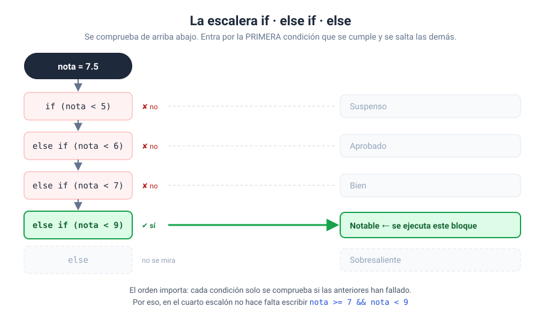
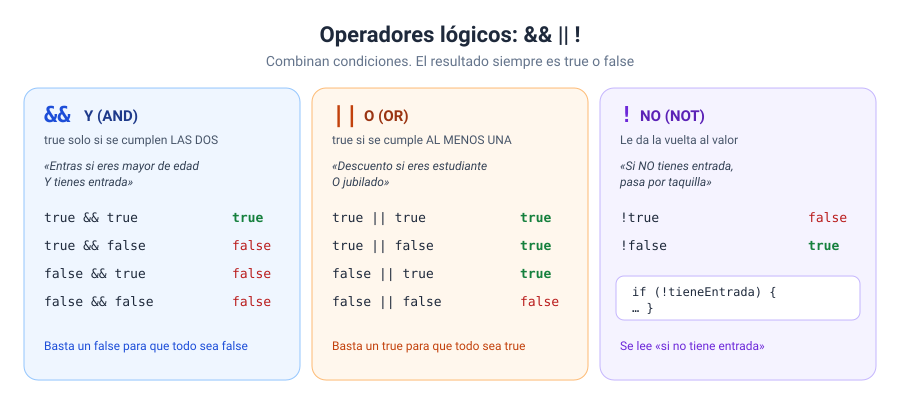
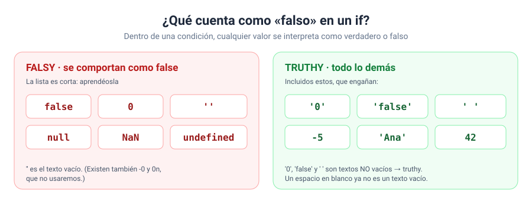
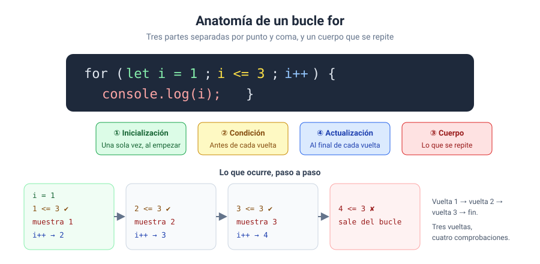
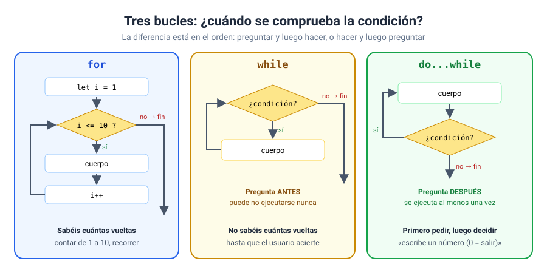
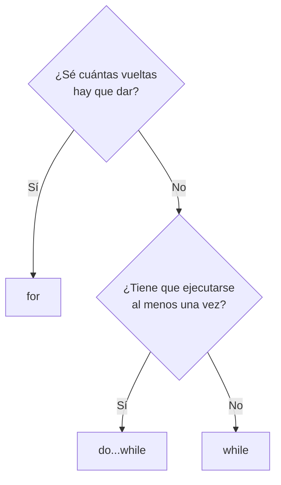

# Bloque 03 · Control de flujo

[← Bloque 02](../02-fundamentos-del-lenguaje/) · [Volver al temario](../TEMARIO.md) · [Ir al bloque 04 →](../04-funciones/)

Hasta ahora vuestros programas eran una lista de instrucciones que se ejecutaban de arriba abajo, todas, siempre en el mismo orden. Eso se acaba hoy. En este bloque os voy a enseñar a hacer que el programa **tome decisiones** («si pasa esto, haz aquello») y **repita tareas** («haz esto diez veces» o «sigue preguntando hasta que acierte»). Con estas dos herramientas se resuelve una cantidad enorme de problemas.

Al terminar este bloque sabréis:

- Tomar decisiones con `if`, `else if` y `else`, y elegir el orden correcto de las condiciones.
- Combinar condiciones con `&&`, `||` y `!`.
- Usar valores *truthy* y *falsy* y el operador ternario.
- Elegir entre muchos valores con `switch`.
- Repetir tareas con `for`, `while` y `do...while`, y saber cuál usar en cada caso.
- Construir contadores y acumuladores dentro de un bucle.
- Controlar un bucle con `break` y `continue` sin caer en un bucle infinito.

---

## 1. Tomar decisiones: `if`

### 1.1. `if` y `else`

```javascript
if (edad >= 18) {
    mensaje = 'Puedes votar';
} else {
    mensaje = 'Todavía no puedes votar';
}
```

La instrucción `if` ejecuta un bloque si la condición es verdadera. Si no lo es, se ejecuta el bloque del `else`, que es opcional [1]. La condición va entre paréntesis y cada bloque, entre llaves.

Dos costumbres que os pido desde el primer día:

- **Poned siempre las llaves**, aunque el bloque tenga una sola línea. JavaScript permite omitirlas, pero es una fuente clásica de errores cuando después alguien añade una segunda línea.
- **Indentad** el contenido de cada bloque. A JavaScript le da igual; a quien lee el código, no.

### 1.2. Varias opciones: `else if`

Cuando hay más de dos caminos, se encadenan condiciones con `else if` [1]:



```javascript
if (nota < 5) {
    calificacion = 'Suspenso';
} else if (nota < 7) {
    calificacion = 'Aprobado';
} else if (nota < 9) {
    calificacion = 'Notable';
} else {
    calificacion = 'Sobresaliente';
}
```

Fijaos bien en el dibujo: se comprueban las condiciones de arriba abajo y **solo se ejecuta el primer bloque cuya condición se cumple**. Las demás ni se miran. Eso tiene dos consecuencias:

1. **El orden importa.** Si ponéis `nota < 9` la primera, un 3 entraría ahí.
2. **No hace falta repetir lo que ya sabéis.** En el escalón de `Notable` no escribo `nota >= 7 && nota < 9`: si he llegado hasta ahí, la nota ya no es menor que 7.

### 1.3. Primero, descartar lo que no vale

Ahora que podéis decidir, ya podéis **validar** lo que escribe el usuario. Mi recomendación es hacerlo siempre al principio:

```javascript
if (Number.isNaN(nota) || nota < 0 || nota > 10) {
    mensaje = 'La nota debe estar entre 0 y 10';
} else if (…) {
    // a partir de aquí, la nota es válida
}
```

`Number.isNaN()` es la forma correcta de detectar un `NaN` [2]. Recordad que `nota === NaN` siempre da `false`.

---

## 2. Operadores lógicos

Sirven para combinar varias condiciones en una sola.



| Operador | Nombre | Devuelve `true` si… |
| --- | --- | --- |
| `&&` | Y (AND) | los dos lados son verdaderos [3] |
| `\|\|` | O (OR) | al menos uno de los dos lo es [4] |
| `!` | NO (NOT) | el valor es falso: le da la vuelta [5] |

```javascript
const puedeEntrar = tieneEntrada && (edad >= 18 || (edad >= 16 && vaAcompanado));
```

> [!TIP]
> `&&` tiene más prioridad que `||`, igual que la multiplicación va antes que la suma. En lugar de memorizarlo, **poned paréntesis** siempre que mezcléis los dos. El código se lee mejor y no hay sorpresas.

Un detalle más: los dos operadores dejan de evaluar en cuanto conocen el resultado. Si el lado izquierdo de un `&&` es falso, el derecho ni se mira, porque el resultado ya será `false`. Es lo que MDN llama evaluación de cortocircuito [3].

### 2.1. Una entrada nueva: `confirm()`

```javascript
const tieneEntrada = confirm('¿Tienes entrada?');
```

Muestra un cuadro con Aceptar y Cancelar y devuelve directamente un booleano: `true` o `false` [6]. Viene de perlas para practicar con condiciones.

---

## 3. Valores *truthy* y *falsy*

La condición de un `if` no tiene por qué ser una comparación. Podéis poner cualquier valor, y JavaScript decide si cuenta como verdadero o como falso.



- **Falsy:** `false`, `0`, `''` (texto vacío), `null`, `undefined` y `NaN`, entre otros [7].
- **Truthy:** todo lo demás [8]. Incluidos `'0'`, `'false'` y `' '`, que son textos **no vacíos**.

Donde más lo vais a usar es para comprobar si el usuario ha escrito algo:

```javascript
let nombre = prompt('¿Cómo te llamas?');
if (nombre === null) {
    nombre = '';          // ha pulsado Cancelar
}
nombre = nombre.trim();   // quita espacios al principio y al final [9]
if (!nombre) {
    nombre = 'invitado';  // '' es falsy → !'' es true
}
```

---

## 4. El operador ternario

Es un `if…else` en miniatura que **devuelve un valor** [10]:

```javascript
condicion ? valorSiTrue : valorSiFalse
```

```javascript
const etiqueta = stock > 0 ? 'Disponible' : 'Agotado';
```

Usadlo para **elegir entre dos valores**. Si en cada caso hay que ejecutar varias instrucciones, volved al `if…else`. Un ternario dentro de otro ternario es la forma más rápida de que nadie entienda vuestro código, vosotros incluidos dentro de un mes.

---

## 5. `switch`: muchos valores concretos

Cuando comparáis **una misma variable** con muchos **valores concretos**, `switch` queda más limpio que una escalera de `else if`:

```javascript
switch (numeroDia) {
    case 1:
        nombre = 'lunes';
        break;
    case 2:
        nombre = 'martes';
        break;
    // …
    default:
        nombre = 'día no válido';
}
```

Lo que tenéis que saber [11]:

- Compara con **igualdad estricta** (`===`). El texto `'1'` no encaja con `case 1`.
- `default` se ejecuta si ningún `case` coincide. Es el `else` del `switch`.
- `break` hace salir del `switch`. **Si lo olvidáis, la ejecución sigue en el `case` siguiente.**

Ese último punto, que suele ser un error, también se puede aprovechar para agrupar casos:

```javascript
switch (numeroDia) {
    case 6:
    case 7:
        tipo = 'fin de semana';
        break;
    default:
        tipo = 'laborable';
}
```

| Situación | Mejor opción |
| --- | --- |
| Una variable comparada con valores concretos | `switch` |
| Rangos (`< 5`), varias variables o condiciones combinadas | `if…else` |

---

## 6. Repetir: los bucles

Un bucle repite un bloque de código mientras se cumpla una condición [12]. JavaScript tiene varios; en este bloque vemos los tres básicos. En los bloques 05 y 06 aparecerán `for...of` y `forEach`, pensados para recorrer listas.

### 6.1. `for`: cuando sabéis cuántas vueltas



```javascript
for (let i = 1; i <= 10; i++) {
    console.log(i);
}
```

La cabecera tiene tres partes separadas por punto y coma: la inicialización, que se ejecuta una vez; la condición, que se comprueba antes de cada vuelta; y la actualización, que se ejecuta al final de cada vuelta [13].

El contador se suele llamar `i` por tradición, pero podéis llamarlo como queráis. Y no solo sirve para contar: dentro del bucle lo podéis usar como dato.

### 6.2. `while`: mientras se cumpla algo

```javascript
let intentos = 0;
let acertado = false;
while (!acertado) {
    // pedir un número, comprobar, actualizar acertado…
}
```

`while` comprueba la condición **antes** de cada vuelta y repite mientras sea verdadera [14]. Usadlo cuando **no sabéis cuántas vueltas** hará falta dar: hasta que el usuario acierte, hasta que escriba algo válido…

### 6.3. `do...while`: al menos una vez

```javascript
let numero;
do {
    numero = Number(prompt('Escribe un número (0 para terminar)'));
    // procesar…
} while (numero !== 0);
```

Igual que `while`, pero comprueba la condición **después** de cada vuelta. Por eso el cuerpo se ejecuta siempre al menos una vez [15]. Es la opción natural cuando primero tenéis que pedir el dato para poder decidir si seguís.

### 6.4. ¿Cuál uso?





| Bucle | Comprueba la condición | Se ejecuta como mínimo | Uso típico |
| --- | --- | --- | --- |
| `for` | Antes de cada vuelta | 0 veces | Repetir N veces, contar de A a B |
| `while` | Antes de cada vuelta | 0 veces | Repetir hasta que pase algo |
| `do...while` | Después de cada vuelta | 1 vez | Pedir datos hasta un valor de parada |

---

## 7. Contadores y acumuladores

Casi todos los bucles útiles llevan alguno de estos dos patrones. Los dos se declaran **antes** del bucle, se actualizan **dentro** y se usan **después**.

| Patrón | Valor inicial | Dentro del bucle | Para qué |
| --- | --- | --- | --- |
| Contador | `let cantidad = 0;` | `cantidad++;` | Contar cuántas veces pasa algo |
| Acumulador numérico | `let suma = 0;` | `suma += valor;` | Sumar valores |
| Acumulador de texto | `let texto = '';` | `texto += linea;` | Construir un texto por partes |
| Máximo | `let mayor = -Infinity;` | `mayor = Math.max(mayor, valor);` | Quedarse con el mayor |

> [!WARNING]
> Si declaráis el acumulador **dentro** del bucle, se reinicia en cada vuelta. Al terminar, solo tendréis el último valor.

---

## 8. `break` y `continue`

| Instrucción | Qué hace | Analogía |
| --- | --- | --- |
| `break` | Termina el bucle y sigue en la línea de después [16] | Abandonar la carrera |
| `continue` | Abandona la vuelta actual y pasa a la siguiente [17] | Saltarse una vuelta y seguir corriendo |

```javascript
while (!acertado) {
    const respuesta = prompt('¿Qué número es?');
    if (respuesta === null) {
        break;        // se rinde: salgo del bucle
    }
    if (Number.isNaN(Number(respuesta))) {
        continue;     // no vale: vuelvo a preguntar sin contar el intento
    }
    // …
}
```

`break` también lo habéis visto en el `switch`: allí sirve para salir del `switch`, no de un bucle.

---

## 9. Cuidado con los bucles infinitos

Un bucle cuya condición nunca llega a ser falsa no termina jamás. MDN lo dice sin rodeos: aseguraos de que la condición acabe siendo `false` [12].

```javascript
let i = 1;
while (i <= 10) {
    console.log(i);
    // ✘ falta i++: i vale 1 para siempre
}
```

Si os pasa, la pestaña del navegador se quedará congelada. No es grave: cerrad la pestaña, corregid el código y volved a abrir la página. Antes de ejecutar un bucle, haceos siempre esta pregunta: **¿qué hay dentro del bucle que acabará haciendo falsa la condición?**

---

## 10. La plantilla de trabajo en este bloque

Seguimos con programas lineales. La novedad es que ahora la sección de procesamiento incluye decisiones y bucles, y que **validamos los datos antes de usarlos**:

```javascript
// estructura del programa principal
let mensaje = '';

// constantes al DOM
const salida = document.querySelector('#salida');

// entradas
const limite = Number(prompt('¿Hasta qué número cuento?', '10'));

// procesamiento
if (Number.isNaN(limite) || limite < 1) {
    mensaje = 'El límite debe ser un número positivo';
} else {
    let suma = 0;
    for (let i = 1; i <= limite; i++) {
        suma += i;
    }
    mensaje = `La suma del 1 al ${limite} es ${suma}`;
}

// salidas
salida.textContent = mensaje;
```

---

## 11. Ejercicios

| Nº | Ejercicio | Qué practicáis | Solución |
| --- | --- | --- | --- |
| 01 | [Calificador de notas](ejercicios/ejercicio_01/) | `if`, `else if`, `else`, validación, orden de las condiciones | [Ver](soluciones/ejercicio_01/) |
| 02 | [Control de acceso al concierto](ejercicios/ejercicio_02/) | `&&`, `\|\|`, `!`, paréntesis, `confirm()` | [Ver](soluciones/ejercicio_02/) |
| 03 | [Un saludo a prueba de Cancelar](ejercicios/ejercicio_03/) | *Truthy* y *falsy*, `trim()`, operador ternario | [Ver](soluciones/ejercicio_03/) |
| 04 | [¿Qué día es?](ejercicios/ejercicio_04/) | `switch`, `break`, `default`, agrupar `case` | [Ver](soluciones/ejercicio_04/) |
| 05 | [Tabla de multiplicar con for](ejercicios/ejercicio_05/) | `for`, contador como dato, acumuladores | [Ver](soluciones/ejercicio_05/) |
| 06 | [Adivina el número](ejercicios/ejercicio_06/) | `while`, `break`, `continue`, búsqueda binaria | [Ver](soluciones/ejercicio_06/) |
| 07 | [Estadísticas hasta el cero](ejercicios/ejercicio_07/) | `do...while`, valor de parada, media y máximo | [Ver](soluciones/ejercicio_07/) |
| 08 | [Fizz Buzz](ejercicios/ejercicio_08/) | `for` + `%` + escalera de `if` + contadores | [Ver](soluciones/ejercicio_08/) |

Con bucles, más que nunca: consola abierta y la pregunta de antes en la cabeza. ¿Qué hará que este bucle termine?

---

[← Bloque 02](../02-fundamentos-del-lenguaje/) · [Volver al temario](../TEMARIO.md) · [Ir al bloque 04 →](../04-funciones/)

### Fuentes y Documentación Oficial

1. [if...else (MDN Web Docs)](https://developer.mozilla.org/es/docs/Web/JavaScript/Reference/Statements/if...else)
2. [Number.isNaN() (MDN Web Docs)](https://developer.mozilla.org/es/docs/Web/JavaScript/Reference/Global_Objects/Number/isNaN)
3. [Operador lógico AND (&&) (MDN Web Docs)](https://developer.mozilla.org/es/docs/Web/JavaScript/Reference/Operators/Logical_AND)
4. [Operador lógico OR (||) (MDN Web Docs)](https://developer.mozilla.org/es/docs/Web/JavaScript/Reference/Operators/Logical_OR)
5. [Logical NOT (!) (MDN Web Docs)](https://developer.mozilla.org/en-US/docs/Web/JavaScript/Reference/Operators/Logical_NOT)
6. [Window: confirm() method (MDN Web Docs)](https://developer.mozilla.org/en-US/docs/Web/API/Window/confirm)
7. [Falsy (MDN Web Docs)](https://developer.mozilla.org/en-US/docs/Glossary/Falsy)
8. [Truthy (MDN Web Docs)](https://developer.mozilla.org/es/docs/Glossary/Truthy)
9. [String.prototype.trim() (MDN Web Docs)](https://developer.mozilla.org/es/docs/Web/JavaScript/Reference/Global_Objects/String/trim)
10. [Operador condicional (ternario) (MDN Web Docs)](https://developer.mozilla.org/es/docs/Web/JavaScript/Reference/Operators/Conditional_operator)
11. [switch (MDN Web Docs)](https://developer.mozilla.org/es/docs/Web/JavaScript/Reference/Statements/switch)
12. [Bucles e iteración (MDN Web Docs)](https://developer.mozilla.org/es/docs/Web/JavaScript/Guide/Loops_and_iteration)
13. [for (MDN Web Docs)](https://developer.mozilla.org/es/docs/Web/JavaScript/Reference/Statements/for)
14. [while (MDN Web Docs)](https://developer.mozilla.org/es/docs/Web/JavaScript/Reference/Statements/while)
15. [do...while (MDN Web Docs)](https://developer.mozilla.org/es/docs/Web/JavaScript/Reference/Statements/do...while)
16. [break (MDN Web Docs)](https://developer.mozilla.org/es/docs/Web/JavaScript/Reference/Statements/break)
17. [continue (MDN Web Docs)](https://developer.mozilla.org/es/docs/Web/JavaScript/Reference/Statements/continue)
