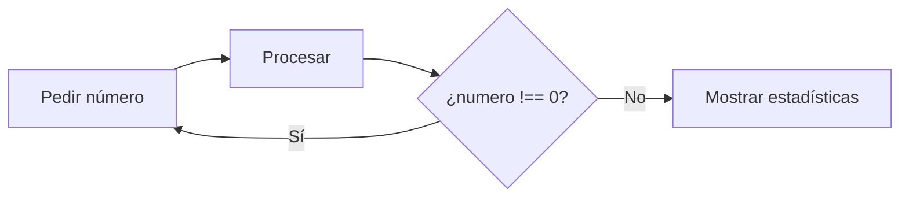

# Solución · Ejercicio 07 · Estadísticas hasta el cero

[← Volver al enunciado](../../ejercicios/ejercicio_07/) · [← Volver al bloque](../../README.md)

## Qué pedía el ejercicio

Leer números hasta que el usuario escriba un 0 y calcular cuántos ha introducido, su suma, su media y el mayor.

## ¿Por qué `do...while`?

`do...while` ejecuta el cuerpo y **después** comprueba la condición. Por eso el cuerpo se ejecuta siempre al menos una vez [1].

```javascript
do {
    numero = Number(prompt('Escribe un número (0 para terminar):', '0'));
    …
} while (numero !== 0);
```

Es exactamente lo que necesito. No puedo saber si el número es 0 hasta que lo haya pedido, así que tengo que preguntar primero y comprobar después. Con un `while` normal tendría que inventarme un valor inicial para `numero` solo para entrar en el bucle.



Un detalle: `numero` se declara **fuera** del bucle porque la condición del `while` está fuera de las llaves y necesita verlo.

## Los cuatro acumuladores

| Variable | Valor inicial | En cada número válido |
| --- | --- | --- |
| `cantidad` | `0` | `cantidad++` |
| `suma` | `0` | `suma += numero` |
| `mayor` | `-Infinity` | `mayor = Math.max(mayor, numero)` |
| `invalidos` | `0` | `invalidos++` (solo en los no válidos) |

¿Por qué `mayor` empieza en `-Infinity` y no en `0`? Porque si el usuario introduce solo números negativos, `-2` y `-8`, el mayor es `-2`. Empezando en `0`, el programa diría que el mayor es `0`, que ni siquiera se ha introducido. `-Infinity` es menor que cualquier número, así que el primero que llegue siempre lo sustituye. `Math.max()` devuelve el mayor de los valores que le paséis [2].

## `continue` en un `do...while`

Si el usuario escribe «hola», `Number()` da `NaN`. Lo cuento como no válido y hago `continue`, que salta directamente a la comprobación de la condición [3]. Como `NaN !== 0` es `true`, el bucle sigue y vuelve a preguntar.

## La media y el caso del cero

```javascript
if (cantidad === 0) {
    salida.textContent = 'No has introducido ningún número.';
} else {
    const media = suma / cantidad;
```

Si el usuario escribe 0 a la primera, `cantidad` vale 0 y la media sería `0 / 0`, es decir, `NaN`. Por eso compruebo antes de dividir. Y como el bloque 02 os enseñó, `toFixed(2)` solo al mostrar.

## Con 4, hola, 10, -2 y 0

| Estadística | Valor |
| --- | --- |
| Números introducidos | 3 |
| Suma | 12 |
| Media | 4.00 |
| Mayor | 10 |
| No válidos | 1 |

### Fuentes y Documentación Oficial

1. [do...while (MDN Web Docs)](https://developer.mozilla.org/es/docs/Web/JavaScript/Reference/Statements/do...while)
2. [Math (MDN Web Docs)](https://developer.mozilla.org/es/docs/Web/JavaScript/Reference/Global_Objects/Math)
3. [continue (MDN Web Docs)](https://developer.mozilla.org/es/docs/Web/JavaScript/Reference/Statements/continue)
