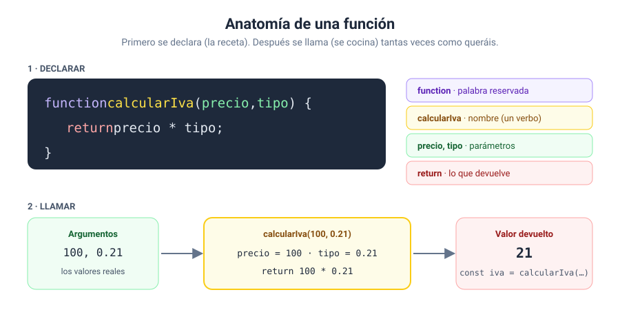
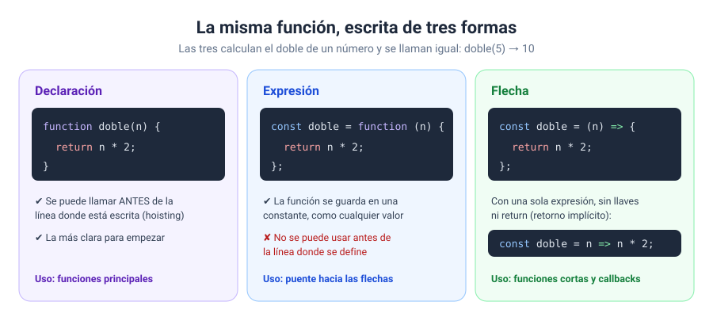
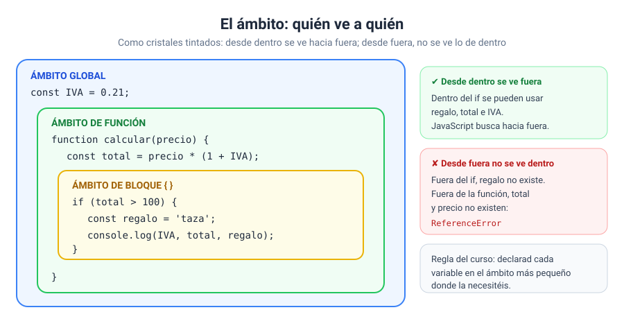
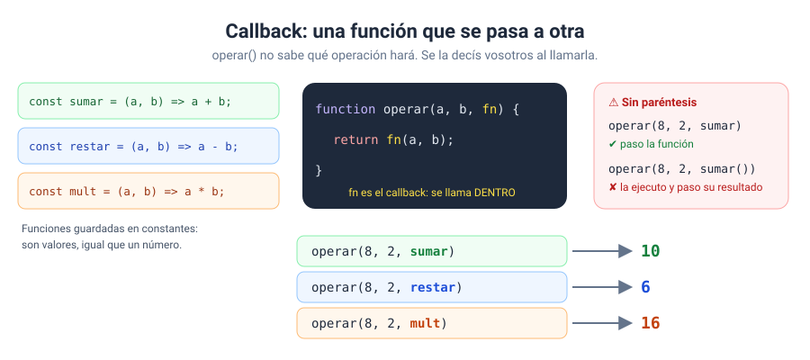
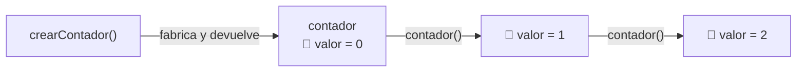

# Bloque 04 · Funciones

[← Bloque 03](../03-control-de-flujo/) · [Volver al temario](../TEMARIO.md) · [Ir al bloque 05 →](../05-arrays-y-objetos/)

Hasta ahora, cada programa era un único bloque de instrucciones. Funciona mientras el programa es pequeño, pero en cuanto crece aparecen dos problemas: código repetido y código imposible de leer. Las funciones resuelven los dos. En este bloque os voy a enseñar a **empaquetar un trozo de código, ponerle un nombre y reutilizarlo** tantas veces como queráis. Es probablemente el salto más importante de la fase 1.

Al terminar este bloque sabréis:

- Declarar funciones y llamarlas con argumentos.
- Devolver resultados con `return` y salir antes de tiempo.
- Dar valores por defecto a los parámetros.
- Escribir funciones de tres formas: declaración, expresión y flecha.
- Entender el ámbito de las variables: global, de función y de bloque.
- Pasar funciones como argumento (*callbacks*) y crear funciones que recuerdan datos (*closures*).
- Dividir un programa en funciones pequeñas, cada una con una sola tarea.

---

## 1. ¿Qué es una función?

Una función es un bloque de código con nombre que realiza una tarea y que podéis ejecutar cuando queráis [1]. Pensad en una **receta**: se escribe una vez y se cocina tantas veces como haga falta, con los ingredientes que toque cada día.

¿Por qué merece la pena?

- **No repetís código.** Si una fórmula aparece cinco veces y tiene un fallo, lo corregís en un solo sitio.
- **El programa se lee mejor.** `calcularIva(precio)` se entiende sin mirar cómo está hecho por dentro.
- **Podéis probar cada pieza por separado.** Una función pequeña es fácil de comprobar con varios casos.

---

## 2. Declarar y llamar



```javascript
// 1. declarar: escribir la receta
function calcularIva(precio, tipo) {
    return precio * tipo;
}

// 2. llamar: cocinarla
const iva = calcularIva(100, 0.21);   // 21
```

Una declaración de función lleva la palabra `function`, un nombre, la lista de parámetros entre paréntesis y el cuerpo entre llaves [2]. Declarar una función **no la ejecuta**. Solo se ejecuta cuando la llamáis, escribiendo su nombre seguido de paréntesis.

### 2.1. Ponerles nombre

Las funciones **hacen** cosas, así que su nombre suele empezar por un verbo: `calcularTotal`, `mostrarMensaje`, `validarEmail`. Las que responden a una pregunta de sí o no suelen empezar por `es`, `esta` o `tiene`: `esPar`, `estaEntre`, `tieneStock`.

---

## 3. Parámetros y argumentos

Los dos términos se confunden mucho, así que os los separo:

| Término | Dónde aparece | Qué es | Ejemplo |
| --- | --- | --- | --- |
| **Parámetro** | En la declaración | El nombre del hueco | `precio`, `tipo` |
| **Argumento** | En la llamada | El valor real que rellena el hueco | `100`, `0.21` |

Los argumentos se asignan a los parámetros **por orden**: el primero al primero, el segundo al segundo. Si os falta alguno, ese parámetro vale `undefined`.

### 3.1. Valores por defecto

```javascript
function saludar(nombre = 'invitado', idioma = 'es') {
    // …
}

saludar();                  // nombre = 'invitado', idioma = 'es'
saludar('Lucía');           // idioma = 'es'
saludar(undefined, 'fr');   // nombre = 'invitado'
saludar(null, 'it');        // nombre = null  ⚠
```

El valor por defecto se usa cuando el argumento falta o vale `undefined`, pero **no** cuando vale `null` u otro valor *falsy* [3]. La idea es que `null` es un valor que alguien ha pasado a propósito.

Colocad los parámetros con valor por defecto **al final**. Así, los opcionales se pueden omitir sin tener que escribir `undefined`.

---

## 4. `return`: devolver un resultado

```javascript
function celsiusAFahrenheit(celsius) {
    return celsius * 9 / 5 + 32;
}
const f = celsiusAFahrenheit(25);   // 77
```

`return` hace dos cosas: **termina la función** y **devuelve un valor** a quien la llamó. Si no hay `return`, o no lleva valor, la función devuelve `undefined` [4].

Hay, por tanto, dos tipos de funciones:

| Tipo | Lleva `return` | Ejemplo |
| --- | --- | --- |
| Calcula y devuelve | Sí | `celsiusAFahrenheit(25)` → `77` |
| Hace una acción | No (devuelve `undefined`) | `mostrarMensaje('Hola')`, que escribe en la página |

### 4.1. Salir antes de tiempo

Como `return` termina la función, podéis usarlo para salir en cuanto conozcáis la respuesta:

```javascript
function precioEntrada(edad, dia) {
    if (Number.isNaN(edad) || edad < 0) {
        return null;          // datos no válidos: salgo
    }
    if (edad < 4) {
        return 0;
    }
    if (dia === 'miércoles') {
        return 5;
    }
    return 8;                 // ninguna excepción: precio normal
}
```

Esta técnica, el *early return*, evita las escaleras de `else` y deja cada caso a la vista.

---

## 5. Tres formas de escribir una función



```javascript
// declaración
function doble(n) {
    return n * 2;
}

// expresión: la función se guarda en una constante
const doble = function (n) {
    return n * 2;
};

// flecha
const doble = (n) => {
    return n * 2;
};

// flecha con retorno implícito
const doble = (n) => n * 2;
```

Las tres se llaman igual: `doble(5)`. La expresión de función crea una función y la guarda en una constante [5]. La función flecha es una forma más corta de escribir una expresión; si el cuerpo es una sola expresión, se pueden quitar las llaves y el `return`, y el resultado se devuelve solo [6].

### 5.1. *Hoisting*

Las **declaraciones** de función se pueden llamar antes de la línea donde están escritas: JavaScript las registra antes de ejecutar el código. Con las expresiones y las flechas no pasa [7]:

```javascript
doble(5);                    // ✔ si doble es una declaración
triple(5);                   // ✘ ReferenceError si triple es una expresión o una flecha
const triple = (n) => n * 3;
```

Mi recomendación: aunque el *hoisting* lo permita, **declarad las funciones al principio** del programa y llamadlas después. Se lee de arriba abajo, sin sorpresas.

| Forma | Cuándo la uso en el curso |
| --- | --- |
| Declaración | Funciones principales del programa |
| Flecha | Funciones cortas y *callbacks* |
| Expresión | Sobre todo para entender las flechas |

---

## 6. El ámbito de las variables

El ámbito (*scope*) es la zona del código donde una variable existe. En JavaScript hay tres que os interesan: el **global**, el **de función** y el **de bloque**, que crean unas llaves `{ }` [8].



La regla se resume en una frase: **desde dentro se ve hacia fuera, pero desde fuera no se ve hacia dentro**.

```javascript
const IVA = 0.21;                       // global

function calcular(precio) {
    const total = precio * (1 + IVA);   // ✔ ve IVA, que está fuera
    return total;
}

console.log(total);                     // ✘ ReferenceError: total no existe aquí
```

Si dentro declaráis una variable con el mismo nombre que otra de fuera, la de dentro **tapa** a la de fuera mientras estéis dentro. A esto se le llama *shadowing*. Funciona, pero es una fuente de despistes: evitadlo.

> [!TIP]
> Declarad cada variable en el **ámbito más pequeño** donde la necesitéis. Una variable que solo usa una función, dentro de la función. Cuantas menos variables globales, menos sitios desde los que alguien puede cambiarlas por error.

---

## 7. Las funciones son valores: *callbacks*

En JavaScript, una función es un valor más, como un número o un texto. Se puede guardar en una constante… y también **pasar como argumento a otra función**. Una función que se pasa a otra para que esta la ejecute se llama *callback* [9].



```javascript
const sumar = (a, b) => a + b;

function operar(a, b, operacion) {
    return operacion(a, b);       // llama al callback
}

operar(8, 2, sumar);              // 10
operar(8, 2, (x, y) => x * y);    // 16: callback anónimo escrito en la llamada
```

> [!WARNING]
> Pasad el *callback* **sin paréntesis**: `operar(8, 2, sumar)`. Si escribís `sumar()`, la estáis ejecutando en ese momento y pasando su resultado, no la función.

Ahora mismo puede parecer un rodeo, pero esta idea está en todas partes: `addEventListener` en el bloque 07, `map` y `filter` en el bloque 05, `setTimeout` en el bloque 10… En todos esos casos vosotros entregáis la función y otro decide **cuándo** llamarla.

---

## 8. Funciones que recuerdan: *closures*

Una función también puede **devolver** otra función. Y la función devuelta recuerda las variables del lugar donde se creó, aunque ese lugar ya haya terminado de ejecutarse:

```javascript
function crearContador() {
    let valor = 0;
    return () => {
        valor++;
        return valor;
    };
}

const contador = crearContador();
contador();   // 1
contador();   // 2
contador();   // 3
```

Una función junto con las referencias a su entorno forma un *closure* [10]. Pensad en una mochila: la función se lleva consigo las variables que tenía a mano al nacer. Cada llamada a `crearContador()` fabrica una mochila nueva, así que cada contador lleva su propia cuenta. Y nadie de fuera puede tocar `valor` directamente: es un dato privado.



No os agobiéis si no lo veis del todo a la primera. Con quedaros con la idea de que la función recuerda dónde nació, por ahora es suficiente.

---

## 9. Buenas prácticas con funciones

- **Una función, una tarea.** Si para describir lo que hace necesitáis la palabra «y», probablemente son dos funciones.
- **Separad el cálculo de la presentación.** Una función calcula el precio y otra lo convierte en texto. Si cambia el formato, el cálculo no se toca.
- **Preferid funciones puras** cuando podáis: que con los mismos argumentos devuelvan siempre lo mismo y no toquen nada de fuera (ni el DOM, ni variables globales). Son las más fáciles de probar y de reutilizar.
- **Que reciban lo que necesitan como parámetros** en lugar de leer variables globales.
- **Nombres que cuenten lo que hacen.** Si el nombre es bueno, no hace falta leer el cuerpo.

---

## 10. La plantilla de trabajo en este bloque

La sección de estructura del programa principal estrena un apartado: **las funciones**, declaradas al principio.

```javascript
// estructura del programa principal
// funciones
function calcularTotal(precio, cantidad, iva = 0.21) {
    const subtotal = precio * cantidad;
    return subtotal + subtotal * iva;
}

function formatearEuros(importe) {
    return `${importe.toFixed(2)} €`;
}

// constantes al DOM
const salida = document.querySelector('#salida');

// entradas
const precio = Number(prompt('Precio:', '10'));
const cantidad = Number(prompt('Cantidad:', '3'));

// procesamiento
const total = calcularTotal(precio, cantidad);

// salidas
salida.textContent = `Total: ${formatearEuros(total)}`;
```

> [!WARNING]
> Una trampa que aparece en el ejercicio 02: si el usuario pulsa Cancelar, `prompt()` devuelve `null`… y `Number(null)` vale `0`, no `NaN`. Lo mismo ocurre con un texto vacío [11]. Si un 0 puede colarse como dato válido, leed primero el texto y comprobad si es `null` o está vacío antes de convertir.

En el bloque 07, cuando lleguen los eventos, las funciones serán las que se ejecuten al pulsar un botón. Todo lo que aprendáis aquí se aprovecha allí directamente.

---

## 11. Ejercicios

| Nº | Ejercicio | Qué practicáis | Solución |
| --- | --- | --- | --- |
| 01 | [Conversor de temperaturas](ejercicios/ejercicio_01/) | Declarar, llamar, `return`, funciones sin `return` | [Ver](soluciones/ejercicio_01/) |
| 02 | [Precio de la entrada de cine](ejercicios/ejercicio_02/) | Varios parámetros, *early return*, devolver `null`, `Number(null)` | [Ver](soluciones/ejercicio_02/) |
| 03 | [Saludos con valores por defecto](ejercicios/ejercicio_03/) | Parámetros por defecto, `undefined` frente a `null` | [Ver](soluciones/ejercicio_03/) |
| 04 | [Tres formas de escribir una función](ejercicios/ejercicio_04/) | Declaración, expresión, flecha, retorno implícito, *hoisting* | [Ver](soluciones/ejercicio_04/) |
| 05 | [Detective del ámbito](ejercicios/ejercicio_05/) | Ámbito global, de función y de bloque, *shadowing* | [Ver](soluciones/ejercicio_05/) |
| 06 | [Calculadora con callbacks](ejercicios/ejercicio_06/) | Funciones como argumento, *callbacks* anónimos | [Ver](soluciones/ejercicio_06/) |
| 07 | [Fábrica de contadores](ejercicios/ejercicio_07/) | Funciones que devuelven funciones, *closures*, datos privados | [Ver](soluciones/ejercicio_07/) |
| 08 | [Planificador de estudio](ejercicios/ejercicio_08/) | Dividir un programa en funciones pequeñas, validar con bucle, funciones puras | [Ver](soluciones/ejercicio_08/) |

El ejercicio 08 cierra la fase 1 del curso: junta variables, condiciones, bucles y funciones en un programa completo. Si os sale sin mirar la solución, estáis preparados para el bloque 05.

---

[← Bloque 03](../03-control-de-flujo/) · [Volver al temario](../TEMARIO.md) · [Ir al bloque 05 →](../05-arrays-y-objetos/)

### Fuentes y Documentación Oficial

1. [Funciones — Guía de JavaScript (MDN Web Docs)](https://developer.mozilla.org/es/docs/Web/JavaScript/Guide/Functions)
2. [function (MDN Web Docs)](https://developer.mozilla.org/es/docs/Web/JavaScript/Reference/Statements/function)
3. [Default parameters (MDN Web Docs)](https://developer.mozilla.org/en-US/docs/Web/JavaScript/Reference/Functions/Default_parameters)
4. [return (MDN Web Docs)](https://developer.mozilla.org/es/docs/Web/JavaScript/Reference/Statements/return)
5. [function — expresión (MDN Web Docs)](https://developer.mozilla.org/es/docs/Web/JavaScript/Reference/Operators/function)
6. [Arrow function expressions (MDN Web Docs)](https://developer.mozilla.org/en-US/docs/Web/JavaScript/Reference/Functions/Arrow_functions)
7. [Gramática y tipos — Elevación de función (MDN Web Docs)](https://developer.mozilla.org/es/docs/Web/JavaScript/Guide/Grammar_and_types)
8. [Scope (MDN Web Docs)](https://developer.mozilla.org/en-US/docs/Glossary/Scope)
9. [Función Callback (MDN Web Docs)](https://developer.mozilla.org/es/docs/Glossary/Callback_function)
10. [Closures (MDN Web Docs)](https://developer.mozilla.org/es/docs/Web/JavaScript/Guide/Closures)
11. [Number — Number coercion (MDN Web Docs)](https://developer.mozilla.org/en-US/docs/Web/JavaScript/Reference/Global_Objects/Number)
