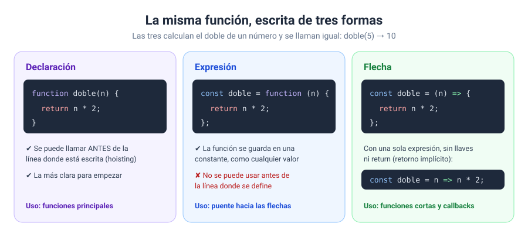

# Solución · Ejercicio 04 · Tres formas de escribir una función

[← Volver al enunciado](../../ejercicios/ejercicio_04/) · [← Volver al bloque](../../README.md)

## Qué pedía el ejercicio

Escribir tres funciones de área con las tres sintaxis de JavaScript y descubrir qué es el *hoisting*.

## Las tres formas



### 1. Declaración de función

```javascript
function areaRectangulo(base, altura) {
    return base * altura;
}
```

La que conocéis desde el ejercicio 01 [1].

### 2. Expresión de función

```javascript
const areaTriangulo = function (base, altura) {
    return base * altura / 2;
};
```

Aquí la función no tiene nombre propio: se crea y se **guarda en una constante**, igual que guardaríais un número o un texto [2]. Se llama exactamente igual: `areaTriangulo(4, 3)`. Fijaos en el punto y coma del final: es una asignación, como `const x = 5;`.

### 3. Función flecha

```javascript
const areaCirculo = (radio) => Math.PI * radio ** 2;
```

Una forma más corta de escribir una expresión de función [3]. Si el cuerpo es una sola expresión, podéis quitar las llaves y el `return`: el resultado de la expresión se devuelve solo. Es el **retorno implícito** [3].

| Sintaxis | Cuándo la uso en el curso |
| --- | --- |
| Declaración | Funciones principales del programa |
| Flecha | Funciones cortas y, sobre todo, callbacks (ejercicio 06) |
| Expresión | Para entender las flechas; en código moderno se ve menos |

## El *hoisting*

La primera línea del programa llama a `areaRectangulo` **antes** de que esté escrita… y funciona. ¿Magia? No. Antes de ejecutar el código, JavaScript registra todas las **declaraciones** de función, así que ya existen desde el principio. A esto se le llama elevación o *hoisting*, y solo afecta a las declaraciones, no a las expresiones [4].

Con `areaTriangulo` no pasa. La constante no tiene valor hasta que se ejecuta su línea, y si intentáis usarla antes, Chrome os dice:

```
ReferenceError: Cannot access 'areaTriangulo' before initialization
```

> [!TIP]
> Aunque el *hoisting* lo permita, mi recomendación es **declarar las funciones al principio del programa**, en la sección de estructura, y llamarlas después. Es lo que hace la plantilla del curso y se lee de arriba abajo sin sorpresas.

## Qué tenéis que observar

- Con 4, 3 y 2: rectángulo 12.00, triángulo 6.00 y círculo 12.57.
- La figura mayor es el círculo, por poco.

### Fuentes y Documentación Oficial

1. [function (MDN Web Docs)](https://developer.mozilla.org/es/docs/Web/JavaScript/Reference/Statements/function)
2. [function (MDN Web Docs)](https://developer.mozilla.org/es/docs/Web/JavaScript/Reference/Operators/function)
3. [Arrow function expressions (MDN Web Docs)](https://developer.mozilla.org/en-US/docs/Web/JavaScript/Reference/Functions/Arrow_functions)
4. [Gramática y tipos — Elevación de función (MDN Web Docs)](https://developer.mozilla.org/es/docs/Web/JavaScript/Guide/Grammar_and_types)
