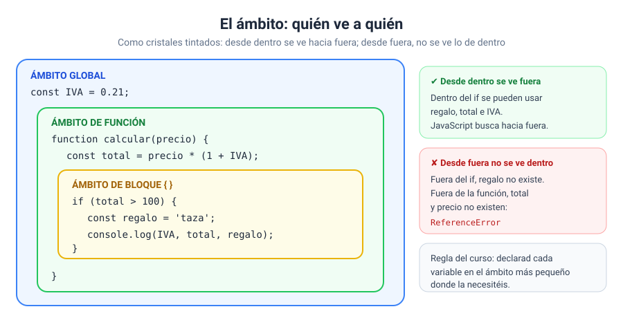

# Solución · Ejercicio 05 · Detective del ámbito

[← Volver al enunciado](../../ejercicios/ejercicio_05/) · [← Volver al bloque](../../README.md)

## Qué pedía el ejercicio

Averiguar qué variable ve cada parte del programa cuando hay tres variables con el mismo nombre en tres ámbitos distintos.

## Los resultados

| Dónde se lee | Valor de `lugar` |
| --- | --- |
| Dentro del bloque `if` | `'bloque'` |
| Dentro de la función, fuera del `if` | `'función'` |
| Fuera de todo | `'global'` |

| Pregunta | Respuesta |
| --- | --- |
| `llamadas` después de 3 llamadas | `3` |
| `typeof secreto` fuera de la función | `'undefined'` |

## Los tres ámbitos

El ámbito (*scope*) es la zona del código donde una variable existe y se puede usar. JavaScript tiene tres que os interesan ahora [1]:

| Ámbito | Se crea con | En el ejercicio |
| --- | --- | --- |
| Global | El propio programa | `lugar = 'global'`, `llamadas` y las constantes al DOM |
| De función | Una función | `lugar = 'función'` y `secreto` |
| De bloque | Unas llaves `{ }` (un `if`, un bucle…) | `lugar = 'bloque'` |



## La regla: desde dentro se ve hacia fuera

Cuando JavaScript encuentra un nombre de variable, lo busca primero en el ámbito actual. Si no está, sube al ámbito que lo contiene, y así hasta el global.

- **`llamadas++` dentro de la función** modifica la variable global, porque dentro de la función no hay ninguna `llamadas`: JavaScript sube y la encuentra fuera. Por eso, tras tres llamadas, vale 3.
- **Las constantes al DOM** son globales, así que la función puede escribir en ellas sin recibirlas como parámetro.

## Lo que no funciona: desde fuera hacia dentro

`secreto` es local de la función. Fuera de ella **no existe**:

```javascript
console.log(secreto);   // ReferenceError: secreto is not defined
```

¿Y por qué `typeof secreto` no da error? Es una excepción de `typeof`: con una variable que no existe devuelve `'undefined'` en lugar de lanzar el error. Por eso es útil para comprobar si algo existe.

## *Shadowing*: tapar una variable

Cuando declaráis una variable con el mismo nombre que otra de un ámbito exterior, la interior **tapa** a la exterior mientras estáis dentro. Las dos existen, pero desde dentro solo veis la más cercana. Al salir del bloque, la interior desaparece y la exterior vuelve a verse.

> [!TIP]
> Este ejercicio usa el mismo nombre tres veces para que veáis el mecanismo. En vuestro código, **evitadlo**: tres variables `lugar` distintas son una invitación al despiste. Y declarad cada variable en el ámbito más pequeño donde la necesitéis.

### Fuentes y Documentación Oficial

1. [Scope (MDN Web Docs)](https://developer.mozilla.org/en-US/docs/Glossary/Scope)
