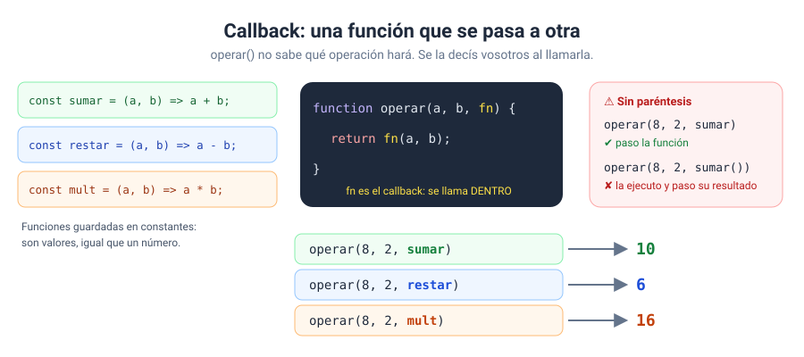

# Solución · Ejercicio 06 · Calculadora con callbacks

[← Volver al enunciado](../../ejercicios/ejercicio_06/) · [← Volver al bloque](../../README.md)

## Qué pedía el ejercicio

Escribir una función `operar()` que no sabe qué operación hará, y decírselo pasándole otra función como argumento.

## Las funciones son valores

```javascript
const sumar = (a, b) => a + b;
```

Esta línea guarda una función en una constante, igual que `const precio = 10;` guarda un número. Y si una función es un valor, se puede hacer con ella lo mismo que con cualquier valor… incluido **pasarla como argumento** a otra función.

## El callback

```javascript
function operar(a, b, operacion) {
    return operacion(a, b);
}
```

El tercer parámetro, `operacion`, no es un número: es una función. Y `operar` la llama por dentro con `operacion(a, b)`. Una función que se pasa a otra como argumento para que esta la ejecute se llama **callback** [1].



## Con paréntesis o sin paréntesis

Este es el error número uno con los callbacks:

```javascript
operar(a, b, sumar)     // ✔ entrego la función
operar(a, b, sumar())   // ✘ la ejecuto ahora (sin argumentos) y entrego su resultado: NaN
```

Sin paréntesis estáis **entregando la receta**. Con paréntesis, la estáis **cocinando** en ese momento y entregando el plato. `operar` necesita la receta para cocinarla ella misma con `a` y `b`.

## Callbacks anónimos

```javascript
operar(a, b, (x, y) => x ** y);
```

Si una operación solo la necesitáis una vez, no hace falta guardarla en una constante: se escribe directamente en la llamada. Es una función **anónima**, sin nombre. Aquí es donde las funciones flecha de una línea brillan [2].

## ¿Para qué sirve esto?

Ahora mismo parece un rodeo para sumar dos números, lo reconozco. Pero esta idea es la base de casi todo lo que viene:

- En el bloque 05, `map`, `filter` y `forEach` reciben un callback que dice qué hacer con cada elemento de una lista.
- En el bloque 07, `addEventListener('click', callback)` recibe la función que se ejecutará cuando el usuario haga clic.
- En el bloque 10, `setTimeout(callback, 1000)` recibe la función que se ejecutará al cabo de un segundo.

En todos esos casos, vosotros entregáis la función y es otro quien decide **cuándo** llamarla.

## Con 8 y 2

| Callback | Resultado |
| --- | --- |
| `sumar` | 10 |
| `restar` | 6 |
| `multiplicar` | 16 |
| `dividir` | 4 |
| `(x, y) => x ** y` | 64 |
| media | 5 |

### Fuentes y Documentación Oficial

1. [Función Callback (MDN Web Docs)](https://developer.mozilla.org/es/docs/Glossary/Callback_function)
2. [Arrow function expressions (MDN Web Docs)](https://developer.mozilla.org/en-US/docs/Web/JavaScript/Reference/Functions/Arrow_functions)
