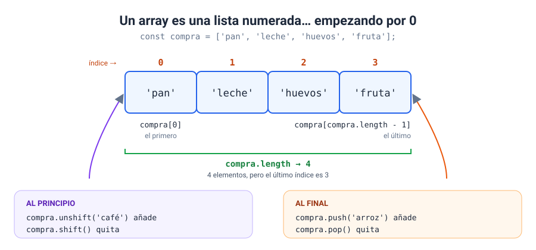
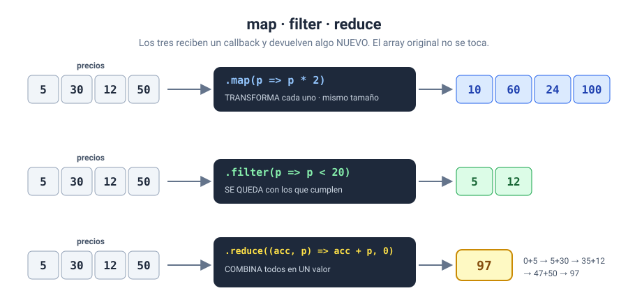
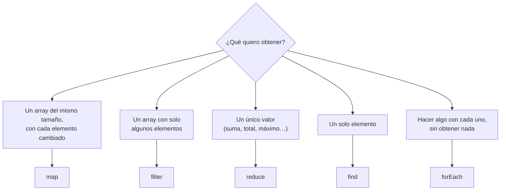
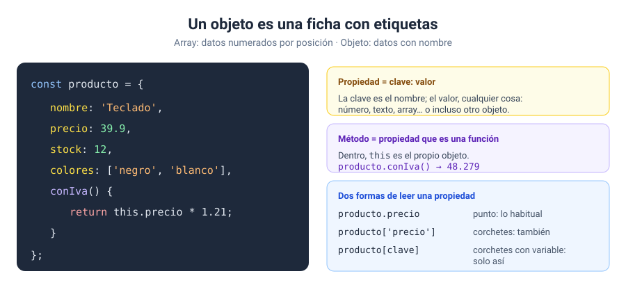
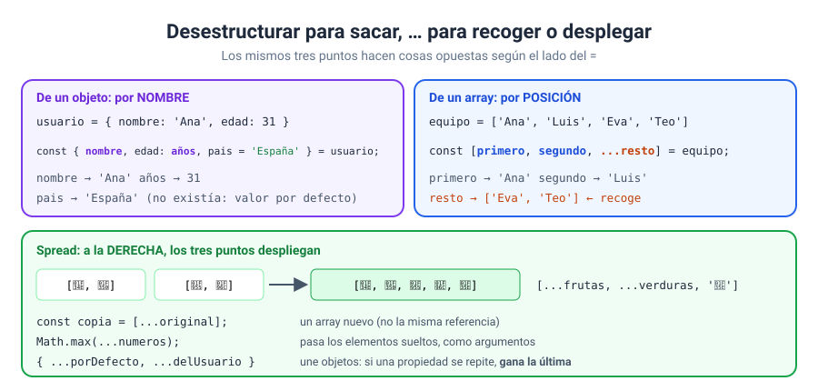
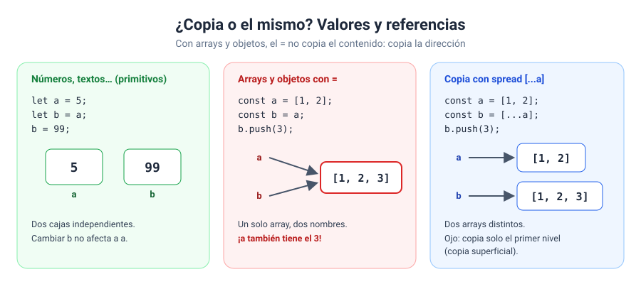

# Bloque 05 · Arrays y objetos

[← Bloque 04](../04-funciones/) · [Volver al temario](../TEMARIO.md) · [Ir al bloque 06 →](../06-dom/)

Hasta ahora, cada variable guardaba un único dato: un número, un texto, un booleano. Pero los programas reales trabajan con **colecciones**: la lista de la compra, las notas de una clase, el catálogo de una tienda. En este bloque os voy a enseñar las dos estructuras con las que JavaScript organiza los datos: los **arrays**, listas ordenadas por posición, y los **objetos**, fichas con datos que tienen nombre. Y, sobre todo, cómo combinarlas.

Al terminar este bloque sabréis:

- Crear arrays, leerlos por índice y modificarlos por los extremos y por el medio.
- Buscar elementos por valor y por condición.
- Recorrer un array con `for`, `for...of` y `forEach`.
- Transformar, filtrar, resumir y ordenar con `map`, `filter`, `reduce` y `sort`.
- Crear objetos con propiedades y métodos, y recorrerlos.
- Trabajar con arrays de objetos, la estructura más habitual en el mundo real.
- Usar desestructuración y *spread*.
- Distinguir entre copiar un valor y copiar una referencia, y convertir datos a JSON y de vuelta.

---

## 1. Arrays: listas ordenadas

Un array es una lista ordenada de valores. Cada valor ocupa una posición numerada, su **índice**, que **empieza en 0** [1].



```javascript
const compra = ['pan', 'leche', 'huevos'];

compra[0]                    // 'pan'      el primero
compra[2]                    // 'huevos'
compra.length                // 3          cuántos hay
compra[compra.length - 1]    // 'huevos'   el último, sea cual sea la longitud
compra[5]                    // undefined  no existe
```

`length` indica el número de elementos [2]. Como los índices empiezan en 0, el último siempre está en `length - 1`. Esta resta os va a acompañar mucho tiempo.

Un array puede guardar cualquier tipo de valor, incluso mezclados, aunque lo normal es que todos sus elementos sean del mismo tipo.

---

## 2. Modificar un array

| Método | Dónde | Qué hace | Devuelve |
| --- | --- | --- | --- |
| `push(x)` | Al final | Añade | La nueva longitud [3] |
| `pop()` | Al final | Quita | El elemento quitado [4] |
| `unshift(x)` | Al principio | Añade | La nueva longitud [5] |
| `shift()` | Al principio | Quita | El elemento quitado [6] |
| `splice(i, n)` | En la posición `i` | Quita `n` elementos | Un array con los quitados [7] |

Para quitar un elemento concreto, primero hay que encontrar su posición:

```javascript
const posicion = compra.indexOf('leche');
if (posicion !== -1) {
    compra.splice(posicion, 1);
}
```

Comprobad siempre que `indexOf` no ha devuelto `-1`. Con un índice negativo, `splice` cuenta desde el final [7], así que `splice(-1, 1)` borraría el último elemento sin avisar.

---

## 3. Buscar en un array

| Quiero saber… | Método | Devuelve |
| --- | --- | --- |
| Si un valor está | `includes(valor)` | `true` / `false` [8] |
| Dónde está un valor | `indexOf(valor)` | Índice o `-1` [9] |
| El primero que cumple algo | `find(callback)` | El elemento o `undefined` [10] |
| Dónde está el primero que cumple algo | `findIndex(callback)` | Índice o `-1` [11] |
| Si todos cumplen algo | `every(callback)` | `true` / `false` [12] |

```javascript
const notas = [7.5, 4, 9, 3.5];
notas.includes(9);                 // true
notas.find((n) => n < 5);          // 4
notas.every((n) => n >= 0);        // true
```

Los métodos que buscan **por condición** reciben un *callback*, como los del bloque 04: una función que se ejecuta con cada elemento y devuelve `true` o `false`.

---

## 4. Recorrer un array

```javascript
const temperaturas = [18, 21, 25];

// for clásico: control total, con índice
for (let i = 0; i < temperaturas.length; i++) {
    console.log(i, temperaturas[i]);
}

// for...of: solo los valores
for (const t of temperaturas) {
    console.log(t);
}

// forEach: un callback por elemento, con valor e índice
temperaturas.forEach((t, i) => {
    console.log(i, t);
});
```

| Necesito… | Uso |
| --- | --- |
| Solo los valores | `for...of` [13] |
| Valor e índice, de forma cómoda | `forEach` [14] |
| Parar a mitad con `break`, saltar elementos, ir al revés | `for` clásico |

> [!WARNING]
> En el `for` clásico, la condición es `i < array.length`, con `<`. Con `<=`, la última vuelta lee una posición que no existe y obtenéis `undefined`.

---

## 5. Transformar: `map`, `filter` y `reduce`

Estos tres métodos son el corazón del trabajo con datos en JavaScript. Los tres reciben un *callback* y **devuelven algo nuevo sin modificar el array original**.



```javascript
const precios = [5, 30, 12, 50];

precios.map((p) => p * 2);                  // [10, 60, 24, 100]  transforma cada uno
precios.filter((p) => p < 20);              // [5, 12]            se queda con algunos
precios.reduce((acc, p) => acc + p, 0);     // 97                 los combina en uno
```

- `map()` crea un array nuevo con el resultado de aplicar la función a cada elemento [15]. Mismo tamaño que el original.
- `filter()` crea un array nuevo con los elementos que cumplen la condición [16].
- `reduce()` recorre el array arrastrando un acumulador y devuelve un único valor [17]. El segundo argumento, aquí `0`, es el valor inicial del acumulador: ponedlo siempre.

Como `map` y `filter` devuelven arrays, se pueden **encadenar**:

```javascript
const totalBaratosConIva = precios
    .filter((p) => p < 20)
    .map((p) => p * 1.21)
    .reduce((acc, p) => acc + p, 0);
```

### 5.1. ¿Qué método uso?



### 5.2. Ordenar con `sort`

```javascript
[10, 9, 100].sort();                  // [10, 100, 9]   ✘ ordena como texto
[10, 9, 100].sort((a, b) => a - b);   // [9, 10, 100]   ✔ de menor a mayor
[10, 9, 100].sort((a, b) => b - a);   // [100, 10, 9]   ✔ de mayor a menor
```

`sort()` tiene dos trampas. La primera: sin argumentos, ordena los elementos como **texto**, según sus caracteres Unicode [18]. Para números hay que pasarle una función de comparación. La segunda: ordena el array **en el sitio**, modificando el original [19]. Si queréis conservarlo, ordenad una copia: `[...array].sort(…)`.

### 5.3. Otros dos útiles

- `join(separador)` une los elementos en un texto [20]: `['a', 'b'].join(', ')` → `'a, b'`.
- `slice(inicio, fin)` devuelve una copia de un trozo del array, sin incluir `fin`, y no modifica el original [21]. No lo confundáis con `splice`, que sí lo modifica.

### 5.4. ¿Modifica el original o no?

| Modifican el array original | Devuelven algo nuevo |
| --- | --- |
| `push`, `pop`, `unshift`, `shift`, `splice`, `sort` | `map`, `filter`, `reduce`, `slice`, `join`, `find`, `includes`… |

---

## 6. Objetos: fichas con nombre

En un array, los datos se identifican por su **posición**. En un objeto, por su **nombre**. Cuando los datos son distintos entre sí y cada uno tiene un significado, lo natural es un objeto [22].



```javascript
const producto = {
    nombre: 'Teclado',
    precio: 39.9,
    colores: ['negro', 'blanco'],
    conIva() {
        return this.precio * 1.21;
    },
};
```

Cada propiedad es un par `clave: valor`. Una propiedad cuyo valor es una función se llama **método** [22]. Dentro de un método, `this` se refiere al objeto desde el que se llama [23].

### 6.1. Leer, añadir, modificar y borrar

```javascript
producto.precio          // leer con punto
producto['precio']       // leer con corchetes
producto[clave]          // corchetes con una variable: la única forma
producto.stock = 12;     // añadir (si no existía) o modificar
delete producto.colores; // borrar
producto.peso            // undefined: no existe, pero no da error
```

Para borrar una propiedad se usa el operador `delete` [24]. Usad el punto siempre que podáis. Los corchetes, cuando el nombre de la propiedad está dentro de una variable.

### 6.2. Recorrer un objeto

```javascript
for (const clave in producto) {
    console.log(clave, producto[clave]);
}

Object.keys(producto);   // ['nombre', 'precio', 'colores', 'conIva']
```

`for...in` recorre los nombres de las propiedades [25]. `Object.keys()` los devuelve en un array [26], con lo que podéis usar `length` o cualquier método de arrays.

> [!TIP]
> `for...of` para arrays, `for...in` para objetos. Se parecen en el nombre, pero no son intercambiables.

---

## 7. Arrays de objetos

Combinad las dos estructuras y tendréis la forma en que se guardan casi todos los datos del mundo real: un array donde cada elemento es un objeto con las mismas propiedades. Es como una tabla: cada objeto es una fila y cada propiedad, una columna.

```javascript
const productos = [
    { nombre: 'Teclado', categoria: 'periféricos', precio: 59.9, stock: 12 },
    { nombre: 'Monitor', categoria: 'monitores', precio: 219, stock: 0 },
    { nombre: 'Ratón', categoria: 'periféricos', precio: 24.5, stock: 8 },
];

productos.filter((p) => p.categoria === 'periféricos');     // los de una categoría
productos.find((p) => p.nombre === 'Monitor');              // uno concreto
productos.map((p) => p.nombre);                             // ['Teclado', 'Monitor', 'Ratón']
productos.reduce((acc, p) => acc + p.precio * p.stock, 0);  // valor del inventario
[...productos].sort((a, b) => a.precio - b.precio);         // ordenados por precio
```

Todo lo de los apartados anteriores funciona igual. La única diferencia es que, dentro del *callback*, cada elemento es un objeto y accedéis a sus propiedades con el punto. Esta es la estructura que os devolverán las API del bloque 11.

---

## 8. Desestructuración y *spread*



### 8.1. Desestructuración: sacar datos

Permite extraer valores de arrays o propiedades de objetos en variables, en una sola línea [27]:

```javascript
// de un objeto: por NOMBRE
const { nombre, ciudad, edad: edadUsuario, pais = 'España' } = usuario;

// de un array: por POSICIÓN
const [primero, segundo, ...resto] = participantes;

// en los parámetros de una función
function presentar({ nombre, ciudad }) {
    return `${nombre} vive en ${ciudad}`;
}
```

Con `edad: edadUsuario` renombráis la variable; con `pais = 'España'` le dais un valor por defecto, que se usa si la propiedad no existe o vale `undefined` [27].

### 8.2. *Spread*: desplegar

Los tres puntos delante de un array u objeto lo despliegan en sus elementos [28]:

```javascript
const cesta = [...frutas, ...verduras, 'pan'];          // unir arrays
const copia = [...original];                            // copiar un array
Math.max(...numeros);                                   // pasar elementos sueltos
const config = { ...porDefecto, ...delUsuario };        // unir objetos: gana el último
```

> [!NOTE]
> Los mismos tres puntos hacen cosas opuestas según el lado. **A la izquierda** del `=` o en los parámetros, **recogen** lo que sobra: son el *resto*. **A la derecha**, **despliegan**: son el *spread*.

---

## 9. Valores y referencias

Este apartado explica muchos errores misteriosos, así que leedlo con calma.



Con los tipos primitivos, `=` copia el valor: tenéis dos cajas independientes. Con arrays y objetos no. La variable no guarda el contenido, sino una **referencia** que indica dónde está. Al hacer `=`, se copia la referencia, y las dos variables apuntan al **mismo** array.

```javascript
const a = [1, 2];
const b = a;        // b es otro nombre para el MISMO array
b.push(3);
console.log(a);     // [1, 2, 3]  ¡a también ha cambiado!
```

Tres consecuencias:

1. **Para copiar, usad *spread*:** `const b = [...a];` o `const copia = { ...objeto };`.
2. **`const` no impide cambiar el contenido.** Impide que la variable apunte a otro array u objeto, pero no que modifiquéis el que ya tiene. Por eso `const compra = []` admite `push`.
3. **`===` compara referencias**, no contenido: `[1, 2] === [1, 2]` es `false`, porque son dos arrays distintos.

### 9.1. Copia superficial y profunda

El *spread* hace una **copia superficial**: copia el primer nivel, pero si una propiedad es a su vez un array u objeto, solo copia su referencia, y el original y la copia la comparten [29]. Para una copia completamente independiente, nivel a nivel, usad `structuredClone()`, que hace una **copia profunda** [30].

```javascript
const partida = { nivel: 3, inventario: ['espada'] };

const superficial = { ...partida };
superficial.inventario.push('llave');   // ⚠ también cambia partida.inventario

const profunda = structuredClone(partida);
profunda.inventario.push('gema');       // ✔ partida no se entera
```

---

## 10. JSON: datos como texto

JSON es un formato de texto para representar datos. Es el idioma en el que las aplicaciones web se intercambian información, y lo vais a usar para guardar datos en el navegador (bloque 09) y para recibirlos de un servidor (bloque 11).

```javascript
const texto = JSON.stringify(partida, null, 2);   // objeto → texto
const objeto = JSON.parse(texto);                 // texto → objeto nuevo
```

`JSON.stringify()` convierte un valor de JavaScript en un texto JSON [31]; los argumentos `null, 2` lo formatean con sangría para que se lea mejor. `JSON.parse()` hace el camino contrario y construye un objeto nuevo [32].

```json
{
  "jugador": "Aria",
  "nivel": 3,
  "inventario": ["espada", "poción"]
}
```

En JSON las claves van **siempre entre comillas dobles** y no puede haber métodos, solo datos.

---

<!-- ampliación -->
## 11. Objetos que no se pueden cambiar: `Object.freeze`

`const` impide que una variable apunte a otro objeto, pero no impide cambiar el objeto por dentro. Cuando queréis un objeto **de solo lectura** (una configuración, unas tarifas, unos textos fijos), usad `Object.freeze` [33]:

```javascript
const TARIFAS = Object.freeze({ normal: 8, reducida: 5 });

TARIFAS.normal = 1;        // se ignora (en un módulo, TypeError)
TARIFAS.vip = 20;          // tampoco: no se pueden añadir propiedades
delete TARIFAS.reducida;   // ni borrarlas
Object.isFrozen(TARIFAS);  // true
```

En un script normal, los intentos de cambiarlo se ignoran **sin avisar**; en modo estricto (por ejemplo, dentro de un módulo del bloque 12) lanzan un `TypeError` [33]. Podéis comprobar si un objeto está congelado con `Object.isFrozen` [34].

> [!WARNING]
> La congelación es **superficial**: si una propiedad es otro objeto o un array, ese interior sí se puede cambiar [33]. `Object.freeze({ dias: ['lunes'] }).dias.push('martes')` funciona.

---

## 12. Elegir el bucle adecuado

Ya conocéis cinco formas de repetir. Todas pueden resolver casi cualquier recorrido, pero cada una encaja mejor en un caso:

| Bucle | Os da | Se usa para | ¿`break`? |
| --- | --- | --- | --- |
| `for (let i = 0; …)` | El índice `i` | Necesitáis la posición, recorrer al revés o de dos en dos | Sí |
| `while (condición)` | Solo la condición | No sabéis cuántas vueltas: hasta encontrar algo | Sí |
| `for...of` | Cada **valor** [35] | Recorrer un array (o un texto) sin necesitar el índice | Sí |
| `for...in` | Cada **nombre de propiedad** [36] | Recorrer las propiedades de un objeto | Sí |
| `forEach` | Valor e índice | Recorrer un array de principio a fin, aplicando algo a cada elemento | **No** |

Dos avisos: `for...in` es para **objetos**, no para arrays (os da las posiciones como textos, `'0'`, `'1'`…), y `forEach` no se puede interrumpir: si necesitáis parar al encontrar algo, usad `for...of` con `break`, o `find`.

---

## 13. La plantilla de trabajo en este bloque

La estructura del programa principal se llena ahora con los **datos** con los que va a trabajar el programa. El procesamiento se apoya en los métodos de arrays:

```javascript
// estructura del programa principal
const productos = [
    { nombre: 'Teclado', precio: 59.9, stock: 12 },
    { nombre: 'Ratón', precio: 24.5, stock: 0 },
];

// funciones
const formatearEuros = (n) => `${n.toFixed(2)} €`;

// constantes al DOM
const salida = document.querySelector('#salida');

// entradas
const presupuesto = Number(prompt('¿Cuánto quieres gastar?', '50'));

// procesamiento
const asequibles = productos
    .filter((p) => p.stock > 0 && p.precio <= presupuesto)
    .map((p) => `${p.nombre} (${formatearEuros(p.precio)})`);

// salidas
salida.textContent = asequibles.join(', ') || 'Nada que se ajuste a tu presupuesto';
```

En el bloque 06 dejaréis de mostrar los resultados como un texto unido con `join`: aprenderéis a **crear elementos HTML** a partir de un array. Todo lo de este bloque es la base para eso.

---

## 14. Ejercicios

| Nº | Ejercicio | Qué practicáis | Solución |
| --- | --- | --- | --- |
| 01 | [La lista de la compra](ejercicios/ejercicio_01/) | Índices, `length`, `push`, `pop`, `unshift`, `shift`, `indexOf` + `splice` | [Ver](soluciones/ejercicio_01/) |
| 02 | [Buscador de alumnos](ejercicios/ejercicio_02/) | `includes`, `indexOf`, `find`, `findIndex`, `every`, arrays paralelos | [Ver](soluciones/ejercicio_02/) |
| 03 | [Una semana de temperaturas](ejercicios/ejercicio_03/) | `for`, `for...of` y `forEach`: cuándo usar cada uno | [Ver](soluciones/ejercicio_03/) |
| 04 | [map, filter, reduce y sort](ejercicios/ejercicio_04/) | Transformar, seleccionar, resumir, encadenar y ordenar números | [Ver](soluciones/ejercicio_04/) |
| 05 | [La ficha de un producto](ejercicios/ejercicio_05/) | Objetos, métodos, `this`, punto y corchetes, `delete`, `for...in`, `Object.keys` | [Ver](soluciones/ejercicio_05/) |
| 06 | [Catálogo de una tienda](ejercicios/ejercicio_06/) | Arrays de objetos: filtrar, buscar, totalizar y ordenar por propiedad | [Ver](soluciones/ejercicio_06/) |
| 07 | [Desestructuración y spread](ejercicios/ejercicio_07/) | Sacar datos de objetos y arrays, unir arrays y objetos | [Ver](soluciones/ejercicio_07/) |
| 08 | [Guardar y cargar la partida](ejercicios/ejercicio_08/) | Referencias, copias superficiales y profundas, JSON | [Ver](soluciones/ejercicio_08/) |
| 09 | [La cola de la consulta](ejercicios/ejercicio_09/) | `push`, `shift`, `unshift`: una cola con urgencias | [Ver](soluciones/ejercicio_09/) |
| 10 | [Ficha técnica con `for...in`](ejercicios/ejercicio_10/) | Recorrer las propiedades de un objeto y construir una tabla | [Ver](soluciones/ejercicio_10/) |
| 11 | [Una configuración congelada](ejercicios/ejercicio_11/) | `Object.freeze`, `Object.isFrozen`, congelación superficial | [Ver](soluciones/ejercicio_11/) |
| 12 | [El mismo reto con cinco bucles](ejercicios/ejercicio_12/) | `for`, `while`, `for...of`, `forEach` y `for...in` con el mismo inventario | [Ver](soluciones/ejercicio_12/) |

El ejercicio 06 es el más importante del bloque. Si lo resolvéis sin mirar la solución, tenéis lo necesario para trabajar con datos reales.

---

[← Bloque 04](../04-funciones/) · [Volver al temario](../TEMARIO.md) · [Ir al bloque 06 →](../06-dom/)

### Fuentes y Documentación Oficial

1. [Array (MDN Web Docs)](https://developer.mozilla.org/es/docs/Web/JavaScript/Reference/Global_Objects/Array)
2. [Array.prototype.length (MDN Web Docs)](https://developer.mozilla.org/es/docs/Web/JavaScript/Reference/Global_Objects/Array/length)
3. [Array.prototype.push() (MDN Web Docs)](https://developer.mozilla.org/es/docs/Web/JavaScript/Reference/Global_Objects/Array/push)
4. [Array.prototype.pop() (MDN Web Docs)](https://developer.mozilla.org/es/docs/Web/JavaScript/Reference/Global_Objects/Array/pop)
5. [Array.prototype.unshift() (MDN Web Docs)](https://developer.mozilla.org/es/docs/Web/JavaScript/Reference/Global_Objects/Array/unshift)
6. [Array.prototype.shift() (MDN Web Docs)](https://developer.mozilla.org/es/docs/Web/JavaScript/Reference/Global_Objects/Array/shift)
7. [Array.prototype.splice() (MDN Web Docs)](https://developer.mozilla.org/es/docs/Web/JavaScript/Reference/Global_Objects/Array/splice)
8. [Array.prototype.includes() (MDN Web Docs)](https://developer.mozilla.org/es/docs/Web/JavaScript/Reference/Global_Objects/Array/includes)
9. [Array.prototype.indexOf() (MDN Web Docs)](https://developer.mozilla.org/es/docs/Web/JavaScript/Reference/Global_Objects/Array/indexOf)
10. [Array.prototype.find() (MDN Web Docs)](https://developer.mozilla.org/es/docs/Web/JavaScript/Reference/Global_Objects/Array/find)
11. [Array.prototype.findIndex() (MDN Web Docs)](https://developer.mozilla.org/es/docs/Web/JavaScript/Reference/Global_Objects/Array/findIndex)
12. [Array.prototype.every() (MDN Web Docs)](https://developer.mozilla.org/es/docs/Web/JavaScript/Reference/Global_Objects/Array/every)
13. [for...of (MDN Web Docs)](https://developer.mozilla.org/es/docs/Web/JavaScript/Reference/Statements/for...of)
14. [Array.prototype.forEach() (MDN Web Docs)](https://developer.mozilla.org/es/docs/Web/JavaScript/Reference/Global_Objects/Array/forEach)
15. [Array.prototype.map() (MDN Web Docs)](https://developer.mozilla.org/es/docs/Web/JavaScript/Reference/Global_Objects/Array/map)
16. [Array.prototype.filter() (MDN Web Docs)](https://developer.mozilla.org/es/docs/Web/JavaScript/Reference/Global_Objects/Array/filter)
17. [Array.prototype.reduce() (MDN Web Docs)](https://developer.mozilla.org/es/docs/Web/JavaScript/Reference/Global_Objects/Array/reduce)
18. [Array.prototype.sort() (MDN Web Docs)](https://developer.mozilla.org/es/docs/Web/JavaScript/Reference/Global_Objects/Array/sort)
19. [Array.prototype.sort() — versión en inglés (MDN Web Docs)](https://developer.mozilla.org/en-US/docs/Web/JavaScript/Reference/Global_Objects/Array/sort)
20. [Array.prototype.join() (MDN Web Docs)](https://developer.mozilla.org/es/docs/Web/JavaScript/Reference/Global_Objects/Array/join)
21. [Array.prototype.slice() (MDN Web Docs)](https://developer.mozilla.org/es/docs/Web/JavaScript/Reference/Global_Objects/Array/slice)
22. [Trabajando con objetos (MDN Web Docs)](https://developer.mozilla.org/es/docs/Web/JavaScript/Guide/Working_with_objects)
23. [this (MDN Web Docs)](https://developer.mozilla.org/es/docs/Web/JavaScript/Reference/Operators/this)
24. [Operador delete (MDN Web Docs)](https://developer.mozilla.org/es/docs/Web/JavaScript/Reference/Operators/delete)
25. [for...in (MDN Web Docs)](https://developer.mozilla.org/es/docs/Web/JavaScript/Reference/Statements/for...in)
26. [Object.keys() (MDN Web Docs)](https://developer.mozilla.org/es/docs/Web/JavaScript/Reference/Global_Objects/Object/keys)
27. [Destructuring (MDN Web Docs)](https://developer.mozilla.org/en-US/docs/Web/JavaScript/Reference/Operators/Destructuring)
28. [Sintaxis Spread (MDN Web Docs)](https://developer.mozilla.org/es/docs/Web/JavaScript/Reference/Operators/Spread_syntax)
29. [Shallow copy (MDN Web Docs)](https://developer.mozilla.org/en-US/docs/Glossary/Shallow_copy)
30. [Window: structuredClone() method (MDN Web Docs)](https://developer.mozilla.org/en-US/docs/Web/API/Window/structuredClone)
31. [JSON.stringify() (MDN Web Docs)](https://developer.mozilla.org/en-US/docs/Web/JavaScript/Reference/Global_Objects/JSON/stringify)
32. [JSON.parse() (MDN Web Docs)](https://developer.mozilla.org/en-US/docs/Web/JavaScript/Reference/Global_Objects/JSON/parse)
33. [Object.freeze() (MDN Web Docs)](https://developer.mozilla.org/en-US/docs/Web/JavaScript/Reference/Global_Objects/Object/freeze)
34. [Object.isFrozen() (MDN Web Docs)](https://developer.mozilla.org/en-US/docs/Web/JavaScript/Reference/Global_Objects/Object/isFrozen)
35. [for...of (MDN Web Docs)](https://developer.mozilla.org/en-US/docs/Web/JavaScript/Reference/Statements/for...of)
36. [for...in (MDN Web Docs)](https://developer.mozilla.org/en-US/docs/Web/JavaScript/Reference/Statements/for...in)
