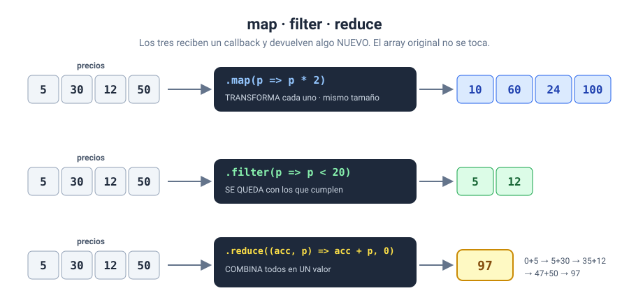

# Solución · Ejercicio 04 · map, filter, reduce y sort

[← Volver al enunciado](../../ejercicios/ejercicio_04/) · [← Volver al bloque](../../README.md)

## Qué pedía el ejercicio

Transformar, seleccionar, resumir y ordenar un array de precios sin modificar el original.



## Los tres grandes

### `map`: transformar

```javascript
const conIva = precios.map((p) => p * (1 + IVA));
```

`map()` crea un **array nuevo** con el resultado de aplicar la función a cada elemento [1]. Siempre tiene el mismo tamaño que el original: entran seis precios, salen seis precios con IVA.

### `filter`: seleccionar

```javascript
const baratos = precios.filter((p) => p < 20);
```

`filter()` crea un **array nuevo** con los elementos para los que la función devuelve `true` [2]. Si ninguno cumple, devuelve un array vacío [2].

### `reduce`: resumir

```javascript
const total = precios.reduce((acc, p) => acc + p, 0);
```

`reduce()` recorre el array arrastrando un **acumulador**, y al final devuelve un único valor [3]. Es el patrón del acumulador del bloque 03, empaquetado:

| Vuelta | `acc` | `p` | Devuelve |
| --- | --- | --- | --- |
| 1 | 0 | 12.5 | 12.5 |
| 2 | 12.5 | 30 | 42.5 |
| 3 | 42.5 | 8 | 50.5 |
| … | … | … | … |
| 6 | 115.49 | 5 | **120.49** |

El `0` del final es el valor inicial del acumulador. Ponedlo siempre.

## Encadenar

```javascript
precios
    .filter((p) => p < 20)
    .map((p) => p * (1 + IVA))
    .reduce((acc, p) => acc + p, 0);
```

Como `filter` y `map` devuelven arrays, podéis llamar al siguiente método directamente sobre el resultado. Se lee como una receta: «de los precios, quédate con los menores de 20, súmales el IVA y súmalos todos». Escribid un método por línea; así se lee de un vistazo.

## `sort`: dos trampas

### Trampa 1: ordena como texto

```javascript
[...precios].sort()                  // 12.50 · 19.99 · 30.00 · 45.00 · 5.00 · 8.00  ✘
[...precios].sort((a, b) => a - b)   // 5.00 · 8.00 · 12.50 · 19.99 · 30.00 · 45.00  ✔
```

Sin argumentos, `sort()` convierte los elementos en texto y los ordena según sus caracteres Unicode [4]. Igual que en un diccionario, «12» va antes que «5» porque el «1» va antes que el «5». Para ordenar números hay que pasarle una **función de comparación**: `(a, b) => a - b` ordena de menor a mayor y `(a, b) => b - a`, de mayor a menor.

### Trampa 2: modifica el original

`sort()` ordena el array **en el sitio** y devuelve una referencia al mismo array [5]. A diferencia de `map` y `filter`, cambia el original. Por eso ordeno una copia: `[...precios]`. Los tres puntos son la sintaxis *spread*, que veréis a fondo en el ejercicio 07.

## Qué tenéis que observar

- La primera y la última fila de la tabla son idénticas: `map`, `filter`, `reduce` y las copias ordenadas no han tocado `precios`.
- Total: 120.49 €. Total con IVA de los menores de 20 €: 55.04 €.

### Fuentes y Documentación Oficial

1. [Array.prototype.map() (MDN Web Docs)](https://developer.mozilla.org/es/docs/Web/JavaScript/Reference/Global_Objects/Array/map)
2. [Array.prototype.filter() (MDN Web Docs)](https://developer.mozilla.org/es/docs/Web/JavaScript/Reference/Global_Objects/Array/filter)
3. [Array.prototype.reduce() (MDN Web Docs)](https://developer.mozilla.org/es/docs/Web/JavaScript/Reference/Global_Objects/Array/reduce)
4. [Array.prototype.sort() (MDN Web Docs)](https://developer.mozilla.org/es/docs/Web/JavaScript/Reference/Global_Objects/Array/sort)
5. [Array.prototype.sort() — versión en inglés (MDN Web Docs)](https://developer.mozilla.org/en-US/docs/Web/JavaScript/Reference/Global_Objects/Array/sort)
