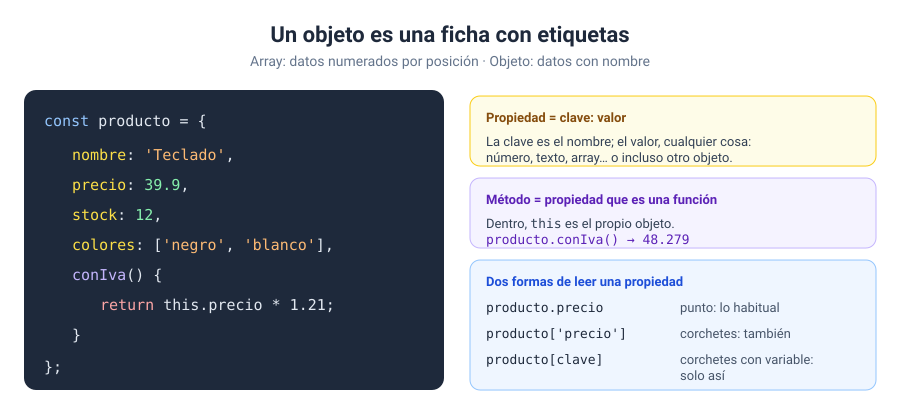

# Solución · Ejercicio 05 · La ficha de un producto

[← Volver al enunciado](../../ejercicios/ejercicio_05/) · [← Volver al bloque](../../README.md)

## Qué pedía el ejercicio

Crear un objeto con varios datos y un método, consultarlo, modificarlo y recorrer sus propiedades.

## Arrays frente a objetos

En un array, los datos se identifican por su **posición**: `notas[2]`. En un objeto, por su **nombre**: `producto.precio`. Cuando los datos son distintos entre sí (un nombre, un precio, un stock…) y cada uno tiene un significado, lo natural es un objeto [1].



## La solución paso a paso

### 1. Crear el objeto

```javascript
const producto = {
    nombre: 'Teclado mecánico',
    precio: 59.9,
    stock: 12,
    colores: ['negro', 'blanco'],
    conIva() {
        return this.precio * 1.21;
    },
};
```

Cada línea es una propiedad `clave: valor`, separadas por comas. Los valores pueden ser de cualquier tipo, incluido un array. `conIva` es un **método**: una propiedad cuyo valor es una función [1]. Dentro de un método, `this` se refiere al objeto desde el que se llama [2], así que `this.precio` es el precio de este producto.

### 2. Punto o corchetes

```javascript
producto.precio        // punto: lo habitual
producto['precio']     // corchetes con el nombre entre comillas
producto[clave]        // corchetes con una variable
```

Las tres leen la misma propiedad. ¿Para qué los corchetes? Para cuando el nombre de la propiedad **está dentro de una variable**, como aquí, donde lo escribe el usuario. `producto.clave` buscaría una propiedad que se llama literalmente «clave» [1].

Si la propiedad no existe, no hay error: se obtiene `undefined`. Por eso lo compruebo.

### 3. Modificar, añadir y borrar

```javascript
producto.stock -= 2;        // modificar
producto.oferta = true;     // añadir
delete producto.colores;    // borrar
```

Para añadir una propiedad basta con asignarla. Para borrarla está el operador `delete` [3]. Y sí, el objeto se declaró con `const` y aun así lo cambio: `const` impide reasignar la variable, no modificar el contenido del objeto. Os lo explico a fondo en el ejercicio 08.

### 4. Recorrer el objeto

```javascript
for (const prop in producto) {
    ficha += `${prop}: ${producto[prop]}\n`;
}
```

`for...in` recorre los **nombres** de las propiedades de un objeto [4]. En cada vuelta, `prop` vale `'nombre'`, `'precio'`… y con `producto[prop]` (corchetes, porque el nombre está en una variable) obtengo el valor.

```javascript
Object.keys(producto)   // ['nombre', 'precio', 'stock', 'conIva', 'oferta']
```

`Object.keys()` devuelve un **array** con los nombres de las propiedades [5]. Al ser un array, podéis usar `.length` para contarlas o cualquier método del ejercicio 04.

> [!TIP]
> `for...in` para objetos, `for...of` para arrays. Se parecen mucho en el nombre, pero no los mezcléis: `for...of` sobre un objeto normal da error, y `for...in` sobre un array os da los índices como texto.

## Qué tenéis que observar

- La ficha ya no tiene `colores`, tiene `oferta: true` y el stock es 10.
- El precio con IVA es 72.48 €.

### Fuentes y Documentación Oficial

1. [Trabajando con objetos (MDN Web Docs)](https://developer.mozilla.org/es/docs/Web/JavaScript/Guide/Working_with_objects)
2. [this (MDN Web Docs)](https://developer.mozilla.org/es/docs/Web/JavaScript/Reference/Operators/this)
3. [Operador delete (MDN Web Docs)](https://developer.mozilla.org/es/docs/Web/JavaScript/Reference/Operators/delete)
4. [for...in (MDN Web Docs)](https://developer.mozilla.org/es/docs/Web/JavaScript/Reference/Statements/for...in)
5. [Object.keys() (MDN Web Docs)](https://developer.mozilla.org/es/docs/Web/JavaScript/Reference/Global_Objects/Object/keys)
