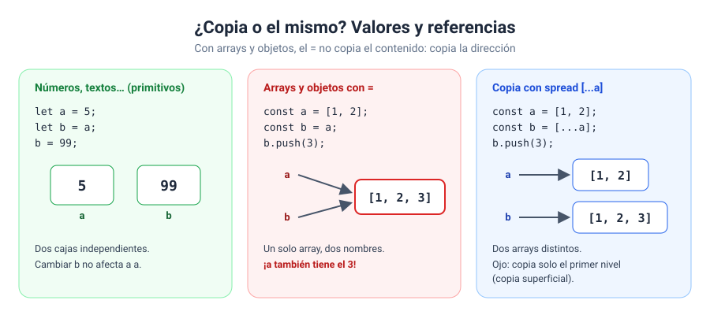

# Solución · Ejercicio 08 · Guardar y cargar la partida

[← Volver al enunciado](../../ejercicios/ejercicio_08/) · [← Volver al bloque](../../README.md)

## Qué pedía el ejercicio

Comprobar con seis experimentos cuándo copiar un array o un objeto crea algo nuevo y cuándo no, y guardar y cargar un objeto como texto JSON.

## Valores y referencias

Con los tipos primitivos (números, textos, booleanos), `=` copia el valor: tenéis dos cajas independientes. Con arrays y objetos no: la variable no guarda el contenido, sino una **referencia**, una especie de dirección que indica dónde está. Al hacer `=`, lo que se copia es esa dirección.



## Los seis experimentos

| Nº | Código | Resultado | Por qué |
| --- | --- | --- | --- |
| 1 | `alias = inventario` | El original **cambia** | Dos nombres para el mismo array |
| 2 | `copia = [...inventario]` | El original no cambia | *Spread* crea un array nuevo |
| 3 | `{ ...partida }` y cambio `nivel` | El original no cambia | El primer nivel se copia |
| 4 | …y cambio `inventario` | El original **cambia** | El array de dentro se comparte |
| 5 | `structuredClone(partida)` | El original no cambia | Copia profunda |
| 6 | `[1, 2] === [1, 2]` | `false` | Son dos arrays distintos |

### Copia superficial frente a profunda

El *spread* hace una **copia superficial**: copia el primer nivel, pero si una propiedad es un array u objeto, copia solo su referencia, y los dos acaban compartiéndolo [1]. Por eso el experimento 3 funciona y el 4 no.

`structuredClone()` hace una **copia profunda**: copia también todo lo que hay dentro, nivel a nivel [2]. Usadla cuando el objeto tenga arrays u objetos dentro y necesitéis una copia totalmente independiente.

### `const` no significa «no cambia»

Ahora entendéis por qué `const inventario` admite un `push`. `const` impide que la variable apunte a **otro** array (`inventario = []` da error), pero no impide modificar el array al que apunta.

### Comparar arrays y objetos

`===` con arrays y objetos compara **referencias**, no contenido. Dos arrays con los mismos elementos son dos arrays distintos, así que la comparación da `false`. Para saber si tienen el mismo contenido hay que comparar elemento a elemento.

## JSON: guardar y cargar

JSON es un formato de **texto** para representar datos. Es el idioma en el que las aplicaciones web se intercambian información, y lo veréis en los bloques 09 y 11.

```javascript
const guardado = JSON.stringify(partida, null, 2);   // objeto → texto
const cargada = JSON.parse(guardado);                // texto → objeto
```

- `JSON.stringify()` convierte un valor de JavaScript en un texto JSON [3]. Los argumentos `null, 2` piden que lo formatee con sangría de 2 espacios, para que se lea bien.
- `JSON.parse()` analiza un texto JSON y construye el valor que describe [4].

```json
{
  "jugador": "Aria",
  "nivel": 3,
  "inventario": [
    "espada",
    "poción",
    "llave"
  ]
}
```

Fijaos en las diferencias con un objeto de JavaScript: en JSON las claves van **siempre entre comillas dobles**, y no hay métodos, solo datos.

¿Y por qué `cargada === partida` es `false`? Porque `JSON.parse` construye un objeto **nuevo**. Tiene el mismo contenido, pero es otro objeto, igual que en el experimento 6.

> [!TIP]
> `JSON.parse(JSON.stringify(objeto))` también sirve para hacer una copia profunda, y lo veréis en mucho código antiguo. `structuredClone()` es la forma moderna y más completa de hacerlo.

### Fuentes y Documentación Oficial

1. [Shallow copy (MDN Web Docs)](https://developer.mozilla.org/en-US/docs/Glossary/Shallow_copy)
2. [Window: structuredClone() method (MDN Web Docs)](https://developer.mozilla.org/en-US/docs/Web/API/Window/structuredClone)
3. [JSON.stringify() (MDN Web Docs)](https://developer.mozilla.org/en-US/docs/Web/JavaScript/Reference/Global_Objects/JSON/stringify)
4. [JSON.parse() (MDN Web Docs)](https://developer.mozilla.org/en-US/docs/Web/JavaScript/Reference/Global_Objects/JSON/parse)
