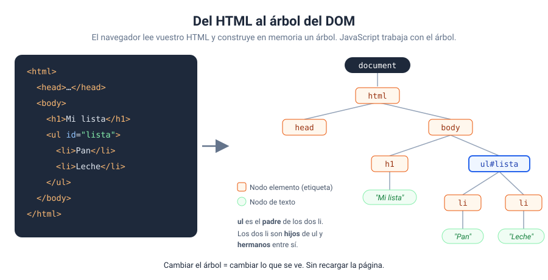
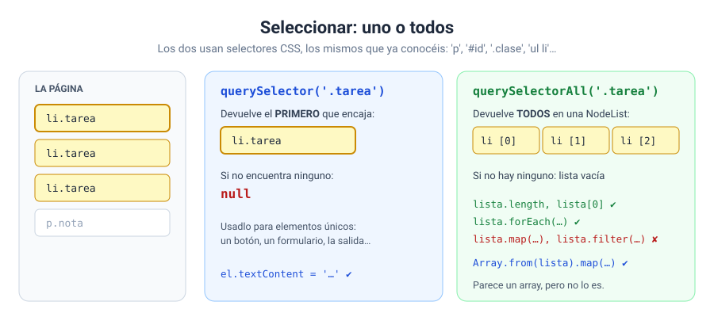
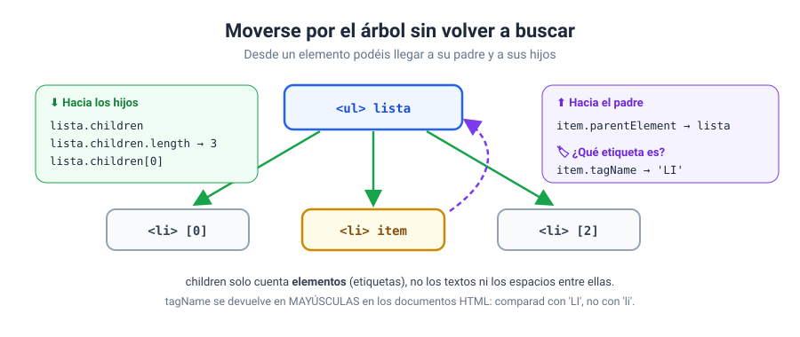
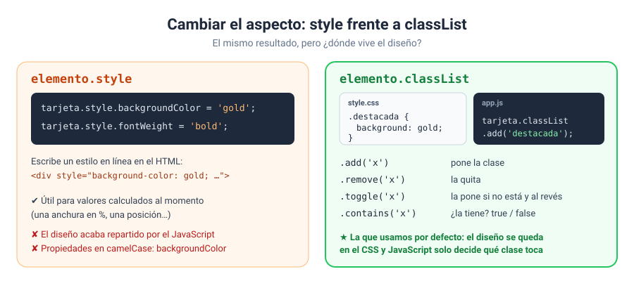
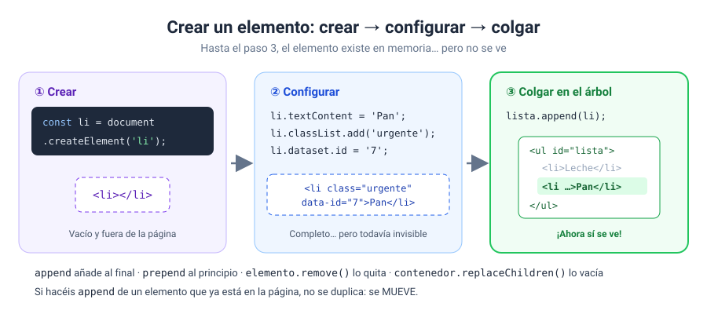
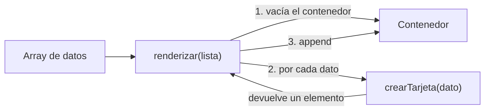

# Bloque 06 · El DOM

[← Bloque 05](../05-arrays-y-objetos/) · [Volver al temario](../TEMARIO.md) · [Ir al bloque 07 →](../07-eventos/)

Empieza la fase 2. Hasta ahora, JavaScript y la página se hablaban poco: un `textContent` por aquí, un `querySelector` por allá. En este bloque os voy a enseñar a **controlar la página entera desde JavaScript**: encontrar cualquier elemento, cambiar su texto, sus atributos y su aspecto, y sobre todo **crear elementos nuevos a partir de datos**. Lo que en el bloque 05 mostrabais con un `join`, a partir de hoy serán tarjetas, listas y tablas de verdad.

Al terminar este bloque sabréis:

- Explicar qué es el DOM y cómo se relaciona con vuestro HTML.
- Seleccionar uno o varios elementos con selectores CSS.
- Moveros por el árbol: padres e hijos.
- Cambiar textos, HTML interno y atributos, incluidos los `data-*`.
- Cambiar el aspecto con `classList` y saber cuándo usar `style`.
- Crear, añadir, mover y eliminar elementos.
- Generar HTML a partir de un array de datos con funciones reutilizables.

---

## 1. Qué es el DOM

Cuando el navegador carga una página, lee el HTML y construye en memoria una representación de ella: un **árbol de objetos** llamado DOM, *Document Object Model* [1]. Cada etiqueta se convierte en un nodo, y los nodos quedan unos dentro de otros, igual que en vuestro código.



La idea clave: **JavaScript no modifica el fichero HTML. Modifica el árbol.** Y como el navegador dibuja la página a partir del árbol, cualquier cambio se ve al instante, sin recargar [2].

Para hablar del árbol se usan palabras de familia:

| Término | Significado | En el dibujo |
| --- | --- | --- |
| Padre | El elemento que contiene a otro | `ul` es padre de los `li` |
| Hijo | Un elemento contenido directamente en otro | Cada `li` es hijo de `ul` |
| Hermanos | Elementos con el mismo padre | Los dos `li` |

> [!TIP]
> La pestaña **Elementos** de las herramientas de desarrollo (`F12`) muestra el DOM **en vivo**, no el HTML original. Si JavaScript añade o cambia algo, lo veréis ahí. Usadla en todos los ejercicios de este bloque.

---

## 2. Seleccionar elementos



```javascript
const titulo = document.querySelector('h1');             // el PRIMERO que encaja, o null
const tareas = document.querySelectorAll('.tarea');      // TODOS, en una NodeList
```

`querySelector()` devuelve el primer elemento que encaja con el selector, o `null` si no hay ninguno [3]. `querySelectorAll()` devuelve todos en una `NodeList`, que estará vacía si no encuentra nada [4].

Los dos aceptan **cualquier selector CSS**:

| Selector | Encuentra |
| --- | --- |
| `'p'` | Elementos `<p>` |
| `'#salida'` | El elemento con `id="salida"` |
| `'.tarea'` | Elementos con la clase `tarea` |
| `'.tarea.hecha'` | Con las dos clases a la vez |
| `'#lista li'` | Los `li` que están dentro de `#lista` |
| `'li:last-child'` | Los `li` que son el último hijo |
| `'.tarea:not(.hecha)'` | Con `tarea` pero sin `hecha` |
| `'[data-tiempo]'` | Con el atributo `data-tiempo` |

También podéis buscar **dentro** de un elemento, en lugar de en todo el documento:

```javascript
const lista = document.querySelector('#lista');
const items = lista.querySelectorAll('li');   // solo los li de esta lista
```

### 2.1. NodeList no es un array

Una `NodeList` tiene `length`, se puede leer por índice y se puede recorrer con `forEach` o `for...of`. Pero **no tiene** `map`, `filter` ni `reduce`. Para usarlos, convertidla con `Array.from()` [5]:

```javascript
Array.from(tareas).map((li) => li.textContent);
```

Además, la `NodeList` de `querySelectorAll` es **estática**: una foto del momento en que buscasteis [4]. Si después añadís elementos, no aparecen en ella.

---

## 3. Moverse por el árbol



Desde un elemento podéis llegar a sus vecinos sin volver a buscar:

```javascript
lista.children              // sus elementos hijos [6]
lista.children.length       // cuántos tiene
lista.children[0]           // el primero
item.parentElement          // su elemento padre [7]
item.tagName                // 'LI' (en mayúsculas en documentos HTML) [8]
```

---

## 4. Cambiar el contenido

```javascript
nombre.textContent = nombreUsuario;                                  // texto
bio.innerHTML = 'Desarrolladora <strong>front-end</strong>';        // HTML
```

| Propiedad | Interpreta etiquetas | Úsala para |
| --- | --- | --- |
| `textContent` [9] | No: las muestra como texto | Cualquier texto, **siempre** si viene del usuario |
| `innerHTML` [10] | Sí: crea los elementos | HTML escrito por vosotros, sin datos de fuera |

> [!IMPORTANT]
> Ya lo visteis en el bloque 01, pero aquí cobra todo su sentido: nunca metáis en `innerHTML` texto que venga del usuario o de fuera. MDN lo señala como una vía para ataques de *cross-site scripting* (XSS) [10]. Para construir HTML con datos, usad `createElement` + `textContent` (apartado 7).

---

## 5. Atributos y datos propios

### 5.1. Cualquier atributo

```javascript
avatar.getAttribute('src');                    // leer: el valor, o null si no existe [11]
avatar.setAttribute('src', 'nueva.svg');       // cambiar o crear [12]
celda.setAttribute('colspan', '3');
```

### 5.2. Atributos `data-*`

Los atributos que empiezan por `data-` sirven para guardar vuestros propios datos en el HTML. JavaScript los ve en `dataset` [13]:

```html
<div id="perfil" data-usuario-id="42" data-plan="gratis">
```

```javascript
perfil.dataset.usuarioId       // '42'
perfil.dataset.plan = 'premium';
perfil.dataset.ultimaVisita = 'hoy';   // crea data-ultima-visita="hoy"
```

Dos reglas [13]:

- **Cambio de nombre:** se quita `data-`, desaparecen los guiones y la letra siguiente pasa a mayúscula. `data-usuario-id` ↔ `usuarioId`.
- **Siempre texto:** `'42'`, no `42`. Convertid con `Number()` si vais a operar.

En el bloque 07 os serán imprescindibles: guardaréis el `id` de cada producto en su tarjeta para saber cuál ha pulsado el usuario.

---

## 6. Cambiar el aspecto



```javascript
// classList: añadir y quitar clases definidas en el CSS  ★ por defecto
tarjeta.classList.add('destacada');
tarjeta.classList.remove('borde');
tarjeta.classList.toggle('oculta');       // pone o quita; devuelve true si al final la tiene [14]
tarjeta.classList.contains('oculta');     // true / false

// style: estilos en línea, para valores calculados al momento
barra.style.width = `${porcentaje}%`;
```

`classList` gestiona la lista de clases del elemento [15]; `style` da acceso a sus estilos **en línea**, con las propiedades CSS escritas en *camelCase*: `backgroundColor`, `fontSize` [16].

Mi regla: **`classList` por defecto**. El diseño se queda en el CSS y JavaScript solo decide qué clase toca. `style`, solo cuando el valor no se puede saber de antemano, como la anchura de una barra de progreso.

---

## 7. Crear, mover y eliminar elementos

### 7.1. Crear → configurar → colgar



```javascript
const li = document.createElement('li');   // 1. crear [17]
li.textContent = 'Pan';                    // 2. configurar
li.classList.add('urgente');
lista.append(li);                          // 3. colgar: al final [18]
```

Hasta el paso 3, el elemento existe en memoria pero **no se ve**. Si un elemento creado no aparece, comprobad lo primero que lo habéis colgado.

### 7.2. Añadir, quitar y vaciar

| Código | Qué hace |
| --- | --- |
| `padre.append(a, b, …)` | Añade uno o varios al final [18] |
| `padre.prepend(a)` | Añade al principio [19] |
| `elemento.remove()` | Quita el elemento de la página [20] |
| `padre.replaceChildren()` | Vacía el elemento: quita todos sus hijos [21] |

### 7.3. `append` también mueve

Si hacéis `append` de un elemento que **ya está** en el documento, no se duplica: **se mueve** a la nueva posición [22]. Es la forma de reordenar una lista sin crear nada:

```javascript
ordenados.forEach((li) => lista.append(li));   // cada uno se va al final, en orden
```

---

## 8. El patrón «de datos a HTML»

Este es el patrón más importante del bloque, y lo vais a usar en todos los bloques que quedan. Los **datos** viven en un array; el **HTML** se genera a partir de ellos con dos funciones:



```javascript
// recibe UN dato y DEVUELVE su elemento (sin colgarlo)
function crearTarjeta(producto) {
    const tarjeta = document.createElement('article');
    tarjeta.classList.add('tarjeta-producto');
    tarjeta.dataset.id = producto.id;

    const titulo = document.createElement('h3');
    titulo.textContent = producto.nombre;

    tarjeta.append(titulo);
    return tarjeta;
}

// recibe una LISTA y la pinta entera, desde cero
function renderizar(lista) {
    catalogo.replaceChildren();
    lista.forEach((producto) => {
        catalogo.append(crearTarjeta(producto));
    });
}

renderizar(productos.filter((p) => p.precio < 100));
```

¿Por qué así?

- **Seguro:** `textContent` muestra los datos como texto, sin riesgo de XSS.
- **Reutilizable:** `crearTarjeta` no sabe dónde va a acabar su tarjeta; quien la llama lo decide.
- **Fácil de actualizar:** si los datos cambian, se vuelve a llamar a `renderizar` y listo. En el bloque 07 lo haréis cada vez que el usuario pulse un botón.

---

## 9. La plantilla de trabajo en este bloque

La sección de **constantes al DOM** crece: ahora guarda los contenedores donde se van a pintar los datos. Y las **funciones** de crear y renderizar se colocan al principio, con las demás.

```javascript
// estructura del programa principal
const tareas = [
    { texto: 'Estudiar el DOM', hecha: false },
    { texto: 'Hacer los ejercicios', hecha: true },
];

// funciones
function crearTarea(tarea) {
    const li = document.createElement('li');
    li.textContent = tarea.texto;
    if (tarea.hecha) {
        li.classList.add('hecha');
    }
    return li;
}

function renderizar(lista) {
    contenedor.replaceChildren();
    lista.forEach((t) => contenedor.append(crearTarea(t)));
}

// constantes al DOM que queremos controlar
const contenedor = document.querySelector('#tareas');

// procesamiento y salidas
renderizar(tareas);
```

Todavía falta una pieza: que el programa reaccione cuando el usuario hace algo. Eso son los eventos, y llegan en el bloque 07. Cuando lleguen, la función `renderizar` estará esperándolos.

---

## 10. Ejercicios

| Nº | Ejercicio | Qué practicáis | Solución |
| --- | --- | --- | --- |
| 01 | [Explorador del árbol DOM](ejercicios/ejercicio_01/) | Selectores CSS en `querySelector`, `null`, `children`, `parentElement` | [Ver](soluciones/ejercicio_01/) |
| 02 | [Muchos elementos a la vez](ejercicios/ejercicio_02/) | `querySelectorAll`, `NodeList`, `forEach`, `Array.from` | [Ver](soluciones/ejercicio_02/) |
| 03 | [Retocar una tarjeta de perfil](ejercicios/ejercicio_03/) | `textContent`, `innerHTML`, `getAttribute`, `setAttribute`, `dataset` | [Ver](soluciones/ejercicio_03/) |
| 04 | [Estilos: style frente a classList](ejercicios/ejercicio_04/) | `classList.add/remove/toggle/contains`, `style` para valores calculados | [Ver](soluciones/ejercicio_04/) |
| 05 | [La lista de la compra, ahora en HTML](ejercicios/ejercicio_05/) | `createElement`, `append`, `prepend` | [Ver](soluciones/ejercicio_05/) |
| 06 | [Tarjetas de producto desde datos](ejercicios/ejercicio_06/) | Patrón `crearTarjeta` + `renderizar`, `replaceChildren`, caso vacío | [Ver](soluciones/ejercicio_06/) |
| 07 | [Clasificación: mover y eliminar](ejercicios/ejercicio_07/) | `remove()`, `append` que mueve, ordenar elementos existentes | [Ver](soluciones/ejercicio_07/) |
| 08 | [Tabla de notas dinámica](ejercicios/ejercicio_08/) | Generar filas de tabla, clases según el valor, `colspan`, fila de resumen | [Ver](soluciones/ejercicio_08/) |

El ejercicio 06 es el que más vais a reutilizar: su patrón aparecerá en casi todo lo que queda de curso.

---

[← Bloque 05](../05-arrays-y-objetos/) · [Volver al temario](../TEMARIO.md) · [Ir al bloque 07 →](../07-eventos/)

### Fuentes y Documentación Oficial

1. [Modelo de Objetos del Documento (DOM) (MDN Web Docs)](https://developer.mozilla.org/es/docs/Web/API/Document_Object_Model)
2. [DOM scripting introduction (MDN Web Docs)](https://developer.mozilla.org/en-US/docs/Learn_web_development/Core/Scripting/DOM_scripting)
3. [Document: querySelector() method (MDN Web Docs)](https://developer.mozilla.org/en-US/docs/Web/API/Document/querySelector)
4. [Document: querySelectorAll() method (MDN Web Docs)](https://developer.mozilla.org/en-US/docs/Web/API/Document/querySelectorAll)
5. [NodeList (MDN Web Docs)](https://developer.mozilla.org/en-US/docs/Web/API/NodeList)
6. [Element: children property (MDN Web Docs)](https://developer.mozilla.org/en-US/docs/Web/API/Element/children)
7. [Node: parentElement property (MDN Web Docs)](https://developer.mozilla.org/en-US/docs/Web/API/Node/parentElement)
8. [Element: tagName property (MDN Web Docs)](https://developer.mozilla.org/en-US/docs/Web/API/Element/tagName)
9. [Node: textContent property (MDN Web Docs)](https://developer.mozilla.org/en-US/docs/Web/API/Node/textContent)
10. [Element: innerHTML property (MDN Web Docs)](https://developer.mozilla.org/en-US/docs/Web/API/Element/innerHTML)
11. [Element: getAttribute() method (MDN Web Docs)](https://developer.mozilla.org/en-US/docs/Web/API/Element/getAttribute)
12. [Element: setAttribute() method (MDN Web Docs)](https://developer.mozilla.org/en-US/docs/Web/API/Element/setAttribute)
13. [HTMLElement: dataset property (MDN Web Docs)](https://developer.mozilla.org/en-US/docs/Web/API/HTMLElement/dataset)
14. [DOMTokenList: toggle() method (MDN Web Docs)](https://developer.mozilla.org/en-US/docs/Web/API/DOMTokenList/toggle)
15. [Element: classList property (MDN Web Docs)](https://developer.mozilla.org/en-US/docs/Web/API/Element/classList)
16. [HTMLElement: style property (MDN Web Docs)](https://developer.mozilla.org/en-US/docs/Web/API/HTMLElement/style)
17. [Document: createElement() method (MDN Web Docs)](https://developer.mozilla.org/en-US/docs/Web/API/Document/createElement)
18. [Element: append() method (MDN Web Docs)](https://developer.mozilla.org/en-US/docs/Web/API/Element/append)
19. [Element: prepend() method (MDN Web Docs)](https://developer.mozilla.org/en-US/docs/Web/API/Element/prepend)
20. [Element: remove() method (MDN Web Docs)](https://developer.mozilla.org/en-US/docs/Web/API/Element/remove)
21. [Element: replaceChildren() method (MDN Web Docs)](https://developer.mozilla.org/en-US/docs/Web/API/Element/replaceChildren)
22. [Node: appendChild() method (MDN Web Docs)](https://developer.mozilla.org/en-US/docs/Web/API/Node/appendChild)
