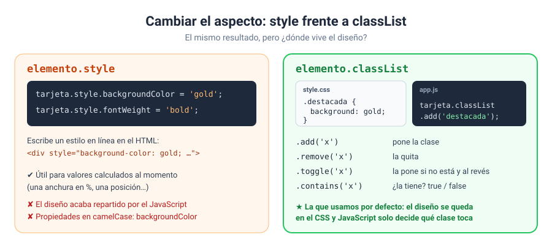

# Solución · Ejercicio 04 · Estilos: style frente a classList

[← Volver al enunciado](../../ejercicios/ejercicio_04/) · [← Volver al bloque](../../README.md)

## Qué pedía el ejercicio

Cambiar el aspecto de varios elementos con estilos en línea y con clases, y comparar los dos enfoques.

## Opción 1: `style`

```javascript
tarjeta1.style.backgroundColor = 'gold';
```

La propiedad `style` da acceso a los estilos **en línea** del elemento, los del atributo `style` del HTML [1]. Si inspeccionáis la tarjeta 1, veréis que ahora tiene `style="background-color: gold;"`.

Fijaos en el nombre: en CSS es `background-color`; en JavaScript, `backgroundColor`. Las propiedades con guion se escriben en *camelCase*.

## Opción 2: `classList`

```javascript
tarjeta2.classList.add('destacada');
tarjeta3.classList.toggle('oculta');
tarjeta4.classList.remove('borde');
tarjeta3.classList.contains('oculta');   // true
```

`classList` es la lista de clases del elemento, con métodos para añadir, quitar y comprobar [2]:

| Método | Qué hace |
| --- | --- |
| `add('x')` | Añade la clase |
| `remove('x')` | La quita |
| `toggle('x')` | La añade si no está y la quita si está. Devuelve `true` si al final la tiene [3] |
| `contains('x')` | ¿La tiene? `true` o `false` |

Las clases `destacada`, `oculta` y `borde` ya estaban definidas en `style.css`. JavaScript no sabe nada de colores ni de bordes: solo decide **qué clase toca**.

## ¿Cuál uso?



**Por defecto, `classList`.** Las ventajas son claras:

- El diseño se queda en el CSS, donde lo buscará cualquiera que quiera cambiarlo.
- Una clase puede cambiar diez propiedades de golpe; con `style` serían diez líneas de JavaScript.
- Quitar una clase devuelve el elemento a su estado anterior. Con `style` tendríais que recordar el valor de antes.

**`style` solo cuando el valor se calcula al momento**, como la anchura de la barra:

```javascript
relleno.style.width = `${porcentaje}%`;
```

No podéis tener una clase para cada porcentaje posible, así que aquí `style` es la herramienta adecuada.

### Un detalle de la barra

```javascript
Math.min(100, Math.max(0, terminados / TOTAL_BLOQUES * 100)) || 0
```

`Math.max(0, …)` impide valores negativos, `Math.min(100, …)` impide pasar del 100 % y `|| 0` convierte un posible `NaN` en 0. Tres protecciones en una línea para que la barra nunca se salga de su sitio.

## Qué tenéis que observar

- La tarjeta 3 ha desaparecido: la clase `oculta` le pone `display: none`.
- La tarjeta 4 ya no tiene el borde discontinuo.
- En el informe, la tarjeta 2 muestra `style="null"`: no tiene atributo `style`, y en ese caso `getAttribute()` devuelve `null` [4].
- Con 6 bloques, la barra se llena hasta el 46 %.

### Fuentes y Documentación Oficial

1. [HTMLElement: style property (MDN Web Docs)](https://developer.mozilla.org/en-US/docs/Web/API/HTMLElement/style)
2. [Element: classList property (MDN Web Docs)](https://developer.mozilla.org/en-US/docs/Web/API/Element/classList)
3. [DOMTokenList: toggle() method (MDN Web Docs)](https://developer.mozilla.org/en-US/docs/Web/API/DOMTokenList/toggle)
4. [Element: getAttribute() method (MDN Web Docs)](https://developer.mozilla.org/en-US/docs/Web/API/Element/getAttribute)
