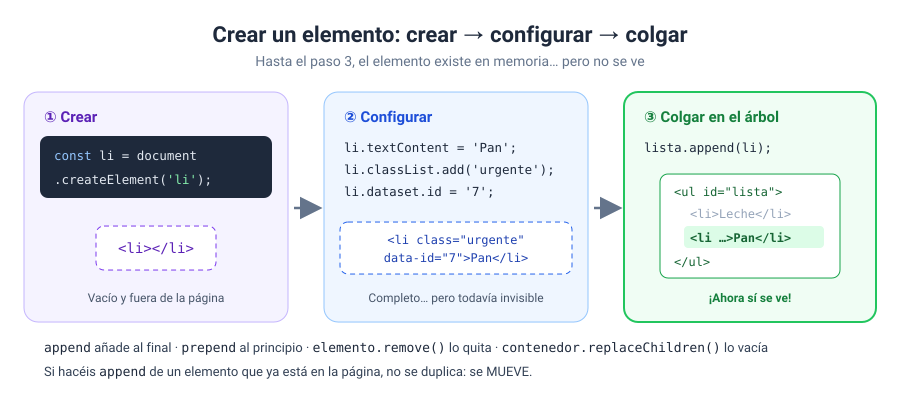
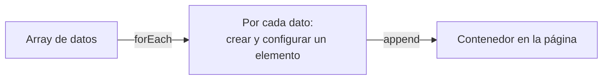

# Solución · Ejercicio 05 · La lista de la compra, ahora en HTML

[← Volver al enunciado](../../ejercicios/ejercicio_05/) · [← Volver al bloque](../../README.md)

## Qué pedía el ejercicio

Convertir un array de productos en elementos `<li>` reales, creados desde JavaScript.

## Crear → configurar → colgar



```javascript
const li = document.createElement('li');   // 1. crear
li.textContent = producto.nombre;          // 2. configurar
li.classList.add('urgente');
lista.append(li);                          // 3. colgar
```

1. `document.createElement('li')` crea un elemento nuevo del tipo indicado [1]. Existe en memoria, pero todavía **no está en la página**.
2. Lo configuráis con todo lo que visteis en los ejercicios anteriores: `textContent`, `classList`, `setAttribute`, `dataset`…
3. `append()` lo añade como **último hijo** del elemento padre [2]. En ese momento aparece en pantalla.

Si os saltáis el paso 3, no veréis nada y no habrá ningún error. Es un despiste muy habitual: si un elemento creado no aparece, comprobad lo primero que lo habéis colgado.

## `append` y `prepend`

```javascript
lista.append(li);          // al final
lista.prepend(cabecera);   // al principio
```

`prepend()` hace lo mismo que `append()`, pero coloca el elemento como **primer** hijo [3]. Por eso la cabecera queda arriba aunque la haya creado la última.

## El patrón «de datos a HTML»

Fijaos en el esquema general, porque lo vais a repetir constantemente:



Los **datos** viven en el array. El **HTML** se genera a partir de ellos. Si mañana la lista tiene 50 productos, el código es exactamente el mismo.

## ¿Y por qué no `innerHTML`?

Se podría construir un texto con todas las etiquetas y asignarlo con `innerHTML`. Pero el nombre del producto lo ha escrito el usuario, y ya sabéis lo que eso significa: riesgo de XSS. Con `createElement` + `textContent`, cualquier cosa que escriba el usuario se muestra como texto, sin peligro.

## Qué tenéis que observar

- Seis productos (cinco del array y «tomates»), con «leche» y «café» en rojo.
- La cabecera arriba: 📝 6 productos (2 urgentes).
- En la pestaña **Elementos**, el `<ul>` tiene siete `<li>` aunque en `index.html` está vacío.

### Fuentes y Documentación Oficial

1. [Document: createElement() method (MDN Web Docs)](https://developer.mozilla.org/en-US/docs/Web/API/Document/createElement)
2. [Element: append() method (MDN Web Docs)](https://developer.mozilla.org/en-US/docs/Web/API/Element/append)
3. [Element: prepend() method (MDN Web Docs)](https://developer.mozilla.org/en-US/docs/Web/API/Element/prepend)
