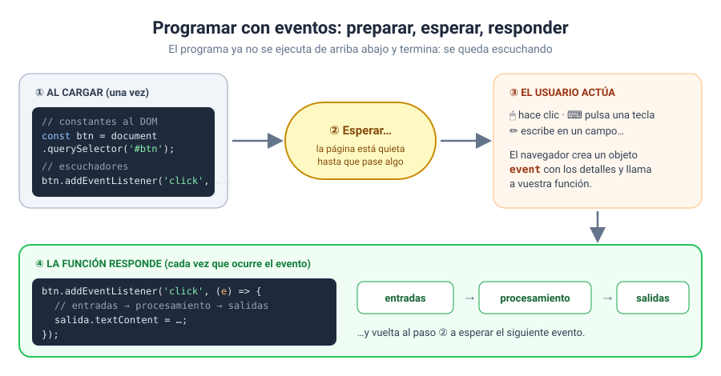
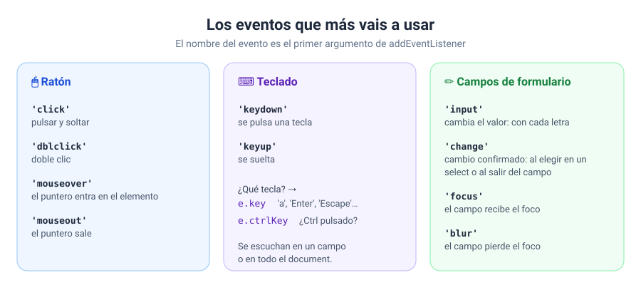
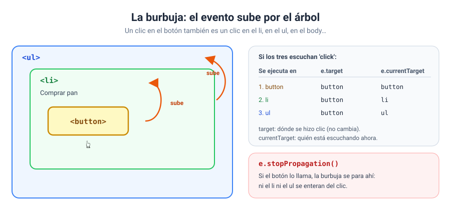
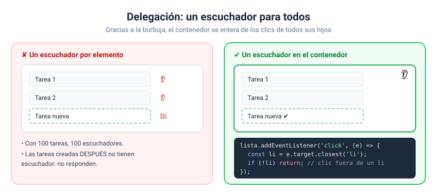
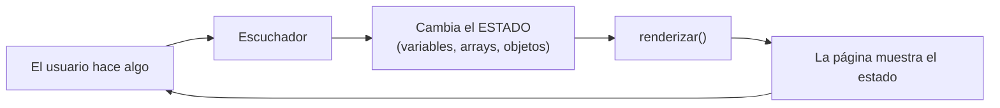

# Bloque 07 · Eventos

[← Bloque 06](../06-dom/) · [Volver al temario](../TEMARIO.md) · [Ir al bloque 08 →](../08-formularios/)

Llegamos al bloque que cambia la forma de programar. Hasta ahora, vuestros programas empezaban, hacían su trabajo de arriba abajo y terminaban. A partir de hoy, el programa **prepara la página y se queda esperando** a que el usuario haga algo: un clic, una tecla, un cambio en un campo. Cuando ocurre, responde. Y vuelve a esperar. Así funcionan todas las aplicaciones web que usáis a diario. Y, por fin, nos despedimos de `prompt()`.

Al terminar este bloque sabréis:

- Escuchar eventos con `addEventListener` y dejar de escucharlos con `removeEventListener`.
- Reaccionar al ratón, al teclado y a los campos de formulario.
- Usar el objeto evento: qué ha pasado, dónde y con qué tecla.
- Anular el comportamiento por defecto del navegador con `preventDefault`.
- Entender cómo se propaga un evento por el árbol del DOM.
- Usar la delegación de eventos para listas que cambian.
- Organizar una aplicación con el patrón **estado → renderizar**.

---

## 1. Programar con eventos

Un evento es algo que ocurre en la página y que el navegador os avisa de que ha ocurrido: un clic, una tecla pulsada, un campo que cambia… [1]. Vuestro trabajo es decir **qué función** se ejecuta cuando pase **qué cosa** en **qué elemento**.



Fijaos en los dos momentos del dibujo:

- **Al cargar** (una sola vez): se buscan los elementos y se colocan los escuchadores.
- **Cada vez que ocurre el evento**: se ejecuta la función, con su esquema de siempre: entradas → procesamiento → salidas.

---

## 2. `addEventListener`

```javascript
const btn = document.querySelector('#btnSaludar');

btn.addEventListener('click', saludar);           // con una función con nombre

btn.addEventListener('click', () => {             // con una función flecha anónima
    salida.textContent = '¡Hola!';
});
```

`addEventListener()` registra una función que se ejecutará cada vez que ocurra el evento indicado en ese elemento [2]. Recibe el nombre del evento, como texto, y la función, que es un *callback* como los del bloque 04.

> [!WARNING]
> La función se pasa **sin paréntesis**: `saludar`, no `saludar()`. Con paréntesis, se ejecuta una vez al cargar la página y lo que se registra es su resultado. El botón no hará nada y no veréis ningún error. Es el fallo número uno de este bloque.

| Función | Cuándo usarla |
| --- | --- |
| Con nombre | Si la reutilizáis en varios eventos o la queréis retirar después |
| Flecha anónima | Si es corta y solo la usa ese elemento |

Si registráis la misma función dos veces en el mismo elemento y para el mismo evento, no se duplica [2].

### 2.1. Dejar de escuchar

```javascript
btn.removeEventListener('click', saludar);
```

`removeEventListener()` retira un escuchador, y para ello necesita **el mismo evento y la misma función** que se registraron [3]. Por eso solo se pueden retirar las funciones con nombre.

---

## 3. Los eventos más habituales



| Evento | Se dispara cuando… |
| --- | --- |
| `click` | Se pulsa y se suelta el botón del ratón sobre el elemento [4] |
| `dblclick` | Se hace doble clic [5] |
| `mouseover` / `mouseout` | El puntero entra en el elemento / sale de él [6] [7] |
| `keydown` | Se pulsa una tecla [8] |
| `input` | El valor de un campo cambia por una acción del usuario: con cada letra [9] |
| `change` | El usuario confirma un cambio: al elegir en un `<select>` o al salir de un campo que ha cambiado [10] |
| `focus` / `blur` | Un elemento recibe el foco / lo pierde [11] [12] |

`input` y `change` se confunden mucho. Mi regla: **para reaccionar mientras se escribe, `input`**; para un `<select>`, una casilla o un cambio ya confirmado, `change`.

---

## 4. El objeto evento

Cuando ocurre un evento, el navegador llama a vuestra función y le pasa un objeto con los detalles. Por convenio se llama `e`:

```javascript
campo.addEventListener('keydown', (e) => {
    if (e.key === 'Enter' && e.ctrlKey) {
        publicar();
    }
});
```

| Propiedad | Contiene |
| --- | --- |
| `e.type` | El nombre del evento: `'click'`, `'keydown'`… [13] |
| `e.target` | El elemento donde **se originó** el evento [14] |
| `e.currentTarget` | El elemento cuyo escuchador **se está ejecutando** [15] |
| `e.key` | La tecla pulsada: `'a'`, `'Enter'`, `'Escape'`, `'ArrowUp'`… [16] |
| `e.ctrlKey` | `true` si Ctrl estaba pulsada [17]. También existen `shiftKey` y `altKey` |

La diferencia entre `target` y `currentTarget` la veréis en el apartado 7. De momento, quedaos con que **`currentTarget` es siempre el elemento que tiene el escuchador**.

---

## 5. Leer los campos de la página

Adiós, `prompt()`. A partir de ahora los datos se leen de los campos:

```javascript
const campo = document.querySelector('#celsius');
campo.addEventListener('input', () => {
    const texto = campo.value;          // SIEMPRE texto [18]
    if (texto.trim() === '') {
        return;                         // Number('') sería 0
    }
    const celsius = Number(texto);
    // …
});
```

`value` es siempre un texto, incluso en `<input type="number">` [18]. Las reglas que aprendisteis con `prompt()` siguen valiendo: comprobad si está vacío y convertid antes de calcular.

---

## 6. `preventDefault`: «de esto me encargo yo»

Muchos eventos tienen un comportamiento por defecto: una tecla escribe un carácter, un enlace navega, un formulario se envía y recarga la página. `e.preventDefault()` le indica al navegador que no haga esa acción [19]:

```javascript
// el carácter no llega a escribirse
telefono.addEventListener('keydown', (e) => {
    if (!esDigito(e.key)) {
        e.preventDefault();
    }
});

// el enlace no navega
enlace.addEventListener('click', (e) => {
    if (!confirm('¿Seguro que quieres salir?')) {
        e.preventDefault();
    }
});
```

Su uso más importante, evitar que un formulario recargue la página, lo veréis en el bloque 08.

---

## 7. Propagación: la burbuja

Cuando hacéis clic en un botón que está dentro de un `li` que está dentro de un `ul`, el evento ocurre en el botón… y después **sube** por todos sus antepasados. Cada uno que escuche ese evento ejecuta su función. Es la propagación en fase de burbuja [20].



Por eso existen dos propiedades distintas:

- `e.target` no cambia mientras el evento sube: es el botón donde se hizo clic [14].
- `e.currentTarget` va cambiando: el botón, luego el `li`, luego el `ul` [15].

Con `e.stopPropagation()`, el evento deja de subir [21]. Usadlo con mucha prudencia: cualquier código que escuche más arriba dejará de enterarse, y esos errores cuestan mucho de encontrar.

---

## 8. Delegación de eventos

La burbuja tiene una aplicación estupenda. En lugar de poner un escuchador en cada elemento de una lista, se pone **uno solo en el contenedor**: todos los clics de los hijos acaban llegando a él [20].



```javascript
lista.addEventListener('click', (e) => {
    const li = e.target.closest('li');     // el li que contiene el clic
    if (!li) {
        return;                            // clic en la lista, pero fuera de un li
    }
    if (e.target.closest('.borrar')) {
        // se ha pulsado el botón de borrar de ese li
    }
});
```

`closest(selector)` devuelve el propio elemento o su antepasado más cercano que encaje con el selector, o `null` si no hay ninguno [22]. Así llegáis al `li` aunque el clic haya caído en un `span` o en un botón de dentro.

Ventajas de la delegación:

- **Un escuchador** en lugar de cien.
- **Funciona con elementos creados después.** Si `renderizar()` borra y recrea los `li`, los escuchadores puestos en ellos desaparecerían. El del contenedor, no.

---

## 9. El patrón estado → renderizar

Juntad el bloque 06 con este y tendréis la forma de organizar cualquier aplicación:



```javascript
// el estado: todo lo que puede cambiar
const estado = { categoria: 'todas', busqueda: '', carrito: [] };

// los escuchadores solo cambian el estado y repintan
buscar.addEventListener('input', () => {
    estado.busqueda = buscar.value.trim();
    renderizar();
});
```

Los escuchadores **nunca tocan las tarjetas directamente**: cambian los datos y llaman a `renderizar()`, que pinta la página a partir del estado. Así la página y los datos nunca dicen cosas distintas. El ejercicio 08 es una tienda entera construida así.

---

## 10. La plantilla de trabajo, completa

Por fin la plantilla del curso aparece entera. Es la que vais a usar a partir de ahora en todos los ejercicios:

```javascript
// estructura del programa principal
const IVA = 0.21;
let total = 0;                       // estado

// funciones
function pintar() {
    salida.textContent = `Total: ${total.toFixed(2)} €`;
}

// constantes al DOM que queremos escuchar
const inputPrecio = document.querySelector('#inputPrecio');
const btnAnadir = document.querySelector('#btnAnadir');
const salida = document.querySelector('#salida');

// colocar escuchadores de eventos
btnAnadir.addEventListener('click', () => {
    // entradas
    const precio = Number(inputPrecio.value);

    // procesamiento
    total += precio + precio * IVA;

    // salidas
    pintar();
});
```

Lo que está fuera de los escuchadores se ejecuta **una vez**, al cargar. Lo que está dentro, **cada vez que ocurre el evento**. Tenedlo siempre presente cuando decidáis dónde declarar una variable: si tiene que recordar algo entre un clic y el siguiente, va fuera.

---

## 11. Ejercicios

| Nº | Ejercicio | Qué practicáis | Solución |
| --- | --- | --- | --- |
| 01 | [Contador de clics](ejercicios/ejercicio_01/) | `addEventListener`, funciones con nombre y anónimas, estado, `removeEventListener` | [Ver](soluciones/ejercicio_01/) |
| 02 | [Conversor en tiempo real](ejercicios/ejercicio_02/) | `input`, `change`, `value`, una función para dos eventos | [Ver](soluciones/ejercicio_02/) |
| 03 | [Mini-tuit con atajos de teclado](ejercicios/ejercicio_03/) | `keydown`, `e.key`, `e.ctrlKey`, contador de caracteres | [Ver](soluciones/ejercicio_03/) |
| 04 | [Galería con eventos de ratón](ejercicios/ejercicio_04/) | `click`, `dblclick`, `mouseover`, `mouseout`, `e.type`, `e.currentTarget` | [Ver](soluciones/ejercicio_04/) |
| 05 | [Campos que ayudan](ejercicios/ejercicio_05/) | `focus`, `blur`, `preventDefault` en teclas y enlaces | [Ver](soluciones/ejercicio_05/) |
| 06 | [¿Quién se entera del clic?](ejercicios/ejercicio_06/) | Burbuja, `target` frente a `currentTarget`, `stopPropagation` | [Ver](soluciones/ejercicio_06/) |
| 07 | [Lista de tareas con delegación](ejercicios/ejercicio_07/) | Delegación, `closest`, estado → renderizar | [Ver](soluciones/ejercicio_07/) |
| 08 | [Catálogo interactivo](ejercicios/ejercicio_08/) | Aplicación completa: filtros, búsqueda, orden y carrito sobre un estado | [Ver](soluciones/ejercicio_08/) |

Los ejercicios 07 y 08 son los más importantes del curso hasta ahora. Si los entendéis bien, el resto de bloques serán añadir piezas a una estructura que ya domináis.

---

[← Bloque 06](../06-dom/) · [Volver al temario](../TEMARIO.md) · [Ir al bloque 08 →](../08-formularios/)

### Fuentes y Documentación Oficial

1. [Introduction to events (MDN Web Docs)](https://developer.mozilla.org/en-US/docs/Learn_web_development/Core/Scripting/Events)
2. [EventTarget: addEventListener() method (MDN Web Docs)](https://developer.mozilla.org/en-US/docs/Web/API/EventTarget/addEventListener)
3. [EventTarget: removeEventListener() method (MDN Web Docs)](https://developer.mozilla.org/en-US/docs/Web/API/EventTarget/removeEventListener)
4. [Element: click event (MDN Web Docs)](https://developer.mozilla.org/en-US/docs/Web/API/Element/click_event)
5. [Element: dblclick event (MDN Web Docs)](https://developer.mozilla.org/en-US/docs/Web/API/Element/dblclick_event)
6. [Element: mouseover event (MDN Web Docs)](https://developer.mozilla.org/en-US/docs/Web/API/Element/mouseover_event)
7. [Element: mouseout event (MDN Web Docs)](https://developer.mozilla.org/en-US/docs/Web/API/Element/mouseout_event)
8. [Element: keydown event (MDN Web Docs)](https://developer.mozilla.org/en-US/docs/Web/API/Element/keydown_event)
9. [Element: input event (MDN Web Docs)](https://developer.mozilla.org/en-US/docs/Web/API/Element/input_event)
10. [HTMLElement: change event (MDN Web Docs)](https://developer.mozilla.org/en-US/docs/Web/API/HTMLElement/change_event)
11. [Element: focus event (MDN Web Docs)](https://developer.mozilla.org/en-US/docs/Web/API/Element/focus_event)
12. [Element: blur event (MDN Web Docs)](https://developer.mozilla.org/en-US/docs/Web/API/Element/blur_event)
13. [Event: type property (MDN Web Docs)](https://developer.mozilla.org/en-US/docs/Web/API/Event/type)
14. [Event: target property (MDN Web Docs)](https://developer.mozilla.org/en-US/docs/Web/API/Event/target)
15. [Event: currentTarget property (MDN Web Docs)](https://developer.mozilla.org/en-US/docs/Web/API/Event/currentTarget)
16. [KeyboardEvent: key property (MDN Web Docs)](https://developer.mozilla.org/en-US/docs/Web/API/KeyboardEvent/key)
17. [KeyboardEvent: ctrlKey property (MDN Web Docs)](https://developer.mozilla.org/en-US/docs/Web/API/KeyboardEvent/ctrlKey)
18. [HTMLInputElement: value property (MDN Web Docs)](https://developer.mozilla.org/en-US/docs/Web/API/HTMLInputElement/value)
19. [Event: preventDefault() method (MDN Web Docs)](https://developer.mozilla.org/en-US/docs/Web/API/Event/preventDefault)
20. [Event bubbling (MDN Web Docs)](https://developer.mozilla.org/en-US/docs/Learn_web_development/Core/Scripting/Event_bubbling)
21. [Event: stopPropagation() method (MDN Web Docs)](https://developer.mozilla.org/en-US/docs/Web/API/Event/stopPropagation)
22. [Element: closest() method (MDN Web Docs)](https://developer.mozilla.org/en-US/docs/Web/API/Element/closest)
