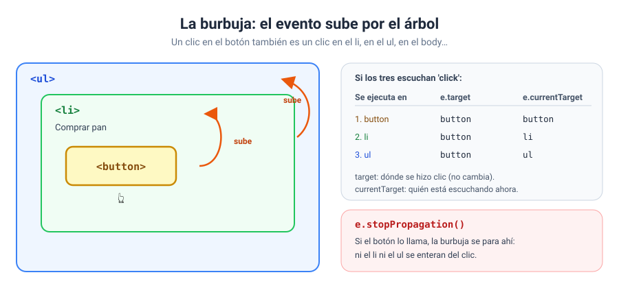

# Solución · Ejercicio 06 · Propagación: ¿quién se entera del clic?

[← Volver al enunciado](../../ejercicios/ejercicio_06/) · [← Volver al bloque](../../README.md)

## Qué pedía el ejercicio

Observar por dónde viaja un evento cuando hay varios elementos anidados escuchándolo, y detenerlo.

## Lo que veis en el registro

**Clic en el botón**, con la casilla desmarcada:

```
escucha: hijo · target: hijo
escucha: padre · target: hijo
escucha: abuelo · target: hijo
```

**Clic en la zona verde**, fuera del botón:

```
escucha: padre · target: padre
escucha: abuelo · target: padre
```

**Clic en el botón**, con la casilla marcada:

```
escucha: hijo · target: hijo
✋ stopPropagation(): la burbuja se para aquí
```

## La burbuja

Cuando hacéis clic en el botón, el evento ocurre en el botón… y después **sube** por todos sus antepasados: el padre, el abuelo, el `body`… Cada uno que tenga un escuchador de ese evento lo ejecuta. A esto se le llama propagación en fase de burbuja (*event bubbling*) [1].



Tiene lógica: si hacéis clic en el botón, también estáis haciendo clic dentro del padre y dentro del abuelo.

## `target` frente a `currentTarget`

| Propiedad | Es… | ¿Cambia mientras sube? |
| --- | --- | --- |
| `e.target` | El elemento donde **se originó** el evento [2] | No |
| `e.currentTarget` | El elemento cuyo escuchador **se está ejecutando ahora** [3] | Sí |

En el primer caso, `target` es siempre `hijo` y `currentTarget` va pasando por `hijo`, `padre` y `abuelo`. Esta diferencia es la base de la delegación de eventos, que veréis en el ejercicio 07.

## `stopPropagation`

```javascript
if (parar.checked) {
    e.stopPropagation();
}
```

`stopPropagation()` impide que el evento siga propagándose [4]. Los escuchadores del propio botón se ejecutan todos, pero el padre y el abuelo ya no se enteran.

`parar.checked` es `true` si la casilla está marcada [5].

> [!WARNING]
> No uséis `stopPropagation` sin un buen motivo. Si cortáis la burbuja, cualquier otro código que esté escuchando más arriba dejará de funcionar sin que nadie entienda por qué. Es una herramienta para casos concretos, no un hábito.

### Fuentes y Documentación Oficial

1. [Event bubbling (MDN Web Docs)](https://developer.mozilla.org/en-US/docs/Learn_web_development/Core/Scripting/Event_bubbling)
2. [Event: target property (MDN Web Docs)](https://developer.mozilla.org/en-US/docs/Web/API/Event/target)
3. [Event: currentTarget property (MDN Web Docs)](https://developer.mozilla.org/en-US/docs/Web/API/Event/currentTarget)
4. [Event: stopPropagation() method (MDN Web Docs)](https://developer.mozilla.org/en-US/docs/Web/API/Event/stopPropagation)
5. [HTMLInputElement: checked property (MDN Web Docs)](https://developer.mozilla.org/en-US/docs/Web/API/HTMLInputElement/checked)
