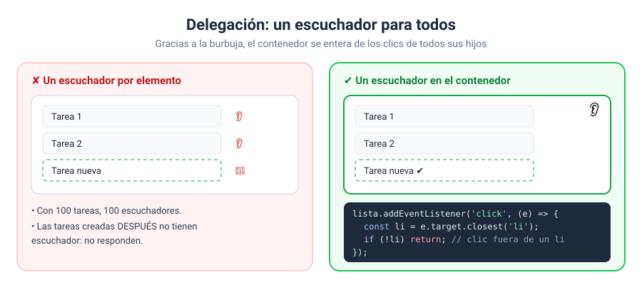
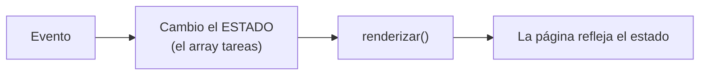

# Solución · Ejercicio 07 · Lista de tareas con delegación

[← Volver al enunciado](../../ejercicios/ejercicio_07/) · [← Volver al bloque](../../README.md)

## Qué pedía el ejercicio

Una lista de tareas completa en la que se puede añadir, marcar y borrar, con un único escuchador para todas las tareas.

## El problema

Con lo del ejercicio 04 pondríais un escuchador en cada tarea. Pero las tareas **se crean y se destruyen** constantemente: cada `renderizar()` borra todos los `li` y los crea de nuevo. Tendríais que volver a poner los escuchadores después de cada repintado. Un lío.

## La solución: delegación

```javascript
lista.addEventListener('click', (e) => { … });
```

Un solo escuchador, en el **contenedor**. Gracias a la burbuja del ejercicio 06, cualquier clic en cualquier tarea acaba llegando a la lista. Y como el escuchador está en la lista, que nunca se borra, funciona con las tareas que existen y con las que se creen después [1].



## ¿En qué tarea se ha hecho clic? `closest`

```javascript
const li = e.target.closest('li');
```

`e.target` puede ser el `span` del texto, el botón ✕ o el propio `li`, según dónde caiga el clic exactamente. `closest('li')` sube desde ese elemento y devuelve **el primer antepasado que encaja con el selector, o el propio elemento** si encaja; si no encuentra ninguno, `null` [2]. Así siempre llego al `li`, haya pinchado donde haya pinchado.

```javascript
if (e.target.closest('.borrar')) { … }
```

El mismo truco para saber si el clic ha caído en el botón de borrar, o dentro de él.

## Los datos mandan

Fijaos en que **nunca toco el HTML directamente** para marcar o borrar. Siempre hago lo mismo:



1. El evento **cambia el array** (añade, borra o cambia `hecha`).
2. `renderizar()` **repinta** todo a partir del array.

¿Por qué no hacer `li.remove()` directamente? Porque entonces el array y la página dirían cosas distintas, y el resumen de pendientes sería incorrecto. Con este patrón, la página siempre es un reflejo fiel de los datos. Y cuando en el bloque 09 guardéis las tareas en el navegador, guardaréis el array, no el HTML.

## El `data-id` conecta las dos cosas

```javascript
li.dataset.id = tarea.id;              // al crear
const id = Number(li.dataset.id);      // al hacer clic
```

Cada `li` lleva el `id` de su tarea. Al hacer clic, lo leo y busco la tarea en el array. Es el puente entre la página y los datos que os anuncié en el bloque 06.

### Fuentes y Documentación Oficial

1. [Event bubbling (MDN Web Docs)](https://developer.mozilla.org/en-US/docs/Learn_web_development/Core/Scripting/Event_bubbling)
2. [Element: closest() method (MDN Web Docs)](https://developer.mozilla.org/en-US/docs/Web/API/Element/closest)
