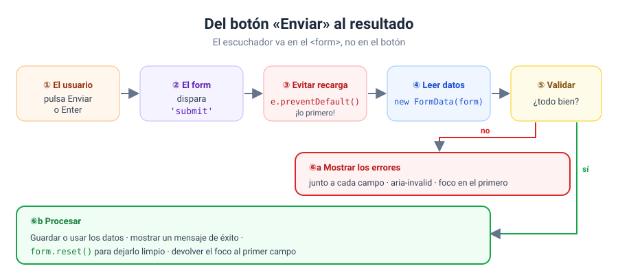
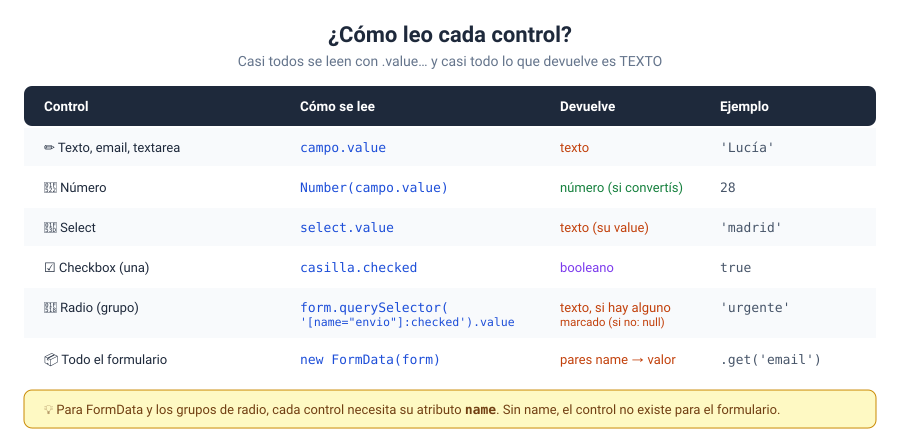
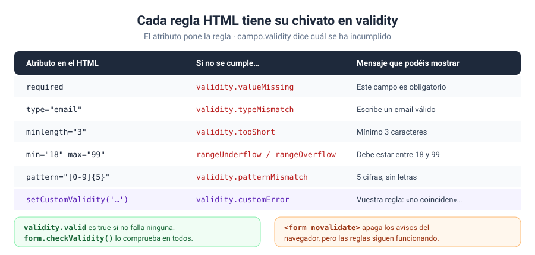
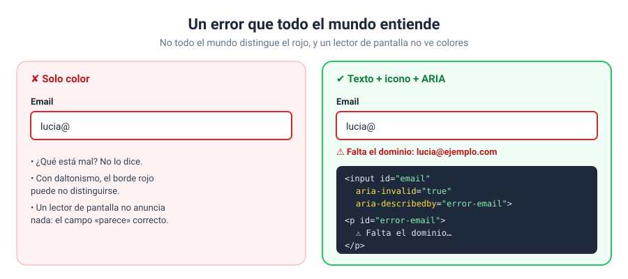

# Bloque 08 · Formularios

[← Bloque 07](../07-eventos/) · [Volver al temario](../TEMARIO.md) · [Ir al bloque 09 →](../09-almacenamiento/)

Casi todo lo que el usuario os cuenta en una página web pasa por un formulario: un registro, un pedido, un mensaje de contacto, un buscador. En este bloque os voy a enseñar a **recoger esos datos y a comprobarlos antes de darlos por buenos**, y a hacerlo de forma que cualquier persona entienda qué ha fallado y cómo arreglarlo. Un formulario que rechaza datos sin explicar por qué es un formulario que la gente abandona.

Al terminar este bloque sabréis:

- Escuchar el envío de un formulario y evitar que recargue la página.
- Leer cualquier control: texto, número, select, casillas, radios y textarea.
- Recoger el formulario entero de una vez con `FormData`.
- Validar con atributos HTML y personalizar los mensajes con la API de validación.
- Programar reglas propias con `setCustomValidity`.
- Mostrar los errores de forma clara y accesible.
- Crear formularios que se adaptan a lo que elige el usuario.

---

## 1. Un formulario bien construido

Antes del JavaScript, el HTML. Un buen formulario se apoya en cuatro piezas:

```html
<form id="registro">
    <label for="email">Email</label>
    <input type="email" id="email" name="email" required>

    <button type="submit">Registrarme</button>
</form>
```

| Pieza | Para qué |
| --- | --- |
| `<form>` | Agrupa los campos y dispara el evento `submit` |
| `<label for="…">` | Nombra el campo; al pulsarla, el foco va al campo. Un lector de pantalla la lee |
| `name` | Identifica el dato. Sin `name`, el campo no existe para `FormData` |
| `<button type="submit">` | Envía el formulario, igual que pulsar Enter en un campo |

---

## 2. El envío: `submit` y `preventDefault`



```javascript
formulario.addEventListener('submit', (e) => {
    e.preventDefault();   // ¡lo primero!
    // leer, validar, procesar…
});
```

Dos reglas que os ahorrarán muchos disgustos:

1. **Escuchad el `submit` del formulario, no el `click` del botón.** El evento `submit` se dispara en el propio `<form>` [1], tanto si se pulsa el botón como si se pulsa Enter en un campo.
2. **`e.preventDefault()`, lo primero.** El comportamiento por defecto de un formulario es enviar los datos y recargar la página [2]. Sin esta línea, vuestro resultado aparecería un instante y se esfumaría.

---

## 3. Leer los datos

### 3.1. Control a control



```javascript
campoNombre.value                                        // texto
Number(campoCantidad.value)                              // número (convertido)
selectTamano.value                                       // value de la opción elegida
casillaQueso.checked                                     // true / false
formulario.querySelector('[name="entrega"]:checked').value   // radio marcado
```

`value` da el contenido de un campo [3]; `checked` dice si una casilla está marcada [4], y el selector `:checked` encuentra el botón de opción elegido en un grupo [5]. Recordad la regla de siempre: `value` es **texto**, incluso en un `<input type="number">`.

### 3.2. Todo el formulario: `FormData`

```javascript
const datos = new FormData(formulario);

datos.get('nombre');          // el valor de un campo, o null
datos.get('modalidad');       // el radio marcado, sin querySelector
datos.getAll('intereses');    // array con TODAS las casillas marcadas con ese name

const objeto = Object.fromEntries(datos);   // un objeto normal
```

`FormData` recoge todos los campos como pares **name → valor** [6]. `get` devuelve el valor de un campo, o `null` si no existe [7]; `getAll`, un array con todos los valores de los campos que comparten `name` [8]; y `Object.fromEntries` convierte los pares en un objeto normal [9]. Es la forma más cómoda de leer un formulario completo. Un aviso con `Object.fromEntries`: si varios campos comparten `name`, como un grupo de casillas, en el objeto solo queda uno. Para esos, usad `getAll`.

---

## 4. Validación nativa: atributos HTML

El navegador sabe validar sin que escribáis JavaScript:

| Atributo | Regla |
| --- | --- |
| `required` | Obligatorio; en una casilla, tiene que estar marcada [10] |
| `minlength` / `maxlength` | Mínimo / máximo de caracteres [11] |
| `type="email"` | Formato de email [12] |
| `min` / `max` | Valor mínimo / máximo de un número [13] |
| `pattern` | Debe encajar con una expresión regular, como `[0-9]{5}` [14] |

Si algún campo no cumple su regla, **el navegador no envía el formulario**: muestra un aviso junto al campo y el evento `submit` ni se dispara [15]. Para colorear los campos, la pseudoclase `:user-invalid` selecciona los inválidos, pero solo después de que el usuario haya interactuado con ellos [16]:

```css
input:user-invalid {
    border-color: #dc2626;
}
```

> [!IMPORTANT]
> Validar en el navegador es una **comodidad** para el usuario, no una medida de seguridad: cualquiera puede saltársela. Si los datos llegan a un servidor, el servidor debe volver a validarlos siempre [15].

---

## 5. La API de validación

La validación nativa tiene dos límites: los mensajes los escribe el navegador, y no admite reglas propias. La API de validación resuelve los dos sin renunciar a los atributos.

### 5.1. `novalidate`: las reglas siguen, los avisos no

```html
<form id="registro" novalidate>
```

Con `novalidate`, el formulario no se valida al enviarse [17]: el `submit` se dispara siempre y los avisos automáticos desaparecen. Pero **las reglas siguen ahí**, y cada campo sigue sabiendo si las cumple.

### 5.2. `validity`: qué regla falla



Cada campo tiene una propiedad `validity`, un objeto `ValidityState` con un booleano por cada tipo de problema: `valueMissing`, `typeMismatch`, `tooShort`, `rangeUnderflow`, `patternMismatch`, `customError`… y `valid`, que es `true` si no falla ninguno [18].

```javascript
function mensajeError(campo) {
    if (campo.validity.valueMissing) return 'Este campo es obligatorio.';
    if (campo.validity.typeMismatch) return 'Escribe un email válido.';
    if (campo.validity.tooShort) return `Mínimo ${campo.minLength} caracteres.`;
    return '';
}
```

### 5.3. Comprobar el formulario entero

| Método | Qué hace |
| --- | --- |
| `formulario.checkValidity()` | Devuelve `true` si ningún control tiene problemas [19] |
| `formulario.reportValidity()` | Lo mismo y, además, muestra los avisos del navegador [20] |

### 5.4. Reglas propias: `setCustomValidity`

```javascript
const coinciden = repetir.value === clave.value;
repetir.setCustomValidity(coinciden ? '' : 'Las contraseñas no coinciden.');
```

`setCustomValidity(mensaje)` marca el campo como inválido con vuestro mensaje [21]. Desde ese momento se comporta como si incumpliera cualquier otra regla: `validity.customError` es `true` y `checkValidity()` devuelve `false`.

> [!WARNING]
> Para que vuelva a ser válido, hay que llamar a `setCustomValidity('')`, con un texto vacío. Si se os olvida, el campo queda marcado como inválido para siempre. Es lo que hacen todos los ejemplos de la guía de MDN [22].

---

## 6. Errores que todo el mundo entiende



Un error accesible tiene cuatro ingredientes:

1. **Un texto que explica qué falla y cómo arreglarlo.** Un borde rojo no basta: no todo el mundo distingue los colores.
2. **`aria-invalid="true"`** en el campo, que anuncia a la tecnología de apoyo que su valor no es válido [23]. Ponedlo solo después de validar, nunca al cargar la página.
3. **`aria-describedby`**, que enlaza el campo con el párrafo del error [24]. El lector de pantalla lo leerá al llegar al campo.
4. **El foco donde está el problema.** Tras un envío fallido, llevad el foco al primer error o a un resumen de errores con `focus()` [25].

```html
<input type="email" id="email" aria-describedby="error-email">
<p id="error-email" class="error-campo"></p>
```

```javascript
parrafoError.textContent = `⚠ ${mensaje}`;
campo.setAttribute('aria-invalid', 'true');
```

Para los mensajes que aparecen en otra parte de la página, como el de «enviado correctamente», usad una región viva con `aria-live="polite"`: así un lector de pantalla también anuncia el cambio [26].

### 6.1. ¿Cuándo validar?

| Momento | Qué hacer |
| --- | --- |
| Mientras se escribe por primera vez (`input`) | Nada: ver un error desde la primera letra es muy molesto |
| Al salir del campo (`blur`) | Validar ese campo |
| Mientras se corrige un campo que ya tenía error (`input`) | Volver a validarlo, para que el aviso desaparezca en cuanto esté bien |
| Al enviar (`submit`) | Validar todos y llevar el foco al primer error |

---

## 7. Formularios que se adaptan

Algunos campos solo tienen sentido según lo que se haya elegido: los datos de factura, la provincia si el país es España… El patrón es el mismo que el `renderizar()` del bloque 07:

```javascript
function actualizar() {
    const conFactura = quieroFactura.checked;
    datosFactura.hidden = !conFactura;   // mostrar u ocultar
    nif.required = conFactura;           // obligatorio SOLO si se ve
}

formulario.addEventListener('input', actualizar);    // los eventos de los campos
formulario.addEventListener('change', actualizar);   // suben hasta el formulario
```

Dos reglas:

- **Un campo oculto nunca debe ser obligatorio.** Si no, el formulario bloquea el envío por un campo que el usuario ni ve.
- **`formulario.reset()` solo reinicia los valores** [27]. Lo que hayáis cambiado con JavaScript, como un grupo que se ha mostrado, no vuelve solo: llamad a `actualizar()` justo después.

---

<!-- ampliación -->
## 8. Grupos de casillas: «marcar todas» y el estado indeterminado

Cuando un formulario tiene una lista de casillas (intereses, permisos, productos), es muy habitual poner encima una casilla **maestra** que marca o desmarca todas. Tiene tres estados posibles:

| Las casillas del grupo | La maestra |
| --- | --- |
| Todas marcadas | `checked = true` |
| Ninguna marcada | `checked = false` |
| Unas sí y otras no | `indeterminate = true` (se dibuja con una raya) |

El estado **indeterminado** solo se puede poner desde JavaScript, con la propiedad `indeterminate` [28]: no existe un atributo HTML para él [29]. Es solo visual: no cambia el valor `checked` de la casilla.

```javascript
const marcadas = casillas.filter((c) => c.checked).length;
maestra.checked = marcadas === casillas.length;
maestra.indeterminate = marcadas > 0 && marcadas < casillas.length;
```

---

## 9. Corregir un cuestionario

Un cuestionario de opción múltiple es un formulario con un grupo de botones de opción por pregunta: todos los de una pregunta comparten el mismo `name`, y así solo se puede marcar uno [5]. Para corregirlo, `FormData` os da la respuesta elegida en cada pregunta con `get(name)`, o `null` si se ha dejado en blanco [7]:

```javascript
const datos = new FormData(formulario);
PREGUNTAS.forEach((pregunta) => {
    const elegida = datos.get(pregunta.name);      // 'b', o null si no contestó
    const acierto = elegida === pregunta.correcta;
});
```

Guardad las respuestas correctas en el JavaScript, no en el HTML, y dad la corrección **pregunta por pregunta**, junto a cada una: «correcta», o «la respuesta era…». Para volver a empezar, `formulario.reset()` deja todos los campos como estaban al cargar la página [27].

---

## 10. La plantilla de trabajo con un formulario

```javascript
// estructura del programa principal
const inscritos = [];

// funciones
function mensajeError(campo) { … }
function validarCampo(campo) { … }
function renderizar() { … }

// constantes al DOM que queremos escuchar
const formulario = document.querySelector('#inscripcion');
const campos = formulario.querySelectorAll('input');

// colocar escuchadores de eventos
campos.forEach((campo) => {
    campo.addEventListener('blur', () => validarCampo(campo));
});

formulario.addEventListener('submit', (e) => {
    e.preventDefault();

    // entradas
    const datos = new FormData(formulario);

    // procesamiento: validar y, si todo va bien, cambiar el estado
    campos.forEach(validarCampo);
    if (!formulario.checkValidity()) {
        formulario.querySelector('[aria-invalid="true"]').focus();
        return;
    }
    inscritos.push(Object.fromEntries(datos));

    // salidas
    renderizar();
    formulario.reset();
});
```

---

## 11. Ejercicios

| Nº | Ejercicio | Qué practicáis | Solución |
| --- | --- | --- | --- |
| 01 | [Pedido en la pizzería](ejercicios/ejercicio_01/) | `submit`, `preventDefault`, leer los seis tipos de control | [Ver](soluciones/ejercicio_01/) |
| 02 | [FormData](ejercicios/ejercicio_02/) | `get`, `getAll`, `Object.fromEntries` | [Ver](soluciones/ejercicio_02/) |
| 03 | [Validación nativa del navegador](ejercicios/ejercicio_03/) | `required`, `minlength`, `type="email"`, `min`/`max`, `pattern`, `:user-invalid` | [Ver](soluciones/ejercicio_03/) |
| 04 | [Mensajes de error propios](ejercicios/ejercicio_04/) | `novalidate`, `validity`, `checkValidity`, `aria-invalid` | [Ver](soluciones/ejercicio_04/) |
| 05 | [Contraseñas con reglas propias](ejercicios/ejercicio_05/) | `setCustomValidity`, requisitos en vivo, `reportValidity` | [Ver](soluciones/ejercicio_05/) |
| 06 | [Formulario de contacto accesible](ejercicios/ejercicio_06/) | `aria-describedby`, resumen de errores, `aria-live`, cuándo validar | [Ver](soluciones/ejercicio_06/) |
| 07 | [Pedido con factura](ejercicios/ejercicio_07/) | Campos que aparecen, `hidden` + `required`, total en vivo, `reset` | [Ver](soluciones/ejercicio_07/) |
| 08 | [Inscripciones a un taller](ejercicios/ejercicio_08/) | Aplicación completa: regla de email repetido, tabla, plazas y borrado | [Ver](soluciones/ejercicio_08/) |
| 09 | [Marcar todas las casillas](ejercicios/ejercicio_09/) | Casilla maestra, `indeterminate`, contador en vivo | [Ver](soluciones/ejercicio_09/) |
| 10 | [Cuestionario con nota](ejercicios/ejercicio_10/) | Grupos de opciones, `FormData.get`, corrección por pregunta, `reset` | [Ver](soluciones/ejercicio_10/) |

Un consejo para el 06: hacedlo una vez con el ratón y otra **solo con el teclado** (Tab, Enter y las flechas). Es la mejor forma de comprobar si vuestro formulario es de verdad accesible.

---

[← Bloque 07](../07-eventos/) · [Volver al temario](../TEMARIO.md) · [Ir al bloque 09 →](../09-almacenamiento/)

### Fuentes y Documentación Oficial

1. [HTMLFormElement: submit event (MDN Web Docs)](https://developer.mozilla.org/en-US/docs/Web/API/HTMLFormElement/submit_event)
2. [Event: preventDefault() method (MDN Web Docs)](https://developer.mozilla.org/en-US/docs/Web/API/Event/preventDefault)
3. [HTMLInputElement: value property (MDN Web Docs)](https://developer.mozilla.org/en-US/docs/Web/API/HTMLInputElement/value)
4. [HTMLInputElement: checked property (MDN Web Docs)](https://developer.mozilla.org/en-US/docs/Web/API/HTMLInputElement/checked)
5. [`<input type="radio">` HTML attribute value (MDN Web Docs)](https://developer.mozilla.org/en-US/docs/Web/HTML/Reference/Elements/input/radio)
6. [FormData (MDN Web Docs)](https://developer.mozilla.org/en-US/docs/Web/API/FormData)
7. [FormData: get() method (MDN Web Docs)](https://developer.mozilla.org/en-US/docs/Web/API/FormData/get)
8. [FormData: getAll() method (MDN Web Docs)](https://developer.mozilla.org/en-US/docs/Web/API/FormData/getAll)
9. [Object.fromEntries() (MDN Web Docs)](https://developer.mozilla.org/en-US/docs/Web/JavaScript/Reference/Global_Objects/Object/fromEntries)
10. [`required` HTML attribute (MDN Web Docs)](https://developer.mozilla.org/en-US/docs/Web/HTML/Reference/Attributes/required)
11. [`minlength` HTML attribute (MDN Web Docs)](https://developer.mozilla.org/en-US/docs/Web/HTML/Reference/Attributes/minlength)
12. [`<input type="email">` HTML attribute value (MDN Web Docs)](https://developer.mozilla.org/en-US/docs/Web/HTML/Reference/Elements/input/email)
13. [`min` HTML attribute (MDN Web Docs)](https://developer.mozilla.org/en-US/docs/Web/HTML/Reference/Attributes/min)
14. [`pattern` HTML attribute (MDN Web Docs)](https://developer.mozilla.org/en-US/docs/Web/HTML/Reference/Attributes/pattern)
15. [Client-side form validation (MDN Web Docs)](https://developer.mozilla.org/en-US/docs/Learn_web_development/Extensions/Forms/Form_validation)
16. [`:user-invalid` CSS pseudo-class (MDN Web Docs)](https://developer.mozilla.org/en-US/docs/Web/CSS/Reference/Selectors/:user-invalid)
17. [`<form>` HTML form element (MDN Web Docs)](https://developer.mozilla.org/en-US/docs/Web/HTML/Reference/Elements/form)
18. [ValidityState (MDN Web Docs)](https://developer.mozilla.org/en-US/docs/Web/API/ValidityState)
19. [HTMLFormElement: checkValidity() method (MDN Web Docs)](https://developer.mozilla.org/en-US/docs/Web/API/HTMLFormElement/checkValidity)
20. [HTMLFormElement: reportValidity() method (MDN Web Docs)](https://developer.mozilla.org/en-US/docs/Web/API/HTMLFormElement/reportValidity)
21. [HTMLInputElement: setCustomValidity() method (MDN Web Docs)](https://developer.mozilla.org/en-US/docs/Web/API/HTMLInputElement/setCustomValidity)
22. [Using HTML form validation and the Constraint Validation API (MDN Web Docs)](https://developer.mozilla.org/en-US/docs/Web/HTML/Guides/Constraint_validation)
23. [ARIA: aria-invalid attribute (MDN Web Docs)](https://developer.mozilla.org/en-US/docs/Web/Accessibility/ARIA/Reference/Attributes/aria-invalid)
24. [ARIA: aria-describedby attribute (MDN Web Docs)](https://developer.mozilla.org/en-US/docs/Web/Accessibility/ARIA/Reference/Attributes/aria-describedby)
25. [HTMLElement: focus() method (MDN Web Docs)](https://developer.mozilla.org/en-US/docs/Web/API/HTMLElement/focus)
26. [ARIA: aria-live attribute (MDN Web Docs)](https://developer.mozilla.org/en-US/docs/Web/Accessibility/ARIA/Reference/Attributes/aria-live)
27. [HTMLFormElement: reset() method (MDN Web Docs)](https://developer.mozilla.org/en-US/docs/Web/API/HTMLFormElement/reset)
28. [HTMLInputElement: indeterminate property (MDN Web Docs)](https://developer.mozilla.org/en-US/docs/Web/API/HTMLInputElement/indeterminate)
29. [<input type="checkbox"> (MDN Web Docs)](https://developer.mozilla.org/en-US/docs/Web/HTML/Reference/Elements/input/checkbox)
