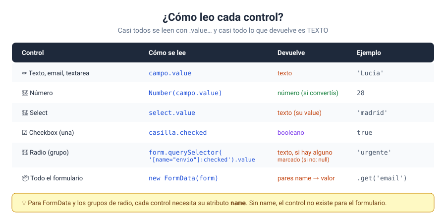

# Solución · Ejercicio 01 · Pedido en la pizzería: leer cada control

[← Volver al enunciado](../../ejercicios/ejercicio_01/) · [← Volver al bloque](../../README.md)

## Qué pedía el ejercicio

Recoger un pedido con seis tipos de control distintos y calcular el total al enviar el formulario.

## El evento `submit`

```javascript
formulario.addEventListener('submit', (e) => {
    e.preventDefault();
    …
});
```

Dos ideas clave:

1. **El escuchador va en el `<form>`, no en el botón.** El evento `submit` se dispara en el propio formulario [1], tanto si el usuario pulsa el botón como si pulsa Enter dentro de un campo. Si escucharais el `click` del botón, el Enter se os escaparía.
2. **`e.preventDefault()`, lo primero.** El comportamiento por defecto de un formulario es enviar los datos y **recargar la página** [2]. Sin esta línea, veríais el resultado un instante y desaparecería. Ponedla siempre la primera, antes de cualquier código que pueda fallar.

Fijaos también en que el botón es `type="submit"`: es el que envía el formulario.

## Cómo se lee cada control



| Control | Código | Devuelve |
| --- | --- | --- |
| Texto y textarea | `campo.value` | Texto [3] |
| Número | `Number(campo.value)` | Texto, que convertís [3] |
| Select | `select.value` | El `value` de la opción elegida |
| Checkbox | `casilla.checked` | `true` o `false` [4] |
| Radio | `querySelector('[name="entrega"]:checked').value` | El `value` del marcado |

### El caso del radio

Los botones de radio de un mismo grupo comparten el atributo `name`, y solo uno puede estar marcado [5]. Para saber cuál, busco el que tiene ese `name` y está marcado (`:checked`). Si ninguno estuviera marcado, `querySelector` devolvería `null` y `.value` daría error. Aquí no pasa porque en el HTML uno empieza marcado con `checked`. Es una buena costumbre.

### `typeof campoCantidad.value`

La última línea del ticket lo confirma: `"string"`. Aunque el campo sea `type="number"`, su `value` es texto. Por eso convierto con `Number()` antes de multiplicar.

## Un detalle: precios en un objeto

```javascript
const PRECIOS = { mediana: 9, familiar: 14 };
PRECIOS[tamano]
```

El `value` de cada opción del `select` coincide con una clave del objeto. Así, `PRECIOS[tamano]` me da el precio directamente, sin `if` ni `switch`. Corchetes con variable, como en el bloque 05.

## Con los valores iniciales

2 pizzas familiares, sin queso y para recoger: **28.00 €**. Con extra de queso y a domicilio: (14 + 1.5) × 2 + 3 = **34.00 €**.

### Fuentes y Documentación Oficial

1. [HTMLFormElement: submit event (MDN Web Docs)](https://developer.mozilla.org/en-US/docs/Web/API/HTMLFormElement/submit_event)
2. [Event: preventDefault() method (MDN Web Docs)](https://developer.mozilla.org/en-US/docs/Web/API/Event/preventDefault)
3. [HTMLInputElement: value property (MDN Web Docs)](https://developer.mozilla.org/en-US/docs/Web/API/HTMLInputElement/value)
4. [HTMLInputElement: checked property (MDN Web Docs)](https://developer.mozilla.org/en-US/docs/Web/API/HTMLInputElement/checked)
5. [`<input type="radio">` HTML attribute value (MDN Web Docs)](https://developer.mozilla.org/en-US/docs/Web/HTML/Reference/Elements/input/radio)
