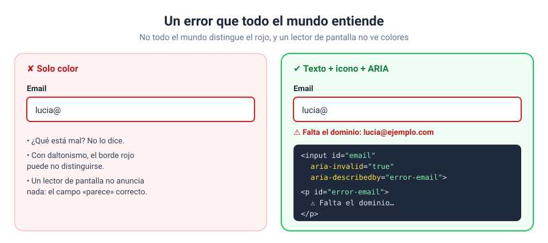

# Solución · Ejercicio 06 · Formulario de contacto accesible

[← Volver al enunciado](../../ejercicios/ejercicio_06/) · [← Volver al bloque](../../README.md)

## Qué pedía el ejercicio

Un formulario de contacto cuyos errores se entiendan bien tanto mirando la pantalla como con un lector de pantalla o solo con el teclado.



## Las cuatro piezas de un error accesible

### 1. El color no basta: hace falta texto

Cada error tiene un mensaje escrito que dice **qué está mal y cómo arreglarlo**: «Escribe al menos 20 caracteres (llevas 12)». El borde rojo ayuda, pero no basta: no todo el mundo distingue los colores. La guía de validación de MDN insiste en que los mensajes sean claros y digan cómo corregir el problema [1].

### 2. `aria-invalid`

```javascript
campo.setAttribute('aria-invalid', 'true');
```

Le dice a la tecnología de apoyo que el valor del campo no es válido [2]. MDN recomienda no ponerlo a `true` antes de que se haya validado, solo como respuesta a una validación [2]. Por eso lo pongo al salir del campo o al enviar, nunca al cargar la página.

### 3. `aria-describedby`

```html
<input id="email" aria-describedby="error-email">
<p id="error-email" class="error-campo"></p>
```

Enlaza el campo con el párrafo que lo describe [3]. Cuando el usuario de un lector de pantalla llega al campo, escucha la etiqueta… y a continuación el error.

### 4. El resumen de errores

```html
<div id="resumenErrores" class="resumen-errores" role="alert" tabindex="-1"></div>
```

Al enviar con errores, aparece arriba un resumen con **un enlace por error** que lleva directamente al campo. Le pongo el foco con `focus()` [4], para que sea lo primero que se lea. `tabindex="-1"` permite darle el foco desde JavaScript aunque un `div` no sea normalmente enfocable, y `role="alert"` hace que se anuncie al aparecer.

## El mensaje de éxito: `aria-live`

```html
<p id="exito" class="exito" aria-live="polite"></p>
```

Un lector de pantalla lee lo que tiene delante. Si un texto cambia en otra parte de la página, el usuario no se entera… salvo que esa zona sea una **región viva**. `aria-live` indica que el elemento se actualizará y que esos cambios deben anunciarse; con `polite`, se anuncian cuando el lector termina lo que estaba diciendo [5].

## Cuándo validar: el equilibrio

| Momento | Qué hago | Por qué |
| --- | --- | --- |
| `blur` (salir del campo) | Validar siempre [6] | El usuario ya ha terminado de escribir |
| `input` (cada letra) | Solo si el campo **ya estaba en error** [7] | El aviso desaparece en cuanto se corrige, pero no molesta mientras se escribe por primera vez |
| `submit` | Validar todo y mostrar el resumen | Comprobación final, incluidos los campos no tocados |

Probad la diferencia: escribid «hola» en el mensaje y salid. Aparece el error. Volved y seguid escribiendo: en cuanto lleguéis a 20 caracteres, el error se va solo.

## Probadlo solo con el teclado

Enviad el formulario vacío con Enter. El foco salta al resumen. Con Tab llegáis al primer enlace; con Enter, saltáis a ese campo. Si un formulario se puede usar así, habéis hecho un buen trabajo.

### Fuentes y Documentación Oficial

1. [Client-side form validation (MDN Web Docs)](https://developer.mozilla.org/en-US/docs/Learn_web_development/Extensions/Forms/Form_validation)
2. [ARIA: aria-invalid attribute (MDN Web Docs)](https://developer.mozilla.org/en-US/docs/Web/Accessibility/ARIA/Reference/Attributes/aria-invalid)
3. [ARIA: aria-describedby attribute (MDN Web Docs)](https://developer.mozilla.org/en-US/docs/Web/Accessibility/ARIA/Reference/Attributes/aria-describedby)
4. [HTMLElement: focus() method (MDN Web Docs)](https://developer.mozilla.org/en-US/docs/Web/API/HTMLElement/focus)
5. [ARIA: aria-live attribute (MDN Web Docs)](https://developer.mozilla.org/en-US/docs/Web/Accessibility/ARIA/Reference/Attributes/aria-live)
6. [Element: blur event (MDN Web Docs)](https://developer.mozilla.org/en-US/docs/Web/API/Element/blur_event)
7. [Element: input event (MDN Web Docs)](https://developer.mozilla.org/en-US/docs/Web/API/Element/input_event)
