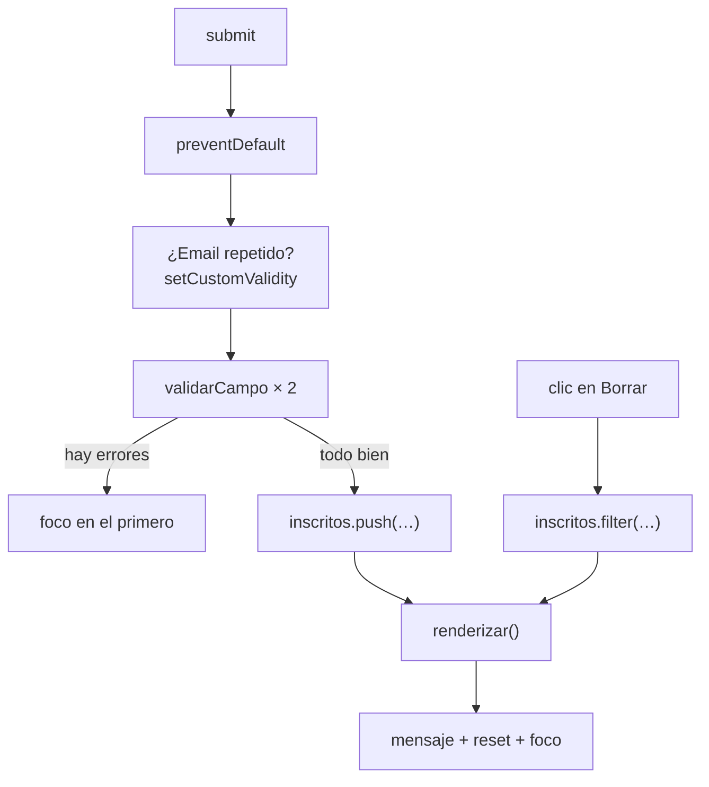

# Solución · Ejercicio 08 · Inscripciones a un taller

[← Volver al enunciado](../../ejercicios/ejercicio_08/) · [← Volver al bloque](../../README.md)

## Qué pedía el ejercicio

Una aplicación completa de inscripciones con validación, regla propia, tabla de inscritos y límite de plazas. Junta todo lo del bloque y buena parte de los bloques 06 y 07.

## El mapa de la aplicación



## Una regla que HTML no puede saber

```javascript
const repetido = inscritos.some((p) => p.email === email);
campoEmail.setCustomValidity(repetido ? 'Este email ya está inscrito.' : '');
```

Ningún atributo HTML sabe quién se ha inscrito ya: eso solo lo sabe vuestro array. Así que compruebo con `some` y lo comunico con `setCustomValidity` [1]. A partir de ahí, el campo se comporta como si incumpliera cualquier otra regla: `validity.customError` es `true` [2] y el mensaje que escribí está en `campo.validationMessage`. Por eso `mensajeError` solo necesita un caso más.

Y recordad la advertencia del ejercicio 05: hay que **borrar** el error. Lo hago en dos sitios: al volver a enviar (el ternario pone `''` si ya no está repetido) y en cuanto el usuario escribe en el campo.

Comparo en minúsculas para que `Lucia@Ejemplo.com` y `lucia@ejemplo.com` cuenten como el mismo email.

## Validar sin cortocircuito

```javascript
const nombreOk = validarCampo(campoNombre);
const emailOk = validarCampo(campoEmail);
if (!nombreOk || !emailOk) { … }
```

¿Por qué no `if (!validarCampo(campoNombre) || !validarCampo(campoEmail))`? Por el cortocircuito del bloque 03: si el nombre fallara, `||` ya sabría el resultado y **no llegaría a validar el email**. El usuario vería un error, lo corregiría y entonces descubriría el segundo. Validando antes los dos, ve todos los errores a la vez.

## Estado → renderizar, otra vez

`inscritos` es el estado. El `submit` lo amplía, el botón Borrar lo reduce, y `renderizar()` repinta la tabla, las plazas y el botón. Es exactamente la arquitectura del catálogo del bloque 07. Los botones Borrar se recrean en cada renderizado, así que uso **delegación** en el `tbody`, con `closest` para encontrar el botón [3].

## El límite de plazas

```javascript
btnInscribir.disabled = libres === 0;
```

Con el taller completo, el botón se desactiva. Y como `renderizar()` se ejecuta también al borrar, en cuanto alguien se da de baja vuelve a activarse. No hay que acordarse de hacerlo en dos sitios.

## Después de inscribir

```javascript
formulario.reset();
campoNombre.focus();
```

El formulario queda limpio [4] y el cursor vuelve al primer campo, listo para la siguiente persona [5]. Y el mensaje de éxito está en una región `aria-live` [6], así que también se anuncia a quien usa lector de pantalla.

### Fuentes y Documentación Oficial

1. [HTMLInputElement: setCustomValidity() method (MDN Web Docs)](https://developer.mozilla.org/en-US/docs/Web/API/HTMLInputElement/setCustomValidity)
2. [ValidityState (MDN Web Docs)](https://developer.mozilla.org/en-US/docs/Web/API/ValidityState)
3. [Element: closest() method (MDN Web Docs)](https://developer.mozilla.org/en-US/docs/Web/API/Element/closest)
4. [HTMLFormElement: reset() method (MDN Web Docs)](https://developer.mozilla.org/en-US/docs/Web/API/HTMLFormElement/reset)
5. [HTMLElement: focus() method (MDN Web Docs)](https://developer.mozilla.org/en-US/docs/Web/API/HTMLElement/focus)
6. [ARIA: aria-live attribute (MDN Web Docs)](https://developer.mozilla.org/en-US/docs/Web/Accessibility/ARIA/Reference/Attributes/aria-live)
