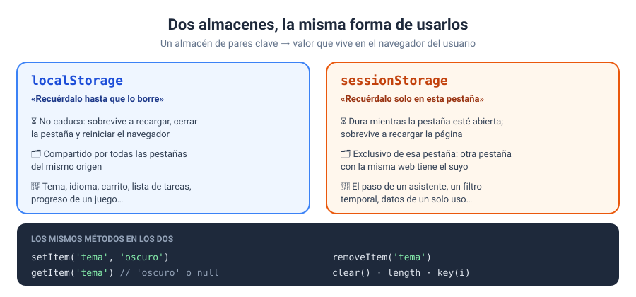
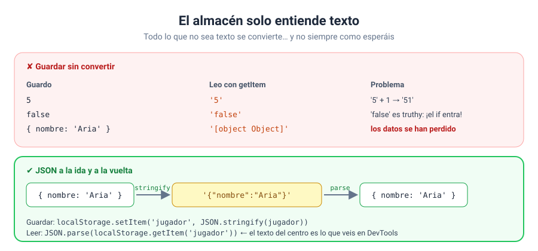
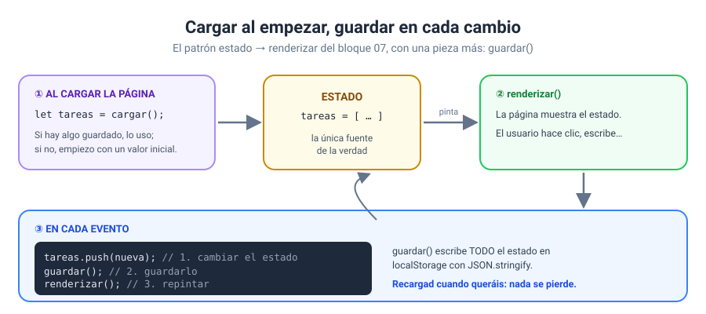
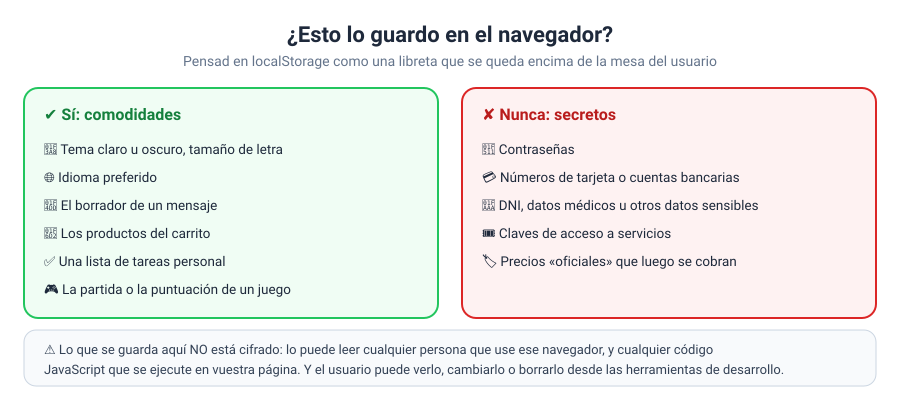

# Bloque 09 · Almacenamiento en el navegador

[← Bloque 08](../08-formularios/) · [Volver al temario](../TEMARIO.md) · [Ir al bloque 10 →](../10-asincronia/)

Hasta ahora, todo lo que hacían vuestras aplicaciones se esfumaba al recargar la página: las tareas, el carrito, las preferencias. Volvíais y estaba todo como al principio. En este bloque os voy a enseñar a **darle memoria a la página**: guardar datos en el navegador del usuario y recuperarlos en su próxima visita, sin servidor y sin base de datos. Y también os voy a contar qué cosas no debéis guardar nunca ahí.

Al terminar este bloque sabréis:

- Guardar, leer y borrar datos con `localStorage` y `sessionStorage`.
- Elegir entre los dos según cuánto deban durar los datos.
- Guardar arrays y objetos con JSON sin perder nada por el camino.
- Aplicar el patrón **cargar al empezar, guardar en cada cambio**.
- Cargar datos guardados de forma segura, aunque estén corruptos o manipulados.
- Sincronizar varias pestañas con el evento `storage`.
- Decidir qué datos se pueden guardar en el navegador y cuáles no.

---

## 1. Dos almacenes en el navegador

La Web Storage API ofrece dos almacenes de pares **clave → valor**: `localStorage` y `sessionStorage` [1].



| | `localStorage` | `sessionStorage` |
| --- | --- | --- |
| Cuánto dura | No caduca: sobrevive a recargar y a cerrar el navegador [2] | Mientras la pestaña esté abierta; sobrevive a recargar [3] |
| Quién lo ve | Todas las pestañas del mismo origen [2] | Solo esa pestaña [3] |
| Para qué | Tema, idioma, carrito, tareas, progreso de un juego | El paso de un asistente, un filtro temporal |

### 1.1. Los métodos

Los dos almacenes tienen exactamente los mismos métodos [4]:

```javascript
localStorage.setItem('tema', 'oscuro');   // guardar o sobrescribir [5]
localStorage.getItem('tema');             // leer: 'oscuro', o null si no existe [6]
localStorage.removeItem('tema');          // borrar una clave [7]
localStorage.clear();                     // borrar TODO el almacén [8]
localStorage.length;                      // cuántas claves hay [9]
localStorage.key(0);                      // el nombre de la clave en la posición 0 [10]
```

Grabaos el `null` de `getItem`: es vuestra forma de saber si había algo guardado.

### 1.2. El almacén es del origen, no de la página

El almacén pertenece a un **origen** (protocolo + dominio + puerto), no a una página concreta [2]. Todas las páginas de `https://mitienda.com` comparten el mismo `localStorage`. En el curso pasa lo mismo: todos los ejercicios abiertos con Live Server, o con doble clic desde el disco, comparten almacén.

Por eso, a partir del ejercicio 02, cada ejercicio usa claves con **un prefijo propio**:

```javascript
const CLAVE = 'curso-js:b09e02:nombre';
```

Y por eso `clear()` es peligroso: borra también lo que hayan guardado las demás páginas del origen. Usad `removeItem` con vuestras claves.

> [!NOTE]
> MDN advierte de que el almacén puede no estar disponible con orígenes `file:` [2]. Chrome y Edge lo permiten, pero si algún ejercicio no guarda nada al abrirlo con doble clic, usad **Live Server**.

### 1.3. Miradlo con vuestros ojos

Herramientas de desarrollo → pestaña **Aplicación** (Chrome, Edge) o **Almacenamiento** (Firefox) → *Local Storage*. Veréis todas las claves, podréis editarlas y borrarlas. Tenedlo abierto durante todo el bloque.

---

## 2. Solo guarda texto

Este es el punto en el que más gente tropieza. `setItem` guarda **texto**; todo lo demás se convierte en texto por el camino [5].



| Guardo | Leo | Problema |
| --- | --- | --- |
| `5` | `'5'` | `'5' + 1` → `'51'` |
| `false` | `'false'` | Es un texto no vacío: *truthy*. El `if` entra |
| `{ nombre: 'Aria' }` | `'[object Object]'` | Los datos se han perdido |
| `['a', 'b']` | `'a,b'` | Ya no es un array |

### 2.1. La solución: JSON

```javascript
// guardar: valor → texto JSON
localStorage.setItem('jugador', JSON.stringify(jugador));

// leer: texto JSON → valor
const jugador = JSON.parse(localStorage.getItem('jugador'));
```

`JSON.stringify()` convierte el valor en un texto JSON [11] y `JSON.parse()` lo reconstruye [12]. JSON conserva los tipos: los números vuelven como números y los booleanos como booleanos.

**Mi regla:** si no es un texto sencillo, JSON a la ida y a la vuelta.

### 2.2. Leer con valor por defecto

La primera vez que alguien visita la página no hay nada guardado. Preparaos siempre para ese caso:

```javascript
const tema = localStorage.getItem('tema') ?? 'claro';     // texto
const texto = localStorage.getItem('tareas');
const tareas = texto === null ? [] : JSON.parse(texto);    // JSON
```

El operador `??` devuelve el valor de la derecha solo si el de la izquierda es `null` o `undefined`. Es como `||`, pero no salta con un texto vacío.

---

## 3. El patrón: cargar al empezar, guardar en cada cambio



Si vuestra aplicación ya sigue el patrón **estado → renderizar** del bloque 07, hacerla persistente es cuestión de dos funciones:

```javascript
const CLAVE = 'curso-js:tareas';

function cargar() {
    const texto = localStorage.getItem(CLAVE);
    return texto === null ? [] : JSON.parse(texto);
}

function guardar() {
    localStorage.setItem(CLAVE, JSON.stringify(tareas));
}

// 1. al empezar: el estado se carga, no se escribe a mano
let tareas = cargar();
renderizar();

// 2. en cada evento: cambiar el estado → guardar → renderizar
formulario.addEventListener('submit', (e) => {
    e.preventDefault();
    tareas.push({ texto: campo.value, hecha: false });
    guardar();
    renderizar();
});
```

Guardad **el estado completo** cada vez, no solo lo que ha cambiado: es más sencillo y el almacén nunca se desincroniza de lo que hay en memoria.

---

## 4. Cargar a la defensiva

Lo que hay en el almacén **no es de fiar**. El usuario puede editarlo desde las herramientas de desarrollo, una versión antigua de vuestra web puede haber guardado otro formato o los datos pueden corromperse. Si `JSON.parse` recibe un texto que no es JSON válido, lanza un `SyntaxError` [12] y vuestro script se detiene.

```javascript
function cargarCarrito() {
    const texto = localStorage.getItem(CLAVE);
    if (texto === null) {
        return [];
    }
    let datos;
    try {
        datos = JSON.parse(texto);     // puede fallar…
    } catch (error) {
        return [];                     // …y si falla, empiezo de cero
    }
    if (!Array.isArray(datos)) {       // ¿es de verdad un array?
        return [];
    }
    return datos.filter((linea) => …); // ¿cada elemento tiene sentido?
}
```

`try...catch` intenta ejecutar un código y, si lanza un error, lo captura en lugar de detener el programa [13]. Lo veréis a fondo en el bloque 10; este es su uso más habitual. Y aunque el texto sea JSON válido, puede no ser lo que esperáis: `Array.isArray()` comprueba que lo leído es de verdad un array [14], y el `filter` final descarta los elementos sin sentido.

---

## 5. Sincronizar pestañas: el evento `storage`

Si el usuario tiene vuestra tienda abierta en dos pestañas y añade algo al carrito en una, la otra no se entera… salvo que escuche el evento `storage`:

```javascript
window.addEventListener('storage', (e) => {
    if (e.key === CLAVE) {
        carrito = cargarCarrito();
        renderizar();
    }
});
```

`storage` se dispara cuando **otro documento** del mismo origen modifica el almacén [15]. No salta en la pestaña que hace el cambio, solo en las demás. `e.key` indica qué clave ha cambiado.

---

## 6. Qué guardar y qué no



El almacenamiento del navegador **no está cifrado** ni protegido. Cualquier persona que use ese navegador puede leerlo, cualquier código JavaScript que se ejecute en vuestra página tiene acceso a él, y el usuario puede verlo y cambiarlo con las herramientas de desarrollo.

Así que:

- **Sí:** preferencias, borradores, listas personales, el contenido de un carrito (como identificadores y cantidades), el progreso de un juego.
- **Nunca:** contraseñas, datos bancarios, documentos de identidad, datos médicos ni claves de acceso.
- **Nunca os fiéis de lo que leéis:** guardad el **identificador** de un producto, no su precio. El precio sale siempre de vuestro código (y, en una tienda real, del servidor). Si no, bastaría con editar el almacén para comprar a céntimo.

Y tened en cuenta que el usuario puede borrarlo en cualquier momento, y que en el modo de navegación privada los navegadores tratan `localStorage` como si fuera `sessionStorage` [1]. Vuestra aplicación tiene que funcionar también cuando el almacén está vacío.

---

## 7. La plantilla de trabajo con persistencia

```javascript
// estructura del programa principal
const CLAVE = 'curso-js:b09:tareas';

// funciones
function cargar() {
    const texto = localStorage.getItem(CLAVE);
    return texto === null ? [] : JSON.parse(texto);
}
function guardar() {
    localStorage.setItem(CLAVE, JSON.stringify(tareas));
}
function renderizar() { … }

// el estado, CARGADO del almacén
let tareas = cargar();

// constantes al DOM que queremos escuchar
const formulario = document.querySelector('#formTarea');

// colocar escuchadores de eventos
formulario.addEventListener('submit', (e) => {
    e.preventDefault();
    // entradas → procesamiento (cambiar el estado) → guardar → salidas
    tareas.push({ texto: formulario.tarea.value });
    guardar();
    renderizar();
});

renderizar();
```

---

## 8. Ejercicios

| Nº | Ejercicio | Qué practicáis | Solución |
| --- | --- | --- | --- |
| 01 | [Mi primer almacén](ejercicios/ejercicio_01/) | `setItem`, `getItem`, `removeItem`, `clear`, `length`, `key`, el origen compartido | [Ver](soluciones/ejercicio_01/) |
| 02 | [Recuerda mi nombre](ejercicios/ejercicio_02/) | Cargar al empezar, el `null` de `getItem`, claves con prefijo | [Ver](soluciones/ejercicio_02/) |
| 03 | [Preferencias de tema y tamaño](ejercicios/ejercicio_03/) | Preferencias en `data-*` del `body`, valor por defecto con `??` | [Ver](soluciones/ejercicio_03/) |
| 04 | [localStorage frente a sessionStorage](ejercicios/ejercicio_04/) | Los dos almacenes con la misma función, números en el almacén | [Ver](soluciones/ejercicio_04/) |
| 05 | [El almacén solo guarda texto](ejercicios/ejercicio_05/) | Siete experimentos con tipos, JSON a la ida y a la vuelta | [Ver](soluciones/ejercicio_05/) |
| 06 | [Un borrador que no se pierde](ejercicios/ejercicio_06/) | Autoguardado de varios campos como un objeto JSON | [Ver](soluciones/ejercicio_06/) |
| 07 | [Lista de tareas que persiste](ejercicios/ejercicio_07/) | El proyecto guiado: estado → guardar → renderizar | [Ver](soluciones/ejercicio_07/) |
| 08 | [Un carrito que sobrevive](ejercicios/ejercicio_08/) | Guardar solo ids, carga segura con `try...catch`, evento `storage` | [Ver](soluciones/ejercicio_08/) |

En el 08, haced el experimento de la ayuda: escribid `hola` en el valor guardado desde las herramientas de desarrollo y recargad. Si vuestra tienda sigue en pie, lo habéis hecho bien.

---

[← Bloque 08](../08-formularios/) · [Volver al temario](../TEMARIO.md) · [Ir al bloque 10 →](../10-asincronia/)

### Fuentes y Documentación Oficial

1. [Web Storage API (MDN Web Docs)](https://developer.mozilla.org/en-US/docs/Web/API/Web_Storage_API)
2. [Window: localStorage property (MDN Web Docs)](https://developer.mozilla.org/en-US/docs/Web/API/Window/localStorage)
3. [Window: sessionStorage property (MDN Web Docs)](https://developer.mozilla.org/en-US/docs/Web/API/Window/sessionStorage)
4. [Using the Web Storage API (MDN Web Docs)](https://developer.mozilla.org/en-US/docs/Web/API/Web_Storage_API/Using_the_Web_Storage_API)
5. [Storage: setItem() method (MDN Web Docs)](https://developer.mozilla.org/en-US/docs/Web/API/Storage/setItem)
6. [Storage: getItem() method (MDN Web Docs)](https://developer.mozilla.org/en-US/docs/Web/API/Storage/getItem)
7. [Storage: removeItem() method (MDN Web Docs)](https://developer.mozilla.org/en-US/docs/Web/API/Storage/removeItem)
8. [Storage: clear() method (MDN Web Docs)](https://developer.mozilla.org/en-US/docs/Web/API/Storage/clear)
9. [Storage: length property (MDN Web Docs)](https://developer.mozilla.org/en-US/docs/Web/API/Storage/length)
10. [Storage: key() method (MDN Web Docs)](https://developer.mozilla.org/en-US/docs/Web/API/Storage/key)
11. [JSON.stringify() (MDN Web Docs)](https://developer.mozilla.org/en-US/docs/Web/JavaScript/Reference/Global_Objects/JSON/stringify)
12. [JSON.parse() (MDN Web Docs)](https://developer.mozilla.org/en-US/docs/Web/JavaScript/Reference/Global_Objects/JSON/parse)
13. [try...catch (MDN Web Docs)](https://developer.mozilla.org/en-US/docs/Web/JavaScript/Reference/Statements/try...catch)
14. [Array.isArray() (MDN Web Docs)](https://developer.mozilla.org/en-US/docs/Web/JavaScript/Reference/Global_Objects/Array/isArray)
15. [Window: storage event (MDN Web Docs)](https://developer.mozilla.org/en-US/docs/Web/API/Window/storage_event)
