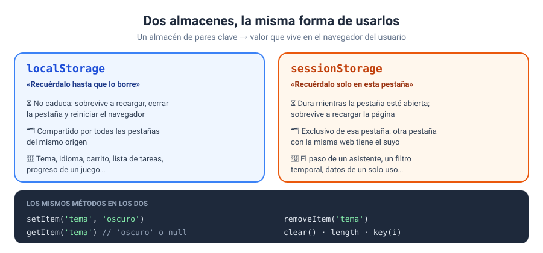

# Solución · Ejercicio 04 · localStorage frente a sessionStorage

[← Volver al enunciado](../../ejercicios/ejercicio_04/) · [← Volver al bloque](../../README.md)

## Qué pedía el ejercicio

Comprobar con dos contadores de visitas en qué se diferencian los dos almacenes del navegador.

## Una función para los dos almacenes

```javascript
function contarVisita(almacen, clave) {
    const anteriores = Number(almacen.getItem(clave));
    const total = anteriores + 1;
    almacen.setItem(clave, total);
    return total;
}

contarVisita(localStorage, CLAVE_LOCAL);
contarVisita(sessionStorage, CLAVE_SESION);
```

`localStorage` y `sessionStorage` son dos objetos del mismo tipo, `Storage`, con los mismos métodos [1]. Por eso una sola función sirve para los dos: recibe el almacén como parámetro. Es el bloque 04 en estado puro.

## Leer números del almacén

El almacén guarda **texto**. Lo que leo es `'3'`, no `3`, así que convierto con `Number()` antes de sumar. Si no, `'3' + 1` daría `'31'`.

¿Y la primera vez, cuando no hay nada? `getItem` devuelve `null`, y `Number(null)` vale `0` [2]. Aquí esa rareza que tanto os advertí en el bloque 04 juega a nuestro favor: la primera visita cuenta desde 0. Pero sabed que lo estáis aprovechando a propósito.

## El experimento

| Acción | `localStorage` | `sessionStorage` |
| --- | --- | --- |
| Recargar la página | Sigue sumando | Sigue sumando |
| Abrir otra pestaña con la misma página | Sigue sumando | **Empieza en 1** |
| Cerrar todo y volver | Sigue sumando | **Empieza en 1** |

- `localStorage` no tiene fecha de caducidad y es **el mismo para todo el origen** [3].
- `sessionStorage` dura lo que dura la sesión de la pestaña: sobrevive a las recargas, pero cada pestaña tiene **la suya**, y se borra al cerrarla [4].



## ¿Cuándo uso cada uno?

| Necesito que se recuerde… | Uso |
| --- | --- |
| Entre visitas, días después | `localStorage` |
| Solo mientras dura esta pestaña | `sessionStorage` |

Un ejemplo de `sessionStorage`: un formulario de varios pasos. Si el usuario recarga en el paso 3, no pierde lo que ha escrito; pero si cierra la pestaña y vuelve mañana, empieza de cero, que es lo esperable.

### Fuentes y Documentación Oficial

1. [Using the Web Storage API (MDN Web Docs)](https://developer.mozilla.org/en-US/docs/Web/API/Web_Storage_API/Using_the_Web_Storage_API)
2. [Number — Number coercion (MDN Web Docs)](https://developer.mozilla.org/en-US/docs/Web/JavaScript/Reference/Global_Objects/Number)
3. [Window: localStorage property (MDN Web Docs)](https://developer.mozilla.org/en-US/docs/Web/API/Window/localStorage)
4. [Window: sessionStorage property (MDN Web Docs)](https://developer.mozilla.org/en-US/docs/Web/API/Window/sessionStorage)
