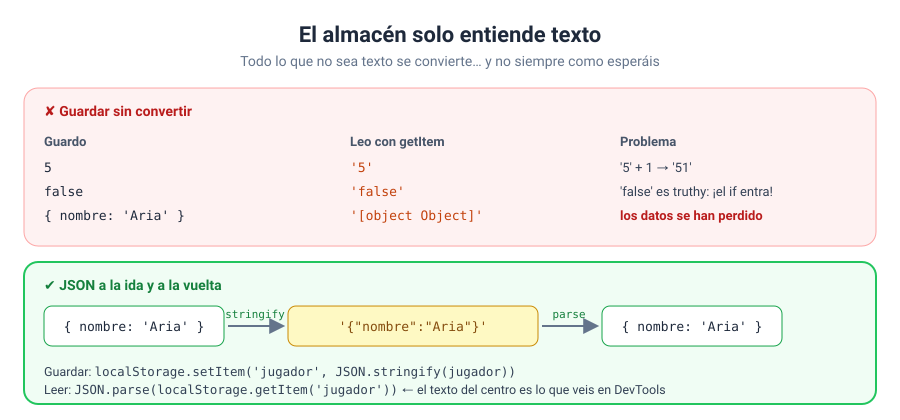

# Solución · Ejercicio 05 · El almacén solo guarda texto: JSON al rescate

[← Volver al enunciado](../../ejercicios/ejercicio_05/) · [← Volver al bloque](../../README.md)

## Qué pedía el ejercicio

Descubrir qué le pasa a cada tipo de dato al guardarlo en `localStorage` y aprender a guardar arrays y objetos sin perder nada.

## Los resultados

| Experimento | Resultado |
| --- | --- |
| 1. Número `5`, más 1 | `'51'` (typeof: `string`) |
| 2. `false` en un `if` | **Entra**: es el texto `'false'` |
| 3. Objeto sin convertir | `[object Object]` |
| 4. Array sin convertir | `espada,escudo` |
| 5. Objeto con JSON | nombre: Aria · nivel: 3 (typeof nivel: `number`) |
| 6. Texto guardado en el caso 5 | `{"nombre":"Aria","nivel":3}` |
| 7. `JSON.parse` de algo que no existe | `null` |

## Por qué pasa

`setItem` solo guarda **texto**. Si le dais otra cosa, la convierte en texto antes de guardarla [1]. Y esa conversión no siempre os conviene:

- **Números:** `5` → `'5'`. Al sumar, se concatena. Lo visteis en el bloque 01 con `prompt`: mismo problema, otro sitio.
- **Booleanos:** `false` → `'false'`. Y como `'false'` es un texto no vacío, es *truthy*: el `if` entra. Este error es especialmente traicionero porque no da ningún aviso.
- **Objetos:** se convierten en el texto `'[object Object]'`. Los datos **se han perdido** y no hay forma de recuperarlos.
- **Arrays:** se convierten en sus elementos separados por comas. Parece que funciona, pero al leer tenéis un texto, no un array.



## La solución: JSON

```javascript
localStorage.setItem(clave, JSON.stringify(jugador));     // objeto → texto JSON
const jugador = JSON.parse(localStorage.getItem(clave));  // texto JSON → objeto
```

Lo visteis en el bloque 05: `JSON.stringify()` convierte un valor en un texto JSON [2] y `JSON.parse()` reconstruye el valor a partir de ese texto [3]. JSON conserva los tipos: el nivel vuelve como `number`, y un `false` volvería como `false`.

Mi regla para este bloque: **todo lo que no sea un texto sencillo, con JSON a la ida y a la vuelta**.

## Cuidado con el caso 7

```javascript
JSON.parse(localStorage.getItem('no-existe'))   // null
```

Si la clave no existe, `getItem` devuelve `null`, y `JSON.parse(null)` devuelve `null` sin protestar. Si a continuación hacéis `datos.nombre`, tendréis el `TypeError` de siempre. Por eso, al cargar, comprobad siempre si había algo guardado y, si no, usad un valor inicial. En los ejercicios 07 y 08 lo meteréis en una función `cargar()`.

### Fuentes y Documentación Oficial

1. [Storage: setItem() method (MDN Web Docs)](https://developer.mozilla.org/en-US/docs/Web/API/Storage/setItem)
2. [JSON.stringify() (MDN Web Docs)](https://developer.mozilla.org/en-US/docs/Web/JavaScript/Reference/Global_Objects/JSON/stringify)
3. [JSON.parse() (MDN Web Docs)](https://developer.mozilla.org/en-US/docs/Web/JavaScript/Reference/Global_Objects/JSON/parse)
