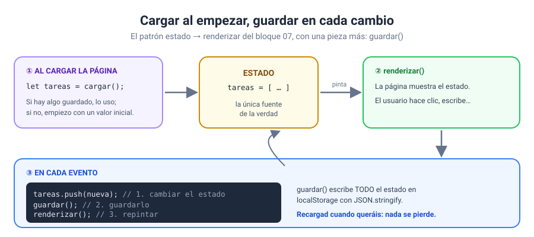

# Solución · Ejercicio 07 · Lista de tareas que persiste

[← Volver al enunciado](../../ejercicios/ejercicio_07/) · [← Volver al bloque](../../README.md)

## Qué pedía el ejercicio

Darle memoria a la lista de tareas del bloque 07: que las tareas y el filtro elegido sobrevivan a recargar o cerrar la página.

## Lo que cambia respecto al bloque 07: casi nada

Esta es la buena noticia. Como la aplicación ya seguía el patrón **estado → renderizar**, añadir persistencia es cuestión de tres piezas:



1. **Cargar** el estado al empezar, en lugar de escribirlo a mano.
2. **Guardar** el estado después de cada cambio.
3. Todo lo demás, igual.

## 1. Cargar

```javascript
function cargarTareas() {
    const texto = localStorage.getItem(CLAVE_TAREAS);
    return texto === null ? structuredClone(TAREAS_INICIALES) : JSON.parse(texto);
}

let tareas = cargarTareas();
let filtro = localStorage.getItem(CLAVE_FILTRO) ?? 'todas';
```

Si no hay nada guardado (`null`) [1], empiezo con las tareas de ejemplo. ¿Por qué una **copia** con `structuredClone`? Por las referencias del bloque 05: si `tareas` fuera el mismo array que `TAREAS_INICIALES`, al marcar una tarea estaría cambiando también los «datos iniciales».

Si hay algo, lo convierto de JSON a array [2].

### El siguiente `id`

```javascript
let siguienteId = Math.max(0, ...tareas.map((t) => t.id)) + 1;
```

En el bloque 07, `siguienteId` empezaba en 3 a mano. Ahora no sé cuántas tareas hay guardadas, así que lo calculo: el mayor `id` existente más uno. El `0` del principio cubre el caso de la lista vacía, porque `Math.max()` sin argumentos da `-Infinity`.

## 2. Guardar en cada cambio

```javascript
function guardar() {
    localStorage.setItem(CLAVE_TAREAS, JSON.stringify(tareas));
    localStorage.setItem(CLAVE_FILTRO, filtro);
}

function actualizar() {
    guardar();
    renderizar();
}
```

Todos los escuchadores terminan igual: cambian el estado y llaman a `actualizar()`. Guardo **el estado completo** cada vez [3], no «el cambio». Es más sencillo y evita que el almacén y la memoria se desincronicen.

## También se guardan las preferencias de la interfaz

El filtro no es un dato de las tareas, pero sí parte de la experiencia. Si el usuario estaba viendo «Pendientes», al volver espera seguir viendo «Pendientes». Lo guardo en su propia clave, como un texto sencillo.

## Probadlo con las herramientas de desarrollo

Abrid la pestaña **Aplicación** y mirad la clave `curso-js:b09e07:tareas` mientras marcáis y borráis tareas. Veréis el JSON cambiar en directo. Y probad a borrar la clave a mano y recargar: vuelven las tareas de ejemplo.

### Fuentes y Documentación Oficial

1. [Storage: getItem() method (MDN Web Docs)](https://developer.mozilla.org/en-US/docs/Web/API/Storage/getItem)
2. [JSON.parse() (MDN Web Docs)](https://developer.mozilla.org/en-US/docs/Web/JavaScript/Reference/Global_Objects/JSON/parse)
3. [Storage: setItem() method (MDN Web Docs)](https://developer.mozilla.org/en-US/docs/Web/API/Storage/setItem)
