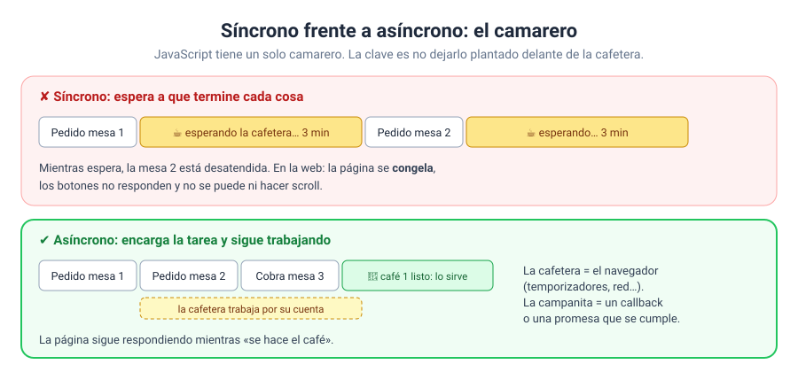
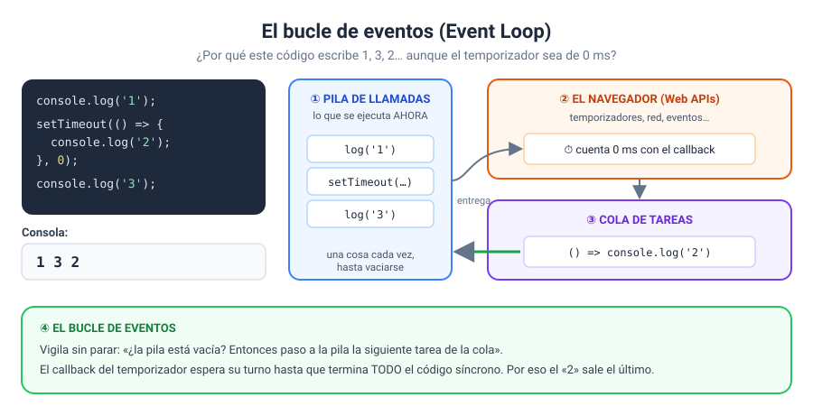
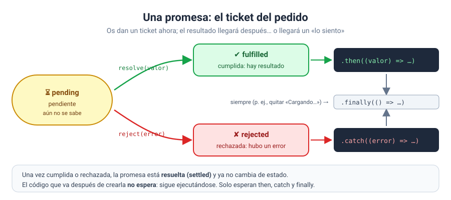
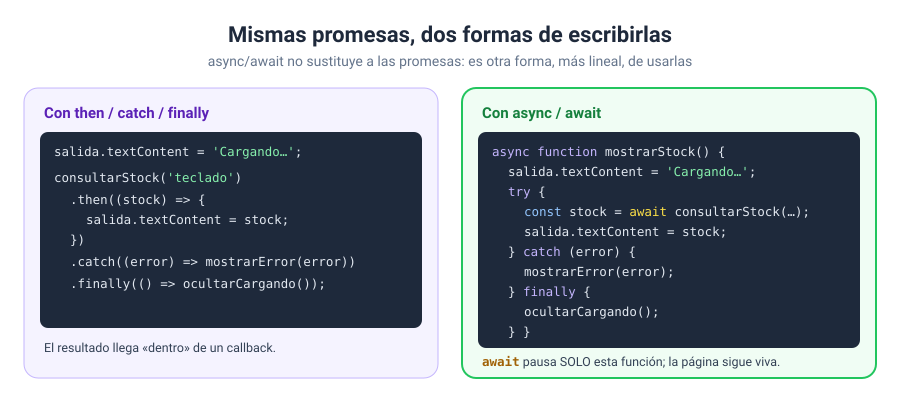

# Bloque 10 · Asincronía

[← Bloque 09](../09-almacenamiento/) · [Volver al temario](../TEMARIO.md) · [Ir al bloque 11 →](../11-fetch-y-apis/)

Hay tareas que no terminan al instante: esperar unos segundos, pedir datos a un servidor, leer un fichero. Si JavaScript se quedara parado esperando cada una, la página se congelaría. En este bloque os voy a enseñar cómo **encargar una tarea y seguir trabajando**, y cómo recoger el resultado cuando llegue: con temporizadores, con promesas y con `async`/`await`. Es la última pieza que os falta antes de pedir datos de verdad a un servidor en el bloque 11.

Al terminar este bloque sabréis:

- Distinguir el código síncrono del asíncrono, y por qué importa.
- Programar tareas con `setTimeout` y `setInterval`, y cancelarlas.
- Explicar el bucle de eventos y por qué no hay que bloquear la página.
- Crear y consumir promesas con `then`, `catch` y `finally`.
- Escribir código asíncrono legible con `async`, `await` y `try...catch`.
- Lanzar varias tareas a la vez con `Promise.all`.

---

## 1. Síncrono y asíncrono

JavaScript ejecuta vuestro código en **un solo hilo**: hace una cosa cada vez [1]. Si una tarea tarda y el programa se queda esperándola, todo lo demás espera también: ni los clics, ni el scroll, ni las animaciones.



La solución es la **asincronía**: en lugar de esperar, se encarga la tarea al navegador (que sabe contar tiempo, hacer peticiones de red…) y se le dice qué hacer cuando termine. Mientras tanto, el programa sigue con lo suyo [2].

---

## 2. Temporizadores

### 2.1. `setTimeout`: una vez, más tarde

```javascript
const id = setTimeout(() => {
    salida.textContent = '¡Tiempo!';
}, 3000);   // milisegundos

clearTimeout(id);   // cancelarlo antes de que ocurra
```

`setTimeout` ejecuta la función cuando pasa el tiempo indicado y devuelve un identificador [3]. Con ese identificador, `clearTimeout` lo cancela [4]. El retraso es un **mínimo**: el tiempo real puede ser algo mayor [3].

### 2.2. `setInterval`: una y otra vez

```javascript
const id = setInterval(actualizarReloj, 1000);   // cada segundo

clearInterval(id);   // detenerlo
```

`setInterval` repite la función cada vez que pasa el intervalo hasta que se detiene con `clearInterval` [5] [6].

### 2.3. Tres reglas con temporizadores

1. **Guardad siempre el identificador** si vais a necesitar cancelar.
2. **Nunca dos a la vez.** Antes de arrancar uno, comprobad si ya hay otro en marcha (por ejemplo, `if (id !== null)`), o desactivad el botón mientras corre.
3. **Medid el tiempo, no lo contéis.** Un intervalo no garantiza una cadencia exacta [5]. Para un cronómetro, guardad el instante de inicio con `Date.now()` [7] y restad: `Date.now() - inicio`.

### 2.4. Esperar a que el usuario deje de escribir

Un uso clásico de `setTimeout` + `clearTimeout`: no reaccionar con cada letra, sino cuando el usuario **se detiene** un momento.

```javascript
let idEspera = null;

buscador.addEventListener('input', () => {
    clearTimeout(idEspera);                 // cada letra cancela la espera anterior…
    idEspera = setTimeout(() => {
        buscar(buscador.value);             // …y solo se busca tras 400 ms sin escribir
    }, 400);
});
```

Es perfecto para guardar un borrador o para un buscador que pide datos a un servidor: en lugar de una petición por letra, una sola cuando el usuario termina.

---

## 3. El bucle de eventos



¿Cómo encaja todo esto con un solo hilo? Con tres piezas [1]:

| Pieza | Qué hace |
| --- | --- |
| **Pila de llamadas** | Donde se ejecuta el código, una cosa cada vez |
| **Cola de tareas** | Donde esperan los callbacks listos para ejecutarse (un temporizador cumplido, un clic…) |
| **Bucle de eventos** | Cuando la pila se vacía, pasa a ella la siguiente tarea de la cola |

La consecuencia más importante: **un callback nunca interrumpe el código que se está ejecutando**. Espera a que termine todo el código síncrono. Por eso esto escribe 1, 3, 2:

```javascript
console.log('1');
setTimeout(() => console.log('2'), 0);
console.log('3');
```

> [!WARNING]
> Si la pila no se vacía nunca, la cola no avanza. Un bucle que tarde varios segundos **congela la página entera**: no se puede hacer clic ni escribir mientras se ejecuta [2]. Todo lo que tarde, de forma asíncrona.

---

## 4. Callbacks y la pirámide

La forma original de encadenar tareas asíncronas era pasar un callback: «cuando termines, haz esto».

```javascript
prepararMasa(() => {
    anadirIngredientes(() => {
        hornear(() => {
            servir(() => {
                console.log('¡Lista!');
            });
        });
    });
});
```

Funciona, pero cada paso va **dentro** del anterior. Con unos pocos pasos se forma una pirámide difícil de leer, y gestionar los errores en cada nivel se complica mucho [2]. Es el famoso *callback hell*.

---

## 5. Promesas

Una **promesa** es un objeto que representa el resultado futuro de una operación asíncrona [8]. Pensad en el ticket que os dan en una cafetería: aún no tenéis el café, pero tenéis algo que os lo garantiza… o que os dirá que se ha acabado la leche.



Una promesa está siempre en uno de tres estados [8]:

- **Pendiente** (*pending*): todavía no se sabe.
- **Cumplida** (*fulfilled*): la operación ha ido bien y hay un valor.
- **Rechazada** (*rejected*): ha fallado y hay un error.

### 5.1. Crear una promesa

```javascript
function consultarStock(producto) {
    return new Promise((resolve, reject) => {
        setTimeout(() => {
            if (existe(producto)) {
                resolve(stock);                    // ✔ cumplida
            } else {
                reject(new Error('No existe'));    // ✘ rechazada
            }
        }, 700);
    });
}
```

`new Promise` recibe una función con dos parámetros: `resolve` para cumplirla y `reject` para rechazarla [9]. Lo más habitual, en cualquier caso, no será crearlas, sino **usarlas**: `fetch`, en el bloque 11, os devolverá promesas.

### 5.2. Usar una promesa

```javascript
consultarStock('teclado')
    .then((stock) => mostrar(stock))          // si se cumple
    .catch((error) => mostrarError(error))    // si se rechaza
    .finally(() => ocultarCargando());        // siempre
```

`then` recibe la función que se ejecuta si la promesa se cumple [10]; `catch`, la que se ejecuta si se rechaza [11]; y `finally`, la que se ejecuta en los dos casos, ideal para limpiar: quitar un «Cargando…», reactivar un botón [12].

Y como `then` devuelve una promesa nueva [10], las tareas se **encadenan en vertical**, sin pirámide:

```javascript
prepararMasa()
    .then(() => anadirIngredientes())
    .then(() => hornear())
    .then(() => servir())
    .catch((error) => console.error(error));   // un solo catch para toda la cadena
```

---

## 6. `async` y `await`

`async` y `await` son otra forma de usar las promesas, que permite escribir el código asíncrono **como si fuera síncrono**, de arriba abajo [13].



```javascript
async function mostrarStock(producto) {
    salida.textContent = 'Cargando…';
    try {
        const stock = await consultarStock(producto);
        salida.textContent = `Quedan ${stock}`;
    } catch (error) {
        salida.textContent = error.message;
    } finally {
        boton.disabled = false;
    }
}
```

- `async` delante de una función permite usar `await` dentro. Y una función `async` **siempre devuelve una promesa** [13].
- `await` pausa la función hasta que la promesa se resuelve y devuelve su valor [14]. Si se rechaza, lanza el error.
- El error se captura con `try...catch` [15], y `finally` se ejecuta siempre.

> [!IMPORTANT]
> `await` pausa **solo la función `async`** en la que está. El resto de la página sigue funcionando mientras tanto [14]. No es como el bucle que congela todo del apartado 3.

### 6.1. Una pausa reutilizable

```javascript
const esperar = (ms) => new Promise((resolve) => setTimeout(resolve, ms));

async function cuentaAtras() {
    for (const n of [3, 2, 1]) {
        salida.textContent = n;
        await esperar(1000);
    }
    salida.textContent = '¡Ya!';
}
```

Convertir `setTimeout` en una promesa permite escribir secuencias con pausas sin un solo callback a la vista.

---

## 7. Una detrás de otra, o todas a la vez

```javascript
// SECUENCIAL: cada una empieza cuando termina la anterior → suma de los tiempos
for (const producto of productos) {
    stocks.push(await consultarStock(producto));
}

// PARALELO: todas empiezan a la vez → lo que tarde la más lenta
const stocks = await Promise.all(productos.map((p) => consultarStock(p)));
```

`Promise.all` recibe un array de promesas y devuelve una que se cumple cuando se cumplen **todas**, con los resultados en el mismo orden. Si una se rechaza, la conjunta se rechaza también [16].

| Forma | Tiempo con 4 tareas de 700 ms | Cuándo |
| --- | --- | --- |
| `await` en un bucle | ~2800 ms | Cada paso necesita el resultado del anterior |
| `Promise.all` | ~700 ms | Las tareas son independientes |

---

## 8. La plantilla de trabajo con asincronía

Los escuchadores pueden llamar a funciones `async`. La plantilla es la de siempre, con dos detalles: avisar al usuario mientras espera y recoger los errores.

```javascript
// estructura del programa principal
// funciones
async function buscar(texto) {
    // salidas inmediatas: el usuario sabe que estamos en ello
    boton.disabled = true;
    salida.textContent = '⏳ Buscando…';
    try {
        // procesamiento asíncrono
        const resultados = await consultar(texto);
        // salidas
        renderizar(resultados);
    } catch (error) {
        salida.textContent = `✘ ${error.message}`;
    } finally {
        boton.disabled = false;
    }
}

// constantes al DOM que queremos escuchar
const formulario = document.querySelector('#buscador');
const boton = document.querySelector('#btnBuscar');
const salida = document.querySelector('#salida');

// colocar escuchadores de eventos
formulario.addEventListener('submit', (e) => {
    e.preventDefault();
    // entradas
    buscar(formulario.texto.value.trim());
});
```

En el bloque 11, `consultar` será una petición real con `fetch`. Todo lo demás ya lo sabéis hacer.

---

## 9. Ejercicios

| Nº | Ejercicio | Qué practicáis | Solución |
| --- | --- | --- | --- |
| 01 | [Un aviso con retraso](ejercicios/ejercicio_01/) | `setTimeout`, `clearTimeout`, el orden de ejecución | [Ver](soluciones/ejercicio_01/) |
| 02 | [Cronómetro](ejercicios/ejercicio_02/) | `setInterval`, `clearInterval`, medir con `Date.now()` | [Ver](soluciones/ejercicio_02/) |
| 03 | [Cuenta atrás con barra](ejercicios/ejercicio_03/) | Un intervalo que se para solo, controles bloqueados mientras corre | [Ver](soluciones/ejercicio_03/) |
| 04 | [¿En qué orden?](ejercicios/ejercicio_04/) | El bucle de eventos en tres experimentos, incluido un bloqueo | [Ver](soluciones/ejercicio_04/) |
| 05 | [Del callback hell a las promesas](ejercicios/ejercicio_05/) | Callbacks anidados frente a `new Promise` y `then` | [Ver](soluciones/ejercicio_05/) |
| 06 | [Promesas que pueden fallar](ejercicios/ejercicio_06/) | `resolve`, `reject`, `then`, `catch`, `finally` | [Ver](soluciones/ejercicio_06/) |
| 07 | [async y await](ejercicios/ejercicio_07/) | `async`, `await`, `try...catch`, secuencial frente a `Promise.all` | [Ver](soluciones/ejercicio_07/) |
| 08 | [Juego de reflejos](ejercicios/ejercicio_08/) | `await esperar()`, temporizador cancelable, `Date.now()`, récord guardado | [Ver](soluciones/ejercicio_08/) |

En el 04, no os saltéis el experimento C. Ver la página congelada dos segundos explica mejor que cualquier párrafo por qué existe todo este bloque.

---

[← Bloque 09](../09-almacenamiento/) · [Volver al temario](../TEMARIO.md) · [Ir al bloque 11 →](../11-fetch-y-apis/)

### Fuentes y Documentación Oficial

1. [JavaScript execution model (MDN Web Docs)](https://developer.mozilla.org/en-US/docs/Web/JavaScript/Reference/Execution_model)
2. [Introducing asynchronous JavaScript (MDN Web Docs)](https://developer.mozilla.org/en-US/docs/Learn_web_development/Extensions/Async_JS/Introducing)
3. [Window: setTimeout() method (MDN Web Docs)](https://developer.mozilla.org/en-US/docs/Web/API/Window/setTimeout)
4. [Window: clearTimeout() method (MDN Web Docs)](https://developer.mozilla.org/en-US/docs/Web/API/Window/clearTimeout)
5. [Window: setInterval() method (MDN Web Docs)](https://developer.mozilla.org/en-US/docs/Web/API/Window/setInterval)
6. [Window: clearInterval() method (MDN Web Docs)](https://developer.mozilla.org/en-US/docs/Web/API/Window/clearInterval)
7. [Date.now() (MDN Web Docs)](https://developer.mozilla.org/en-US/docs/Web/JavaScript/Reference/Global_Objects/Date/now)
8. [Promise (MDN Web Docs)](https://developer.mozilla.org/en-US/docs/Web/JavaScript/Reference/Global_Objects/Promise)
9. [Promise() constructor (MDN Web Docs)](https://developer.mozilla.org/en-US/docs/Web/JavaScript/Reference/Global_Objects/Promise/Promise)
10. [Promise.prototype.then() (MDN Web Docs)](https://developer.mozilla.org/en-US/docs/Web/JavaScript/Reference/Global_Objects/Promise/then)
11. [Promise.prototype.catch() (MDN Web Docs)](https://developer.mozilla.org/en-US/docs/Web/JavaScript/Reference/Global_Objects/Promise/catch)
12. [Promise.prototype.finally() (MDN Web Docs)](https://developer.mozilla.org/en-US/docs/Web/JavaScript/Reference/Global_Objects/Promise/finally)
13. [async function (MDN Web Docs)](https://developer.mozilla.org/en-US/docs/Web/JavaScript/Reference/Statements/async_function)
14. [await (MDN Web Docs)](https://developer.mozilla.org/en-US/docs/Web/JavaScript/Reference/Operators/await)
15. [try...catch (MDN Web Docs)](https://developer.mozilla.org/en-US/docs/Web/JavaScript/Reference/Statements/try...catch)
16. [Promise.all() (MDN Web Docs)](https://developer.mozilla.org/en-US/docs/Web/JavaScript/Reference/Global_Objects/Promise/all)
