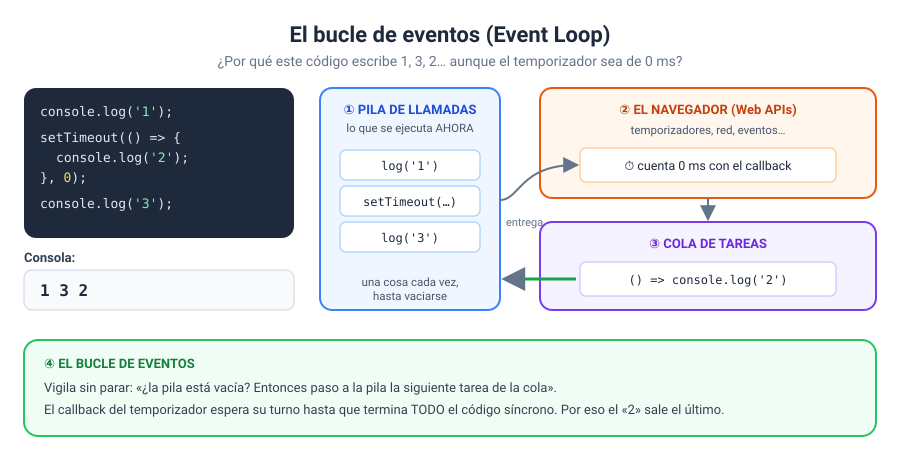

# Solución · Ejercicio 04 · ¿En qué orden? El bucle de eventos

[← Volver al enunciado](../../ejercicios/ejercicio_04/) · [← Volver al bloque](../../README.md)

## Qué pedía el ejercicio

Descubrir con tres experimentos cómo decide JavaScript qué se ejecuta y cuándo.

## Lo que pasa en cada experimento

| Experimento | Orden escrito | Orden en el registro |
| --- | --- | --- |
| A | A1, A2 (0 ms), A3 | **A1, A3, A2** |
| B | B1 (300 ms), B2 (0 ms), B3 | **B3, B2, B1** |
| C | C1, bucle de 2 s, C2 | C1, C2… con el reloj **congelado** 2 segundos |

## La explicación: la pila, la cola y el bucle

JavaScript ejecuta el código en una **pila de llamadas** (*call stack*), y solo puede hacer una cosa cada vez [1]. Cuando llamáis a `setTimeout`, el callback no va a la pila: se lo entregáis al navegador. Cuando el tiempo se cumple, el navegador lo deja en una **cola de tareas**. Y el **bucle de eventos** (*event loop*) va pasando tareas de la cola a la pila, pero **solo cuando la pila está vacía** [1].

### A: ¿por qué A2 sale el último si su retraso es 0?

Un temporizador de 0 ms no significa «ahora mismo», sino «en cuanto sea posible». El callback entra en la cola enseguida, pero tiene que esperar a que termine **todo** el código síncrono del clic, incluido A3. Solo entonces la pila queda vacía y A2 puede ejecutarse.

### B: ¿por qué B2 sale antes que B1?

B3 es síncrono, así que sale primero, como en A. Después, los temporizadores salen **por orden de vencimiento**: el de 0 ms vence antes que el de 300 ms, aunque esté escrito después.

### C: ¿por qué se congela todo?

El bucle `while` mantiene la pila ocupada durante 2 segundos. Mientras tanto, el bucle de eventos no puede pasar nada a la pila: ni los ticks del reloj, ni el clic en «Limpiar». La página está **congelada**. MDN lo muestra con un ejemplo parecido: mientras una función larga se ejecuta, el programa no responde y no se puede escribir, hacer clic ni nada más [2].

Si pulsasteis «Limpiar» durante el bloqueo, quizá visteis que el registro se vaciaba **después** de los 2 segundos: el clic esperaba en la cola su turno.

## La moraleja

> [!IMPORTANT]
> Nunca bloqueéis la pila con tareas largas. Todo lo que tarda (esperar un tiempo, pedir datos a un servidor, leer un fichero) debe hacerse de forma **asíncrona**: se encarga al navegador y se recoge el resultado con un callback o una promesa. Así la página sigue viva mientras tanto.

El experimento C es lo que **no** hay que hacer. Los ejercicios 05 a 08 os enseñan cómo hacerlo bien.

### Fuentes y Documentación Oficial

1. [JavaScript execution model (MDN Web Docs)](https://developer.mozilla.org/en-US/docs/Web/JavaScript/Reference/Execution_model)
2. [Introducing asynchronous JavaScript (MDN Web Docs)](https://developer.mozilla.org/en-US/docs/Learn_web_development/Extensions/Async_JS/Introducing)
