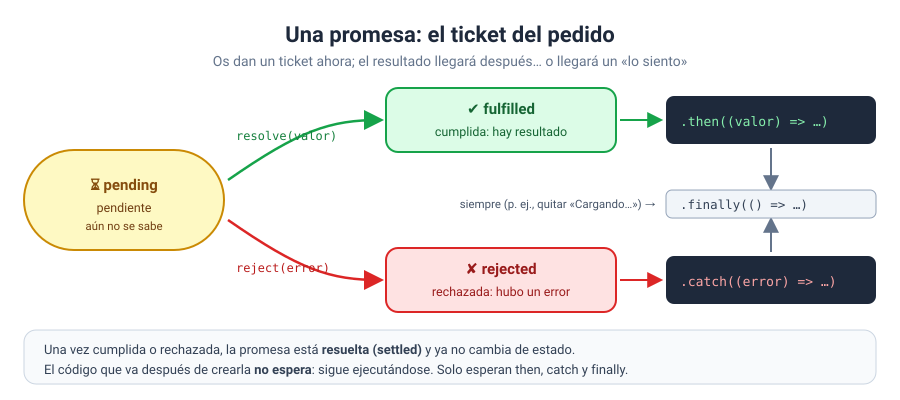

# Solución · Ejercicio 06 · Promesas que pueden fallar: then, catch y finally

[← Volver al enunciado](../../ejercicios/ejercicio_06/) · [← Volver al bloque](../../README.md)

## Qué pedía el ejercicio

Consultar el stock de un producto con una función que tarda y que puede fallar, y tratar cada caso.

## Una promesa que puede fallar

```javascript
return new Promise((resolve, reject) => {
    setTimeout(() => {
        if (Object.keys(STOCK).includes(producto)) {
            resolve(STOCK[producto]);
        } else {
            reject(new Error(`No existe el producto «${producto}».`));
        }
    }, 700);
});
```

La función que recibe `new Promise` tiene **dos** parámetros [1]:

- `resolve(valor)`: la operación ha ido bien. La promesa pasa a **cumplida** (*fulfilled*) con ese valor.
- `reject(error)`: algo ha fallado. La promesa pasa a **rechazada** (*rejected*).

Mientras no se llama a ninguno de los dos, está **pendiente** (*pending*) [2]. Es exactamente lo que hará `fetch` en el bloque 11 cuando pidáis datos a un servidor: tardará, y podrá ir bien o mal.



## Tratar los dos casos

```javascript
consultarStock(producto)
    .then((stock) => { … })      // si se cumple: recibe el valor
    .catch((error) => { … })     // si se rechaza: recibe el error
    .finally(() => { … });       // siempre
```

| Método | Se ejecuta si… | Recibe |
| --- | --- | --- |
| `then` | la promesa se cumple [3] | el valor de `resolve` |
| `catch` | la promesa se rechaza [4] | el error de `reject` |
| `finally` | la promesa termina, de una forma u otra [5] | nada |

`finally` es perfecto para el código de **limpieza** que tiene que ejecutarse pase lo que pase: reactivar el botón, quitar el «Cargando…» [5]. Sin él, tendríais que repetir esas líneas en el `then` y en el `catch`.

## El orden del registro

```
[+0 ms]   1. Pido el stock
[+1 ms]   2. Mientras tanto, la página sigue viva
[+702 ms] 3. Ha llegado la respuesta
[+703 ms] 4. Fin (finally)
```

La línea 2 está escrita **después** de toda la cadena, y sin embargo sale antes que la respuesta. Lo visteis en el ejercicio 01 con `setTimeout`: crear una promesa no detiene el programa. El código sigue, y `then`, `catch` y `finally` se ejecutan **cuando llegue** el resultado.

## Lo que ve el usuario

1. Pulsa «Consultar»: el botón se desactiva y aparece «⏳ Consultando…». Sabe que algo está pasando.
2. Llega la respuesta: ve el resultado o un error claro.
3. El botón se reactiva.

Nunca dejéis al usuario sin respuesta mientras esperáis. Un botón que no hace nada visible durante un segundo invita a pulsarlo cinco veces.

### Fuentes y Documentación Oficial

1. [Promise() constructor (MDN Web Docs)](https://developer.mozilla.org/en-US/docs/Web/JavaScript/Reference/Global_Objects/Promise/Promise)
2. [Promise (MDN Web Docs)](https://developer.mozilla.org/en-US/docs/Web/JavaScript/Reference/Global_Objects/Promise)
3. [Promise.prototype.then() (MDN Web Docs)](https://developer.mozilla.org/en-US/docs/Web/JavaScript/Reference/Global_Objects/Promise/then)
4. [Promise.prototype.catch() (MDN Web Docs)](https://developer.mozilla.org/en-US/docs/Web/JavaScript/Reference/Global_Objects/Promise/catch)
5. [Promise.prototype.finally() (MDN Web Docs)](https://developer.mozilla.org/en-US/docs/Web/JavaScript/Reference/Global_Objects/Promise/finally)
