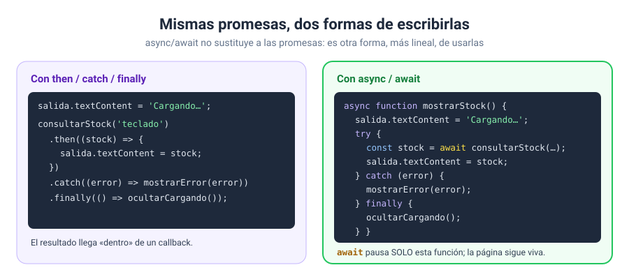

# Solución · Ejercicio 07 · async y await: el mismo código, más claro

[← Volver al enunciado](../../ejercicios/ejercicio_07/) · [← Volver al bloque](../../README.md)

## Qué pedía el ejercicio

Reescribir la consulta del ejercicio 06 con `async`/`await` y comparar dos formas de esperar varias promesas.

## `async` y `await`

```javascript
async function mostrarStock(producto) {
    try {
        const stock = await consultarStock(producto);
        resultado.textContent = `✔ ${producto}: ${stock} unidades.`;
    } catch (error) {
        resultado.textContent = `✘ ${error.message}`;
    } finally {
        console.log('Consulta terminada');
    }
}
```

- `async` delante de una función permite usar `await` dentro de ella [1]. Además, una función `async` **siempre devuelve una promesa** [1].
- `await` delante de una promesa **pausa la función** hasta que la promesa se resuelve, y entonces devuelve su valor [2]. La línea siguiente ya tiene el `stock`, como si fuera código normal y síncrono.
- Si la promesa se **rechaza**, `await` lanza el error, y lo capturáis con el `try...catch` que ya visteis en el bloque 09 [3]. El `finally` se ejecuta en los dos casos, igual que el `.finally()` de las promesas.



Comparadlo con el ejercicio 06: hace exactamente lo mismo, pero se lee **de arriba abajo**, sin callbacks.

> [!IMPORTANT]
> `await` solo pausa **la función `async`** en la que está, no la página. Mientras espera, el resto del programa sigue funcionando: los botones responden y los temporizadores avanzan [2]. No es el bloqueo del ejercicio 04.

## La carrera

### Uno detrás de otro: ~2800 ms

```javascript
for (const producto of PRODUCTOS) {
    stocks.push(await consultarStock(producto));
}
```

Cada `await` espera a que termine una consulta antes de **empezar** la siguiente. Cuatro consultas de 700 ms: 4 × 700 = 2800 ms.

### Todos a la vez: ~700 ms

```javascript
const promesas = PRODUCTOS.map((producto) => consultarStock(producto));
const stocks = await Promise.all(promesas);
```

El `map` **lanza las cuatro consultas de golpe**: cada `consultarStock` empieza en el acto y devuelve su promesa. `Promise.all` recibe un array de promesas y devuelve una sola, que se cumple cuando se cumplen **todas**, con un array de resultados en el mismo orden [4]. Las cuatro esperas transcurren a la vez: unos 700 ms.

| Forma | Tiempo | Úsala cuando… |
| --- | --- | --- |
| `await` en un bucle | Suma de todas | Cada paso necesita el resultado del anterior |
| `Promise.all` | La más lenta | Las tareas son independientes entre sí |

Un aviso: si **una** de las promesas de `Promise.all` se rechaza, la promesa conjunta se rechaza también [4]. Para esos casos necesitaríais un `try...catch` alrededor.

### Fuentes y Documentación Oficial

1. [async function (MDN Web Docs)](https://developer.mozilla.org/en-US/docs/Web/JavaScript/Reference/Statements/async_function)
2. [await (MDN Web Docs)](https://developer.mozilla.org/en-US/docs/Web/JavaScript/Reference/Operators/await)
3. [try...catch (MDN Web Docs)](https://developer.mozilla.org/en-US/docs/Web/JavaScript/Reference/Statements/try...catch)
4. [Promise.all() (MDN Web Docs)](https://developer.mozilla.org/en-US/docs/Web/JavaScript/Reference/Global_Objects/Promise/all)
