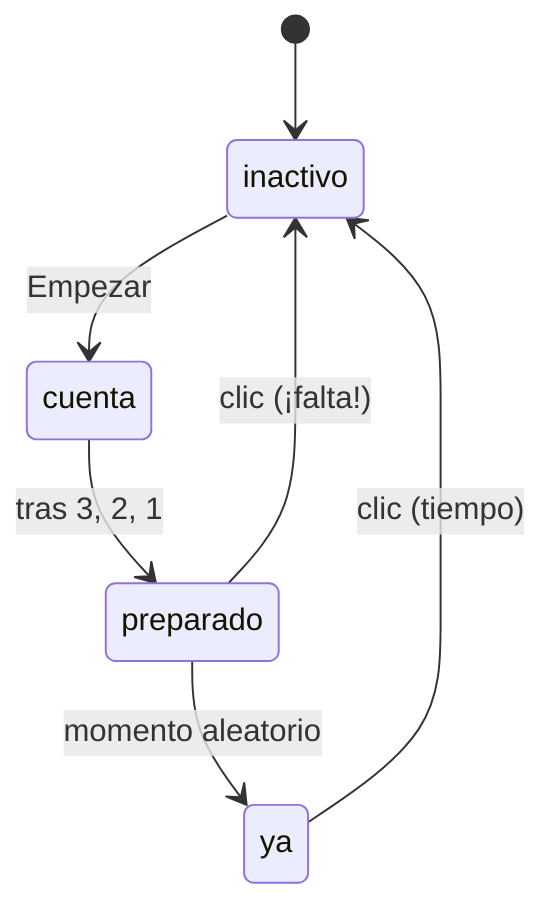

# Solución · Ejercicio 08 · Juego de reflejos

[← Volver al enunciado](../../ejercicios/ejercicio_08/) · [← Volver al bloque](../../README.md)

## Qué pedía el ejercicio

Un juego que mide vuestro tiempo de reacción. Junta temporizadores, promesas, `async`/`await`, medición del tiempo y almacenamiento.

## `esperar`: una pausa que se puede esperar

```javascript
const esperar = (ms) => new Promise((resolve) => setTimeout(resolve, ms));
```

Una línea con mucha miga. Devuelve una promesa que `setTimeout` cumple pasados `ms` milisegundos [1] [2]. Como `resolve` es una función, se la paso directamente a `setTimeout` como callback.

Con ella, la cuenta atrás se escribe como una lista de pasos:

```javascript
for (const numero of [3, 2, 1]) {
    ponerZona('', numero);
    await esperar(700);
}
```

Compárala con la pirámide del ejercicio 05: aquí ni siquiera hay callbacks a la vista. `await` pausa `empezar()` 700 ms en cada vuelta [3], pero la página sigue viva: podéis hacer clic en la zona durante la cuenta, y `pulsar()` se ejecuta, aunque decida ignorarlo.

## Las fases del juego



La variable `fase` es el estado del juego, y `pulsar()` decide qué hacer según ella. Es más fiable que mirar el color de la zona: el color es la **consecuencia** del estado, no el estado.

## Cancelar lo que no ha pasado

```javascript
if (fase === 'preparado') {
    clearTimeout(idTemporizador);
}
```

Si el jugador pulsa en rojo, el paso a verde todavía está programado. Sin `clearTimeout` [4], la zona se pondría verde un segundo después, en mitad del mensaje de falta. Siempre que un temporizador pueda quedar obsoleto, guardad su `id` y cancelad.

## ¿Por qué `setTimeout` y no `await esperar()` para el verde?

Porque hay que poder **cancelarlo**. Una promesa no se puede «des-cumplir» desde fuera. Para la cuenta atrás, que nunca se cancela, `await esperar()` es cómodo; para el verde, que sí, `setTimeout` con su `id`. Cada herramienta para lo suyo.

## Medir el tiempo

```javascript
momentoVerde = Date.now();
…
const tiempo = Date.now() - momentoVerde;
```

Restar dos instantes de `Date.now()` [5] da los milisegundos entre que apareció el verde y vuestro clic. Lo visteis en el cronómetro del ejercicio 02.

## El récord persiste

```javascript
let record = Number(localStorage.getItem(CLAVE_RECORD)) || null;
```

Del bloque 09: guardo el mejor tiempo con `setItem` [6] y lo leo al cargar. Si no hay nada guardado, `Number(null)` da `0`, y `0 || null` da `null`: «todavía no hay récord».

## Accesibilidad

La zona tiene `role="button"` y `tabindex="0"`, así que se puede alcanzar con Tab y pulsar con Enter o con la barra espaciadora. Con `e.preventDefault()` evito que el espacio desplace la página.

### Fuentes y Documentación Oficial

1. [Promise() constructor (MDN Web Docs)](https://developer.mozilla.org/en-US/docs/Web/JavaScript/Reference/Global_Objects/Promise/Promise)
2. [Window: setTimeout() method (MDN Web Docs)](https://developer.mozilla.org/en-US/docs/Web/API/Window/setTimeout)
3. [await (MDN Web Docs)](https://developer.mozilla.org/en-US/docs/Web/JavaScript/Reference/Operators/await)
4. [Window: clearTimeout() method (MDN Web Docs)](https://developer.mozilla.org/en-US/docs/Web/API/Window/clearTimeout)
5. [Date.now() (MDN Web Docs)](https://developer.mozilla.org/en-US/docs/Web/JavaScript/Reference/Global_Objects/Date/now)
6. [Window: localStorage property (MDN Web Docs)](https://developer.mozilla.org/en-US/docs/Web/API/Window/localStorage)
