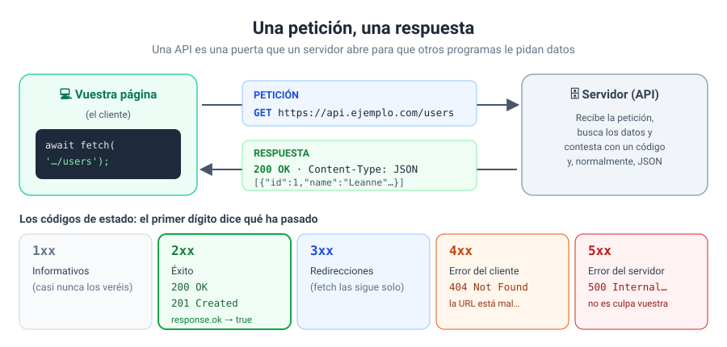
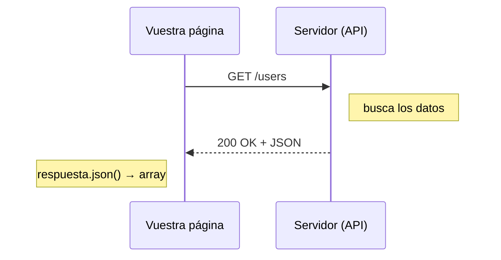
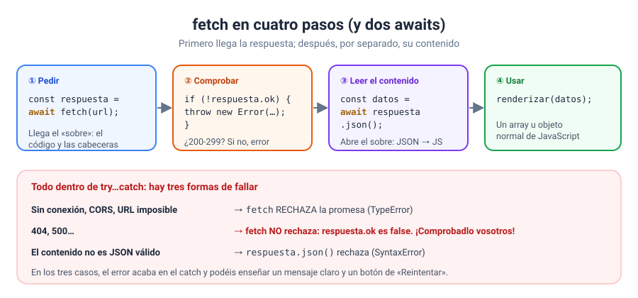
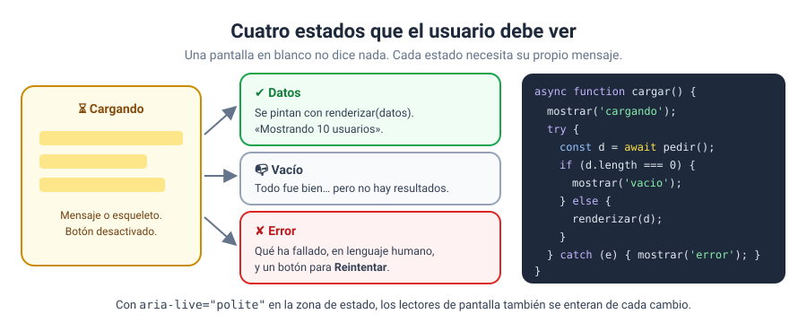
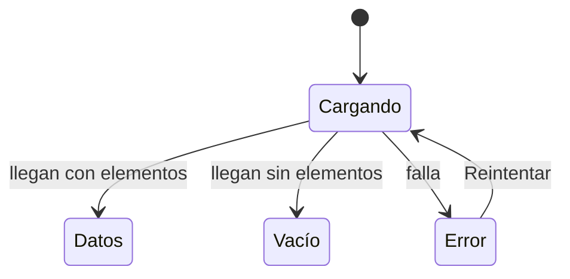
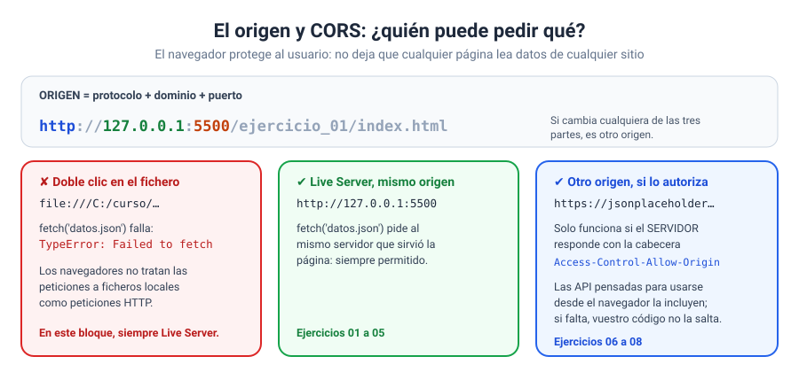
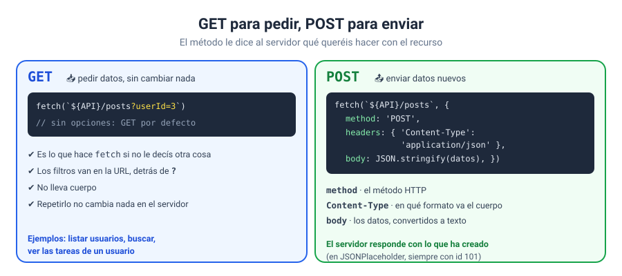

# Bloque 11 · Fetch y APIs

[← Bloque 10](../10-asincronia/) · [Volver al temario](../TEMARIO.md) · [Ir al bloque 12 →](../12-modulos-y-clases/)

Hasta ahora, todos los datos de vuestras páginas los habéis escrito vosotros: un array en el código, un formulario que rellena el usuario, algo guardado en `localStorage`. Las páginas de verdad no funcionan así. El tiempo, las noticias, el catálogo de una tienda o los mensajes de un chat viven en un **servidor**, y la página los pide cuando los necesita. En este bloque os voy a enseñar a hacer esas peticiones con `fetch`, a comprobar si han ido bien y a contarle al usuario qué está pasando mientras tanto. Todo lo que aprendisteis de `async` y `await` en el bloque 10 va a trabajar aquí.

Al terminar este bloque sabréis:

- Explicar qué es una API y qué viaja en una petición y en una respuesta HTTP.
- Pedir datos con `fetch` y convertirlos a JavaScript con `respuesta.json()`.
- Comprobar `respuesta.ok` y distinguir los tres tipos de error que pueden ocurrir.
- Mostrar al usuario los estados de carga, datos, vacío y error.
- Entender qué es el origen de una página, por qué necesitáis Live Server y qué es CORS.
- Enviar datos a un servidor con `POST`.
- Lanzar varias peticiones a la vez con `Promise.all`.

> [!IMPORTANT]
> **En este bloque, abrid siempre los ejercicios con Live Server.** Si hacéis doble clic en el `index.html`, la página se abre como fichero local y todas las peticiones fallarán. En el apartado 5 os explico por qué.

---

## 1. Qué es una API

Una **API** es la puerta que un programa abre para que otros programas le pidan cosas [1]. En la web, normalmente es un servidor que responde a ciertas URL con datos en lugar de con páginas. Vuestra página no ve la base de datos del servidor: solo ve lo que la API decide contestar.

La conversación siempre tiene la misma forma: el cliente (vuestra página) envía una **petición** y el servidor devuelve una **respuesta** [2].





| Viaja en la petición | Viaja en la respuesta |
| --- | --- |
| Un **método**: `GET` para pedir, `POST` para enviar… | Un **código de estado**: `200`, `404`, `500`… |
| La **URL** del recurso que queréis | Unas **cabeceras** que describen el contenido |
| Cabeceras y, a veces, un **cuerpo** con datos | El **cuerpo**: los datos, casi siempre en JSON |

### 1.1. Los códigos de estado

El código de estado es un número de tres cifras, y la primera dice qué ha pasado [3]. Las dos familias que más vais a ver son los `2xx` (todo bien) y los `4xx` (la petición tiene un problema, como pedir una URL que no existe: el famoso `404`). Si veis un `5xx`, el que ha fallado es el servidor.

### 1.2. JSON, otra vez

Los datos llegan como **texto** en formato JSON [4]. Ya lo conocéis del bloque 09: es el mismo formato que usabais con `JSON.stringify` y `JSON.parse` para guardar en `localStorage`. La diferencia es que ahora no lo escribís vosotros: lo escribe el servidor.

---

## 2. `fetch` en cuatro pasos

`fetch` es la función del navegador para hacer peticiones HTTP [5]. Recibe una URL y devuelve una **promesa**, así que se usa con `await` dentro de una función `async` [6].



```javascript
async function cargarConsejos() {
    // ① pedir: llega la respuesta (el «sobre»)
    const respuesta = await fetch('consejos.json');

    // ② comprobar: ¿ha ido bien?
    if (!respuesta.ok) {
        throw new Error(`Error ${respuesta.status}`);
    }

    // ③ leer el contenido: JSON → JavaScript
    const consejos = await respuesta.json();

    // ④ usar los datos
    renderizar(consejos);
}
```

Fijaos en que hay **dos `await`**. El primero espera a que lleguen el código de estado y las cabeceras; en ese momento tenéis un objeto `Response` [7], pero el contenido puede no haber terminado de descargarse. El segundo, `respuesta.json()`, espera a que llegue todo el cuerpo y lo convierte en un array u objeto normal de JavaScript.

Un objeto `Response` os da, entre otras cosas:

| Propiedad o método | Qué contiene |
| --- | --- |
| `respuesta.ok` | `true` si el código está entre 200 y 299 [8] |
| `respuesta.status` | El código de estado: `200`, `404`… [9] |
| `respuesta.json()` | Una promesa con el contenido ya convertido a JavaScript [10] |

### 2.1. Mi función de cabecera: `pedirJSON`

Los pasos ①, ② y ③ son siempre los mismos, así que en los ejercicios los meto en una función que reutilizo:

```javascript
async function pedirJSON(url) {
    const respuesta = await fetch(url);
    if (!respuesta.ok) {
        throw new Error(`Error ${respuesta.status} al pedir ${url}`);
    }
    return respuesta.json();
}

// y luego, en una línea:
const productos = await pedirJSON('productos.json');
```

---

## 3. Tres formas de fallar

Esta es la parte que más se olvida, y la que más problemas da en clase. Una petición puede salir mal de tres maneras distintas, y no todas se comportan igual:

| Qué pasa | Qué hace JavaScript |
| --- | --- |
| No hay conexión, la URL es imposible o el navegador bloquea la petición | `fetch` **rechaza** la promesa con un `TypeError` [6] |
| El servidor contesta, pero con un `404`, un `500`… | `fetch` **no rechaza**: `respuesta.ok` es `false` [6] |
| El contenido no es JSON válido | `respuesta.json()` rechaza con un `SyntaxError` [10] |

La segunda fila es la trampa: para `fetch`, un `404` es una respuesta como otra cualquiera. Por eso el paso ② no es opcional. Si no comprobáis `respuesta.ok` y lanzáis vosotros el error, vuestro código seguirá adelante intentando leer datos que no existen.

Lo bueno es que, con el `throw` del paso ②, los tres casos acaban en el mismo sitio: el `catch` [11].

```javascript
try {
    const datos = await pedirJSON(url);
    renderizar(datos);
} catch (error) {
    estado.textContent = `✘ No se han podido cargar los datos (${error.message}).`;
    btnReintentar.hidden = false;
}
```

---

## 4. Los cuatro estados de la interfaz

Una petición puede tardar un instante o varios segundos. Mientras tanto, una pantalla en blanco no le dice nada al usuario: ¿está cargando?, ¿se ha roto?, ¿no hay nada? Cada situación necesita su propio mensaje.





Mis reglas para los cuatro estados:

1. **Cargando.** Escribid un mensaje (`⏳ Cargando…`) y desactivad el botón que lanza la petición, para que nadie la repita diez veces.
2. **Datos.** Pintadlos y decid cuántos hay: «Mostrando 10 usuarios».
3. **Vacío.** Que no haya resultados no es un error. Decidlo con claridad: «No hay noticias publicadas todavía».
4. **Error.** Explicad lo que ha pasado en lenguaje humano y ofreced un botón de **Reintentar**.

Poned el mensaje de estado en un elemento con `aria-live="polite"`. Así, los lectores de pantalla anuncian cada cambio sin que el usuario tenga que buscarlo [12]. Ya lo usasteis en los formularios del bloque 08.

---

## 5. El origen, Live Server y CORS

El **origen** de una página es la combinación de su protocolo, su dominio y su puerto [13]. Si cambia cualquiera de los tres, es otro origen. El navegador usa el origen para proteger al usuario: no deja que una página cualquiera lea datos de cualquier sitio.



Esto tiene tres consecuencias prácticas:

- **Abrir el fichero con doble clic no sirve.** La página se carga con `file:///`, y los navegadores no aceptan esas peticiones como peticiones HTTP normales [14]. `fetch('datos.json')` falla con `TypeError: Failed to fetch`. Lo he comprobado: con el mismo código y la misma carpeta, la petición funciona en cuanto la página se sirve por HTTP.
- **Con Live Server, pedir ficheros de vuestra carpeta funciona siempre.** La página y el JSON vienen del mismo servidor (`http://127.0.0.1:5500`), así que son del mismo origen. Es el caso de los ejercicios 01 a 05.
- **Pedir a otro origen solo funciona si el servidor lo autoriza.** Lo hace con la cabecera `Access-Control-Allow-Origin`; ese mecanismo se llama **CORS** [15]. Las API pensadas para usarse desde el navegador la incluyen. Si una API no la envía, veréis un error de CORS en la consola, y vuestro código no lo puede arreglar: la decisión es del servidor. Es el caso de los ejercicios 06 a 08.

---

## 6. Pedir y enviar: `GET` y `POST`



Si no le decís otra cosa, `fetch` hace una petición `GET`, el método para **pedir** datos sin cambiar nada en el servidor [16]. Muchas API aceptan parámetros en la URL para filtrar:

```javascript
// solo las publicaciones del usuario 3
const publicaciones = await pedirJSON(`${API}/posts?userId=3`);
```

Para **enviar** datos, se usa `POST` [17], y a `fetch` se le pasa un segundo argumento con las opciones de la petición [5]:

```javascript
const respuesta = await fetch(`${API}/posts`, {
    method: 'POST',
    headers: { 'Content-Type': 'application/json' },
    body: JSON.stringify({ title: 'Hola', body: 'Mi primer POST', userId: 1 }),
});
const creada = await respuesta.json();   // el servidor devuelve lo que ha creado
```

| Opción | Para qué sirve |
| --- | --- |
| `method` | El método HTTP: `'POST'` |
| `headers` | Las cabeceras. `Content-Type` le dice al servidor en qué formato va el cuerpo [18] |
| `body` | Los datos. Un objeto no se puede enviar tal cual: hay que convertirlo con `JSON.stringify` |

---

## 7. Varias peticiones a la vez

Si una página necesita dos cosas independientes (por ejemplo, la lista de usuarios y las tareas del primero), no tiene sentido esperar a una para pedir la otra. `Promise.all` lanza todas a la vez y espera a que terminen [19]:

```javascript
const [usuarios, tareas] = await Promise.all([
    pedirJSON(`${API}/users`),
    pedirJSON(`${API}/todos?userId=1`),
]);
```

Es lo mismo que visteis en el bloque 10, ahora con peticiones de verdad. Si una sola falla, `Promise.all` rechaza y saltáis al `catch`.

---

## 8. La plantilla de trabajo con `fetch`

La plantilla de siempre, con la carga de datos dentro de una función `async` que gestiona los cuatro estados:

```javascript
// estructura del programa principal
const URL_DATOS = 'productos.json';

// funciones
async function pedirJSON(url) {
    const respuesta = await fetch(url);
    if (!respuesta.ok) {
        throw new Error(`Error ${respuesta.status} al pedir ${url}`);
    }
    return respuesta.json();
}

async function cargar() {
    // salidas inmediatas: CARGANDO
    boton.disabled = true;
    estado.textContent = '⏳ Cargando…';
    try {
        // entradas y procesamiento
        const datos = await pedirJSON(URL_DATOS);
        // salidas: VACÍO o DATOS
        if (datos.length === 0) {
            estado.textContent = '📭 No hay resultados.';
            return;
        }
        renderizar(datos);
        estado.textContent = `Mostrando ${datos.length} elementos`;
    } catch (error) {
        // salidas: ERROR
        estado.textContent = `✘ ${error.message}`;
    } finally {
        boton.disabled = false;
    }
}

// constantes al DOM que queremos escuchar
const boton = document.querySelector('#btnCargar');
const estado = document.querySelector('#estado');

// colocar escuchadores de eventos
boton.addEventListener('click', cargar);
```

---

## 9. Ejercicios

| Nº | Ejercicio | Qué practicáis | Solución |
| --- | --- | --- | --- |
| 01 | [Mi primer fetch: leer un JSON](ejercicios/ejercicio_01/) | `fetch`, `respuesta.json()`, los dos `await` | [Ver](soluciones/ejercicio_01/) |
| 02 | [respuesta.ok y los códigos de estado](ejercicios/ejercicio_02/) | `200`, `404` y un fallo de red, uno al lado del otro | [Ver](soluciones/ejercicio_02/) |
| 03 | [El catálogo llega de un fichero](ejercicios/ejercicio_03/) | `pedirJSON`, pintar tarjetas, botón Reintentar | [Ver](soluciones/ejercicio_03/) |
| 04 | [Buscador de países](ejercicios/ejercicio_04/) | Cargar una vez y filtrar en memoria, búsqueda sin tildes con espera | [Ver](soluciones/ejercicio_04/) |
| 05 | [Estados de carga, errores y reintentos](ejercicios/ejercicio_05/) | Cargando, datos, vacío y error con cinco escenarios simulados | [Ver](soluciones/ejercicio_05/) |
| 06 | [Una API pública: usuarios y publicaciones](ejercicios/ejercicio_06/) | Pedir a otro origen, datos anidados, parámetros en la URL | [Ver](soluciones/ejercicio_06/) |
| 07 | [Enviar datos con POST](ejercicios/ejercicio_07/) | `method`, `headers`, `body` y `JSON.stringify` | [Ver](soluciones/ejercicio_07/) |
| 08 | [Tareas de la API con favoritos](ejercicios/ejercicio_08/) | `Promise.all`, filtros, búsqueda y favoritos en `localStorage` | [Ver](soluciones/ejercicio_08/) |

Los ejercicios 01 a 05 piden ficheros JSON de su propia carpeta. Del 06 al 08 se conectan a JSONPlaceholder, una API pública y gratuita para practicar, así que necesitáis conexión a Internet. Y una prueba que os recomiendo: en el 02, abrid la pestaña **Red** de las herramientas de desarrollo y mirad cada petición. Ver el `404` en rojo con vuestros propios ojos se olvida mucho más tarde que leerlo aquí.

---

[← Bloque 10](../10-asincronia/) · [Volver al temario](../TEMARIO.md) · [Ir al bloque 12 →](../12-modulos-y-clases/)

### Fuentes y Documentación Oficial

1. [API (MDN Web Docs)](https://developer.mozilla.org/en-US/docs/Glossary/API)
2. [Overview of HTTP (MDN Web Docs)](https://developer.mozilla.org/en-US/docs/Web/HTTP/Guides/Overview)
3. [HTTP response status codes (MDN Web Docs)](https://developer.mozilla.org/en-US/docs/Web/HTTP/Reference/Status)
4. [JSON (MDN Web Docs)](https://developer.mozilla.org/en-US/docs/Glossary/JSON)
5. [Using the Fetch API (MDN Web Docs)](https://developer.mozilla.org/en-US/docs/Web/API/Fetch_API/Using_Fetch)
6. [Window: fetch() method (MDN Web Docs)](https://developer.mozilla.org/en-US/docs/Web/API/Window/fetch)
7. [Response (MDN Web Docs)](https://developer.mozilla.org/en-US/docs/Web/API/Response)
8. [Response: ok property (MDN Web Docs)](https://developer.mozilla.org/en-US/docs/Web/API/Response/ok)
9. [Response: status property (MDN Web Docs)](https://developer.mozilla.org/en-US/docs/Web/API/Response/status)
10. [Response: json() method (MDN Web Docs)](https://developer.mozilla.org/en-US/docs/Web/API/Response/json)
11. [try...catch (MDN Web Docs)](https://developer.mozilla.org/en-US/docs/Web/JavaScript/Reference/Statements/try...catch)
12. [ARIA: aria-live attribute (MDN Web Docs)](https://developer.mozilla.org/en-US/docs/Web/Accessibility/ARIA/Reference/Attributes/aria-live)
13. [Origin (MDN Web Docs)](https://developer.mozilla.org/en-US/docs/Glossary/Origin)
14. [Reason: CORS request not HTTP (MDN Web Docs)](https://developer.mozilla.org/en-US/docs/Web/HTTP/Guides/CORS/Errors/CORSRequestNotHttp)
15. [Cross-Origin Resource Sharing (CORS) (MDN Web Docs)](https://developer.mozilla.org/en-US/docs/Web/HTTP/Guides/CORS)
16. [GET request method (MDN Web Docs)](https://developer.mozilla.org/en-US/docs/Web/HTTP/Reference/Methods/GET)
17. [POST request method (MDN Web Docs)](https://developer.mozilla.org/en-US/docs/Web/HTTP/Reference/Methods/POST)
18. [Content-Type header (MDN Web Docs)](https://developer.mozilla.org/en-US/docs/Web/HTTP/Reference/Headers/Content-Type)
19. [Promise.all() (MDN Web Docs)](https://developer.mozilla.org/en-US/docs/Web/JavaScript/Reference/Global_Objects/Promise/all)
