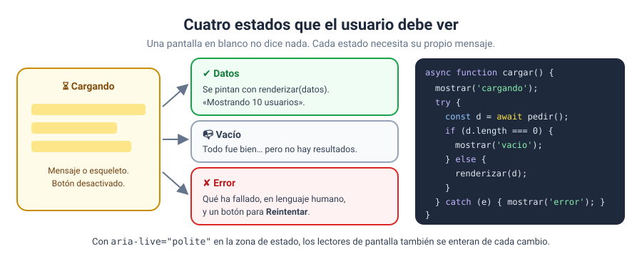

# Solución · Ejercicio 05 · Estados de carga, errores y reintentos

[← Volver al enunciado](../../ejercicios/ejercicio_05/) · [← Volver al bloque](../../README.md)

## Qué pedía el ejercicio

Un tablón de noticias que muestre bien cada situación posible al cargar datos: mientras carga, cuando llegan, cuando no hay nada y cuando algo falla.

## Los cuatro estados



| Escenario | Estado que veis |
| --- | --- |
| Todo bien | ⏳ Cargando… → 4 noticias |
| Conexión lenta | ⏳ Cargando… durante 2 s → 4 noticias |
| Sin noticias | 📭 No hay noticias publicadas todavía |
| JSON roto | ✘ El fichero ha llegado, pero no es un JSON válido |
| No existe | ✘ Error 404 al pedir no-existe.json |

El escenario lento es el más instructivo: sin el mensaje de carga, el usuario vería dos segundos de pantalla vacía y pensaría que no funciona.

## Vacío no es error

```javascript
if (noticias.length === 0) {
    estado.textContent = '📭 No hay noticias publicadas todavía.';
    return;
}
```

Si el servidor devuelve un array vacío, **todo ha ido bien**: simplemente no hay datos. Tratarlo como un error confundiría al usuario («¿se ha roto algo?»). Merece su propio mensaje.

Y fijaos en el `return` dentro del `try`: el `finally` se ejecuta igualmente, así que el botón se reactiva.

## Tres tipos de error

```javascript
if (error.name === 'SyntaxError') { … }   // json() no ha podido leerlo
if (error.name === 'TypeError') { … }     // fetch no ha podido conectar
return error.message;                     // el que lanzamos al ver !respuesta.ok
```

| Error | Quién lo lanza | Cuándo |
| --- | --- | --- |
| `TypeError` | `fetch` | No hay red, el servidor no existe, CORS… [1] |
| `Error` propio | Vuestro `throw` | El servidor responde con un código que no es 2xx [2] |
| `SyntaxError` | `respuesta.json()` | El contenido no se puede interpretar como JSON [3] |

Cada uno pide un mensaje distinto. «No hay conexión» invita a comprobar el wifi; «el fichero no es válido» dice que el problema no es del usuario. Un mensaje útil explica qué ha pasado y, si se puede, qué hacer.

## Reintentar

El botón «Reintentar» llama a la misma función `cargar`. Solo aparece en el estado de error: en los demás no tendría sentido. Los estados se anuncian en una región `aria-live` [4] para que también lleguen a quien usa lector de pantalla.

### Fuentes y Documentación Oficial

1. [Window: fetch() method (MDN Web Docs)](https://developer.mozilla.org/en-US/docs/Web/API/Window/fetch)
2. [Response: ok property (MDN Web Docs)](https://developer.mozilla.org/en-US/docs/Web/API/Response/ok)
3. [Response: json() method (MDN Web Docs)](https://developer.mozilla.org/en-US/docs/Web/API/Response/json)
4. [ARIA: aria-live attribute (MDN Web Docs)](https://developer.mozilla.org/en-US/docs/Web/Accessibility/ARIA/Reference/Attributes/aria-live)
