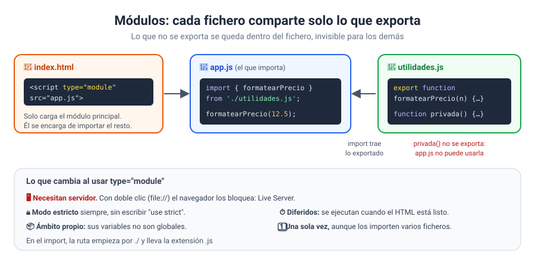
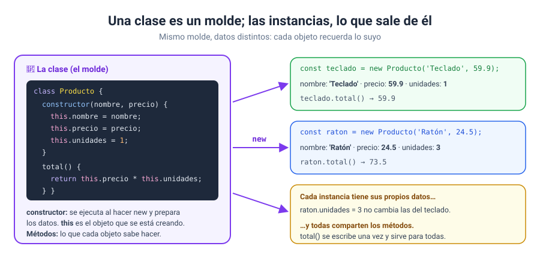
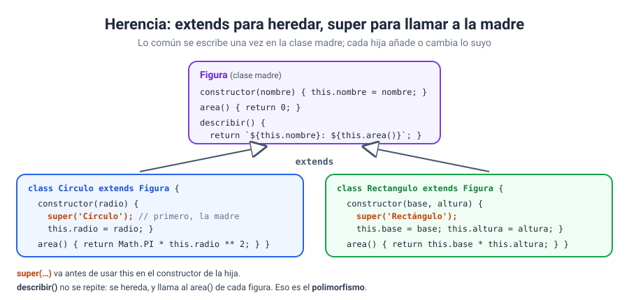
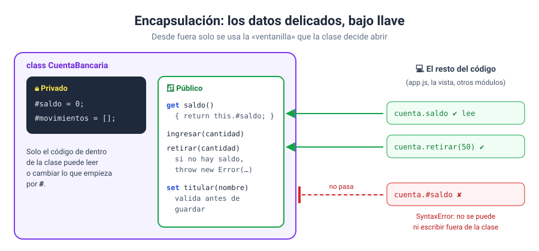
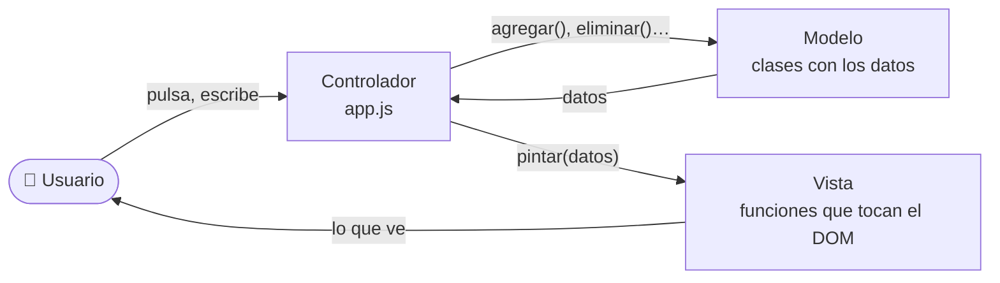

# Bloque 12 · Módulos, clases y buenas prácticas

[← Bloque 11](../11-fetch-y-apis/) · [Volver al temario](../TEMARIO.md) · [Ir al bloque 13 →](../13-proyecto-final/)

Vuestros programas ya hacen muchas cosas: leen formularios, guardan datos, piden información a un servidor… y empiezan a tener cientos de líneas en un único `app.js`. Encontrar algo ahí dentro cuesta cada vez más, y tocar una parte sin romper otra, también. En este bloque no vais a aprender a hacer cosas nuevas, sino a **ordenar** las que ya sabéis hacer: repartir el código en ficheros con **módulos**, agrupar datos y comportamiento con **clases**, separar responsabilidades y encontrar fallos con las herramientas de **depuración**. Es lo que distingue un programa que funciona de un programa que se puede mantener.

Al terminar este bloque sabréis:

- Repartir una aplicación en módulos con `export`, `import` y `<script type="module">`.
- Explicar por qué los módulos necesitan un servidor.
- Declarar clases con `constructor`, propiedades y métodos, y crear instancias con `new`.
- Reutilizar código con herencia: `extends` y `super`.
- Proteger datos con elementos privados `#`, *getters*, *setters* y miembros `static`.
- Separar una aplicación en modelo, vista y controlador.
- Depurar con puntos de interrupción y la instrucción `debugger`.

> [!IMPORTANT]
> Los ejercicios 01, 02, 06 y 08 usan módulos: **abridlos con Live Server**. Los ejercicios 03, 04, 05 y 07 funcionan también con doble clic.

---

## 1. Módulos: un fichero, una responsabilidad

Un **módulo** es un fichero JavaScript con su propio ámbito: lo que declara se queda dentro, salvo lo que decida compartir [1].



### 1.1. `export` e `import`

```javascript
// utilidades.js
export const PORCENTAJE_IVA = 21;
export function formatearPrecio(cantidad) { … }
function privada() { … }                  // sin export: nadie más la ve
```

```javascript
// app.js
import { PORCENTAJE_IVA, formatearPrecio } from './utilidades.js';
```

`export` marca lo que el módulo comparte [2]; `import` lo trae a otro fichero por su nombre exacto [3]. La ruta empieza por `./` (misma carpeta) y lleva la extensión `.js`.

### 1.2. Cuatro formas de importar

| Forma | Código | Detalle |
| --- | --- | --- |
| Con nombre | `import { formatearPrecio } from './utilidades.js'` | Con llaves y el nombre exacto |
| Con alias | `import { formatearPrecio as precio } from …` | Cambia el nombre en este fichero |
| Por defecto | `import convertir from './conversor.js'` | Sin llaves; el nombre lo elegís vosotros [3] |
| Entero | `import * as util from './utilidades.js'` | Todo lo exportado, dentro de un objeto |

Un módulo puede tener muchas exportaciones con nombre, pero solo **una** por defecto [2]. Lo importado es de solo lectura: si intentáis reasignarlo, obtenéis un `TypeError` [3].

### 1.3. `<script type="module">`

```html
<script type="module" src="app.js"></script>
```

En el HTML solo se carga el módulo principal, y él importa los demás. El atributo `type="module"` es imprescindible: le dice al navegador que el fichero es un módulo [4]. Sin él, `import` provoca un `SyntaxError` [3].

### 1.4. Lo que cambia con los módulos

| Diferencia | Qué significa para vosotros |
| --- | --- |
| **Necesitan un servidor** | Con doble clic (`file://`) el navegador bloquea los módulos por seguridad y no se ejecuta nada [1]. Siempre Live Server |
| **Modo estricto** | Siempre activo, sin escribir `"use strict"` [1]. Algunos descuidos que antes se ignoraban ahora dan error [5] |
| **Diferidos** | Se ejecutan cuando el HTML ya está leído, aunque el `<script>` esté en el `<head>` [1] |
| **Ámbito propio** | Sus variables no son globales: no aparecen en `window` ni en la consola [1] |
| **Una sola vez** | Aunque los importen varios ficheros, se ejecutan una vez y todos comparten el mismo [1] |

Lo de necesitar servidor ya os sonará: es el mismo bloqueo que vivisteis con `fetch` en el bloque 11 [6].

---

## 2. Clases: el molde de los objetos

En el bloque 05 creabais objetos con llaves, uno a uno. Cuando necesitáis muchos objetos con la misma forma y el mismo comportamiento, se escribe una **clase**: una plantilla para crearlos [7].



```javascript
class Producto {
    constructor(nombre, precio) {
        this.nombre = nombre;
        this.precio = precio;
        this.unidades = 1;
    }

    total() {
        return this.precio * this.unidades;
    }
}

const teclado = new Producto('Teclado', 59.9);
teclado.total();   // 59.9
```

| Pieza | Qué es |
| --- | --- |
| `class Producto` | El nombre de la clase. Por costumbre, empieza por mayúscula |
| `constructor` | Se ejecuta al crear cada objeto y prepara sus datos [8] |
| `this` | Dentro de la clase, el objeto concreto con el que se trabaja [9] |
| Métodos (`total()`) | Lo que cada objeto sabe hacer. Se escriben sin `function` |
| `new` | Crea un objeto nuevo a partir de la clase [10]. Sin `new`, una clase no se puede usar: da `TypeError` [10] |

Cada **instancia** (cada objeto creado con `new`) guarda sus propios datos, pero todas comparten los mismos métodos: `total` se escribe una vez y sirve para todas [11]. Y la gran ventaja: las reglas viven **dentro** del objeto. Si `quitar()` no deja bajar de 0, nadie que use la clase puede olvidarlo.

---

## 3. Herencia: `extends` y `super`

Cuando varias clases comparten una parte, esa parte se escribe una vez en una **clase madre**, y las demás la **heredan** con `extends` [12].



```javascript
class Figura {
    constructor(nombre) { this.nombre = nombre; }
    area() { return 0; }
    describir() { return `${this.nombre}: ${this.area().toFixed(2)}`; }
}

class Circulo extends Figura {
    constructor(radio) {
        super('Círculo');         // primero, el constructor de la madre
        this.radio = radio;
    }
    area() { return Math.PI * this.radio ** 2; }    // sobrescribe el de la madre
}
```

- **`super(…)`** llama al constructor de la madre [13]. En una clase hija hay que llamarlo **antes** de usar `this`; si no, la consola lanza un `ReferenceError` [12].
- **`super.metodo()`** llama a un método de la madre desde la hija [13]: útil para ampliar lo que hace en lugar de reescribirlo.
- **Sobrescribir:** si la hija declara un método con el mismo nombre, se usa el suyo.
- **Polimorfismo:** `describir()` solo está en `Figura`, pero llama al `area()` de cada figura. El mismo código funciona con todas, y añadir una figura nueva no obliga a cambiarlo.
- **`instanceof`** dice si un objeto pertenece a una clase, mirando toda la cadena de herencia [14]: un círculo es `instanceof Circulo` y también `instanceof Figura`.

---

## 4. Encapsulación: privados, *getters*, *setters* y `static`

Si cualquiera puede escribir `cuenta.saldo = 1000000`, las reglas de la clase no sirven de nada. La **encapsulación** guarda los datos delicados bajo llave y deja una ventanilla de métodos que ponen condiciones.



```javascript
class CuentaBancaria {
    static LIMITE_RETIRADA = 600;        // de la clase, no de cada cuenta
    #saldo = 0;                          // privado

    get saldo() {                        // se lee: cuenta.saldo
        return this.#saldo;
    }

    retirar(cantidad) {
        if (cantidad > this.#saldo) {
            throw new Error('Saldo insuficiente.');
        }
        this.#saldo -= cantidad;
    }
}
```

| Herramienta | Qué hace |
| --- | --- |
| `#nombre` | Campo o método **privado**: solo lo puede usar el código de la clase. Escribirlo fuera es un error de sintaxis [15] |
| `get` | Una propiedad que se lee como un dato pero ejecuta una función [16] |
| `set` | Una propiedad que se asigna como un dato pero ejecuta una función, normalmente para validar [17] |
| `static` | Un miembro de la **clase**, no de cada objeto: `CuentaBancaria.LIMITE_RETIRADA` [18] |
| `throw new Error(…)` | La clase avisa de que algo no se puede hacer [19]; quien la usa lo recoge con `try...catch` |

Una regla de oro: una clase **no escribe en el DOM**. Lanza errores con mensajes claros y deja que la página decida cómo mostrarlos.

---

## 5. Separar responsabilidades: modelo, vista y controlador

Con módulos y clases ya tenéis las piezas para ordenar una aplicación entera. El reparto más habitual tiene tres papeles:



| Papel | Sabe… | No sabe… |
| --- | --- | --- |
| **Modelo** | Qué datos hay y qué reglas cumplen | Que existe una página |
| **Vista** | Cómo se pinta cada cosa | De dónde vienen los datos ni cómo se cambian |
| **Controlador** | Qué hacer cuando el usuario actúa | Cómo se valida ni cómo se pinta |

Una prueba rápida de que el reparto está bien hecho: en el modelo no aparece `document`, y en la vista no aparece el modelo. Así, si cambia el aspecto, solo se toca la vista; si cambia una regla, solo el modelo.

---

## 6. Depuración: detener el programa y mirar

Los fallos más difíciles no dan ningún error: el programa funciona, pero el resultado está mal. Para encontrarlos, `console.log` se queda corto. Las herramientas de desarrollo permiten **detener la ejecución** en una línea y examinarlo todo en ese momento [20].

| Herramienta | Qué hace |
| --- | --- |
| **Punto de interrupción** | En **Fuentes** (*Sources*), pulsad el número de una línea: la ejecución se detendrá ahí [20] |
| **Pasar a la siguiente** (F10) | Ejecuta la línea y se detiene en la siguiente |
| **Entrar** (F11) | Entra en la función que se llama en esa línea |
| **Ámbito** (*Scope*) | Todas las variables con su valor en ese instante [20] |
| `debugger;` | Escrito en el código, detiene la ejecución si las herramientas están abiertas [21] |

Y el método, que vale más que cualquier herramienta: **sabed qué debería salir**, detened el programa antes del fallo, **mirad los valores en lugar de suponerlos** y corregid de uno en uno.

---

## 7. La plantilla de trabajo con módulos

A partir de ahora, una aplicación mediana queda así:

```
mi-aplicacion/
├── index.html      ← <script type="module" src="app.js">
├── style.css
├── app.js          ← controlador: importa, escucha y coordina
├── modelo.js       ← clases con los datos y sus reglas
├── vista.js        ← funciones que pintan en el DOM
└── almacen.js      ← guardar y cargar (localStorage o fetch)
```

Y el módulo principal mantiene la plantilla de siempre:

```javascript
// estructura del programa principal
import { ListaCompra } from './modelo.js';
import { pintarLista, mostrarMensaje } from './vista.js';

const lista = new ListaCompra();

// funciones
function actualizar() {
    pintarLista(contenedor, lista.articulos);
}

// constantes al DOM que queremos escuchar
const formulario = document.querySelector('#formArticulo');
const contenedor = document.querySelector('#articulos');
const mensaje = document.querySelector('#mensaje');

// colocar escuchadores de eventos
formulario.addEventListener('submit', (e) => {
    e.preventDefault();
    // entradas
    const nombre = formulario.nombre.value;
    // procesamiento: el modelo valida
    try {
        lista.agregar(nombre, 1);
        mostrarMensaje(mensaje, '');
    } catch (error) {
        mostrarMensaje(mensaje, `✘ ${error.message}`);
    }
    // salidas
    actualizar();
});

actualizar();
```

---

## 8. Ejercicios

| Nº | Ejercicio | Qué practicáis | Solución |
| --- | --- | --- | --- |
| 01 | [Mi primer módulo](ejercicios/ejercicio_01/) | `export`, `import`, `type="module"`, lo que no se exporta | [Ver](soluciones/ejercicio_01/) |
| 02 | [Formas de exportar e importar](ejercicios/ejercicio_02/) | Alias, por defecto, `* as`, y cuatro diferencias de los módulos | [Ver](soluciones/ejercicio_02/) |
| 03 | [Mi primera clase: el carrito](ejercicios/ejercicio_03/) | `class`, `constructor`, métodos, `new`, `instanceof` | [Ver](soluciones/ejercicio_03/) |
| 04 | [Herencia: figuras geométricas](ejercicios/ejercicio_04/) | `extends`, `super`, sobrescribir, polimorfismo | [Ver](soluciones/ejercicio_04/) |
| 05 | [Encapsulación: la cuenta bancaria](ejercicios/ejercicio_05/) | `#privados`, `get`, `set`, `static`, `throw` | [Ver](soluciones/ejercicio_05/) |
| 06 | [Modelo, vista y controlador](ejercicios/ejercicio_06/) | Separar responsabilidades en tres módulos | [Ver](soluciones/ejercicio_06/) |
| 07 | [Depuración: cuatro fallos escondidos](ejercicios/ejercicio_07/) | Puntos de interrupción, paso a paso, `debugger` | [Ver](soluciones/ejercicio_07/) |
| 08 | [Proyecto: mi biblioteca con clases y módulos](ejercicios/ejercicio_08/) | Todo el bloque, con `toJSON` y `localStorage` | [Ver](soluciones/ejercicio_08/) |

El 07 no os lo saltéis aunque parezca el más sencillo. Aprender a depurar os ahorrará más horas que cualquier otra cosa de este curso, y el proyecto final del bloque 13 os lo va a pedir.

---

[← Bloque 11](../11-fetch-y-apis/) · [Volver al temario](../TEMARIO.md) · [Ir al bloque 13 →](../13-proyecto-final/)

### Fuentes y Documentación Oficial

1. [JavaScript modules (MDN Web Docs)](https://developer.mozilla.org/en-US/docs/Web/JavaScript/Guide/Modules)
2. [export (MDN Web Docs)](https://developer.mozilla.org/en-US/docs/Web/JavaScript/Reference/Statements/export)
3. [import (MDN Web Docs)](https://developer.mozilla.org/en-US/docs/Web/JavaScript/Reference/Statements/import)
4. [&lt;script&gt;: The Script element (MDN Web Docs)](https://developer.mozilla.org/en-US/docs/Web/HTML/Reference/Elements/script)
5. [Strict mode (MDN Web Docs)](https://developer.mozilla.org/en-US/docs/Web/JavaScript/Reference/Strict_mode)
6. [Reason: CORS request not HTTP (MDN Web Docs)](https://developer.mozilla.org/en-US/docs/Web/HTTP/Guides/CORS/Errors/CORSRequestNotHttp)
7. [Classes (MDN Web Docs)](https://developer.mozilla.org/en-US/docs/Web/JavaScript/Reference/Classes)
8. [constructor (MDN Web Docs)](https://developer.mozilla.org/en-US/docs/Web/JavaScript/Reference/Classes/constructor)
9. [this (MDN Web Docs)](https://developer.mozilla.org/en-US/docs/Web/JavaScript/Reference/Operators/this)
10. [new (MDN Web Docs)](https://developer.mozilla.org/en-US/docs/Web/JavaScript/Reference/Operators/new)
11. [Using classes (MDN Web Docs)](https://developer.mozilla.org/en-US/docs/Web/JavaScript/Guide/Using_classes)
12. [extends (MDN Web Docs)](https://developer.mozilla.org/en-US/docs/Web/JavaScript/Reference/Classes/extends)
13. [super (MDN Web Docs)](https://developer.mozilla.org/en-US/docs/Web/JavaScript/Reference/Operators/super)
14. [instanceof (MDN Web Docs)](https://developer.mozilla.org/en-US/docs/Web/JavaScript/Reference/Operators/instanceof)
15. [Private elements (MDN Web Docs)](https://developer.mozilla.org/en-US/docs/Web/JavaScript/Reference/Classes/Private_elements)
16. [get (MDN Web Docs)](https://developer.mozilla.org/en-US/docs/Web/JavaScript/Reference/Functions/get)
17. [set (MDN Web Docs)](https://developer.mozilla.org/en-US/docs/Web/JavaScript/Reference/Functions/set)
18. [static (MDN Web Docs)](https://developer.mozilla.org/en-US/docs/Web/JavaScript/Reference/Classes/static)
19. [Error (MDN Web Docs)](https://developer.mozilla.org/en-US/docs/Web/JavaScript/Reference/Global_Objects/Error)
20. [JavaScript debugging and error handling (MDN Web Docs)](https://developer.mozilla.org/en-US/docs/Learn_web_development/Core/Scripting/Debugging_JavaScript)
21. [debugger (MDN Web Docs)](https://developer.mozilla.org/en-US/docs/Web/JavaScript/Reference/Statements/debugger)
