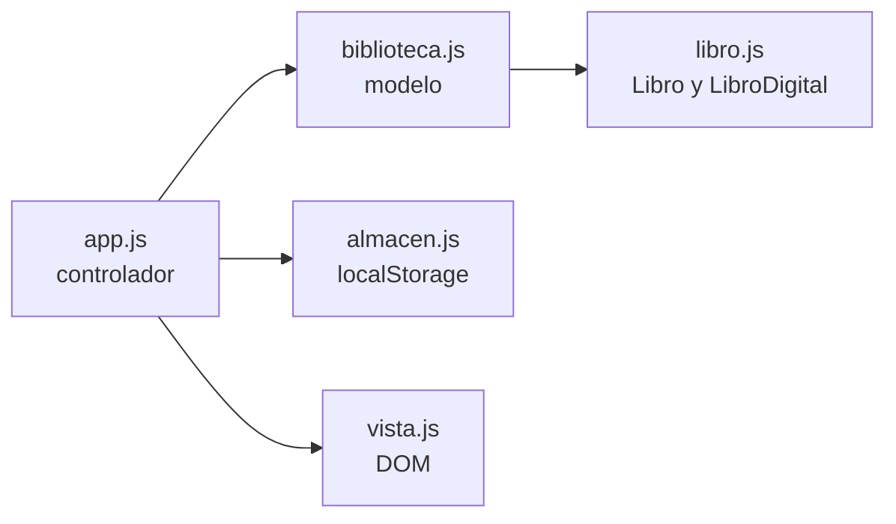

# Solución · Ejercicio 08 · Proyecto: mi biblioteca con clases y módulos

[← Volver al enunciado](../../ejercicios/ejercicio_08/) · [← Volver al bloque](../../README.md)

## Qué pedía el ejercicio

Una aplicación de biblioteca personal con todo lo del bloque: clases con herencia, datos privados, módulos con responsabilidades separadas y persistencia en el navegador.

## El mapa de la aplicación



| Módulo | Exporta | Responsabilidad |
| --- | --- | --- |
| `libro.js` | `Libro`, `LibroDigital`, `crearLibro` | Cómo es un libro y qué reglas cumple |
| `biblioteca.js` | `Biblioteca` | La colección: añadir, quitar, filtrar, estadísticas |
| `almacen.js` | `cargarDatos`, `guardarDatos` | Guardar y recuperar del navegador |
| `vista.js` | `pintarLibros`, `pintarEstadisticas`, `mostrarMensaje` | Pintar en el DOM |
| `app.js` | (nada: es el principal) | Escuchar al usuario y coordinar a los demás |

Solo `app.js` conoce a todos. `vista.js` no sabe que existe `localStorage`, y `biblioteca.js` no sabe que existe una página. Cada uno exporta lo justo [1].

## La herencia, con `super` en los métodos

```javascript
describir() {
    return `${super.describir()} (${this.formato})`;
}
```

En el ejercicio 04 usabais `super(…)` para llamar al constructor de la madre. Aquí veis su otro uso: `super.describir()` llama al **método** de la madre [2]. `LibroDigital` no repite cómo se describe un libro; reutiliza lo de `Libro` y le añade el formato. Lo mismo hace `toJSON()` con `...super.toJSON()`.

El constructor también reutiliza la validación: `super(datos)` comprueba el título, el autor y las páginas, y `LibroDigital` solo añade la comprobación del formato.

## `toJSON`: decidir qué se guarda

```javascript
toJSON() {
    return { tipo: 'papel', id: this.id, titulo: this.titulo, … };
}
```

Cuando `JSON.stringify` encuentra un objeto con un método `toJSON`, guarda lo que ese método devuelva en lugar del objeto [3]. Gracias a eso:

- `JSON.stringify(biblioteca)` funciona aunque `#libros` sea privado: el `toJSON` de `Biblioteca` devuelve el array.
- Cada libro se guarda con un campo `tipo`, que `crearLibro` usa al cargar para reconstruir un `Libro` o un `LibroDigital`.

Esto resuelve un problema que dejamos pendiente en el bloque 09: en `localStorage` solo se guarda texto [4], y al leerlo con `JSON.parse` se obtienen objetos **sin métodos**. Por eso el constructor de `Biblioteca` vuelve a pasar cada dato por `crearLibro`: convierte los datos simples otra vez en instancias de verdad, con su `describir()` y su `alternarLeido()`.

## Cargar sin romperse

```javascript
const guardados = cargarDatos();
const biblioteca = new Biblioteca(guardados === null ? EJEMPLOS : guardados);
```

| Situación | `cargarDatos()` | Resultado |
| --- | --- | --- |
| Primera visita | `null` | Se cargan los tres libros de ejemplo |
| Habéis borrado todos los libros | `[]` | Biblioteca vacía (no vuelven los ejemplos) |
| Datos corruptos | `[]` | Biblioteca vacía, sin errores |
| Un libro guardado no es válido | El array | Se descarta ese libro y se avisa en la consola |

Es la carga segura del bloque 09, con una capa más: además de que el JSON sea válido, cada libro tiene que superar la validación de su clase.

## `instanceof` para filtrar

```javascript
if (filtro === 'digitales') return l instanceof LibroDigital;
```

No hace falta una propiedad `esDigital`: la clase del objeto ya lo dice [5].

## Lo que habéis construido

Este ejercicio es una pequeña aplicación con una arquitectura como la de los proyectos profesionales: si mañana los libros vinieran de una API (bloque 11), solo cambiaría `almacen.js`. Es exactamente la base que necesitáis para el proyecto final.

### Fuentes y Documentación Oficial

1. [JavaScript modules (MDN Web Docs)](https://developer.mozilla.org/en-US/docs/Web/JavaScript/Guide/Modules)
2. [super (MDN Web Docs)](https://developer.mozilla.org/en-US/docs/Web/JavaScript/Reference/Operators/super)
3. [JSON.stringify() (MDN Web Docs)](https://developer.mozilla.org/en-US/docs/Web/JavaScript/Reference/Global_Objects/JSON/stringify)
4. [Window: localStorage property (MDN Web Docs)](https://developer.mozilla.org/en-US/docs/Web/API/Window/localStorage)
5. [instanceof (MDN Web Docs)](https://developer.mozilla.org/en-US/docs/Web/JavaScript/Reference/Operators/instanceof)
