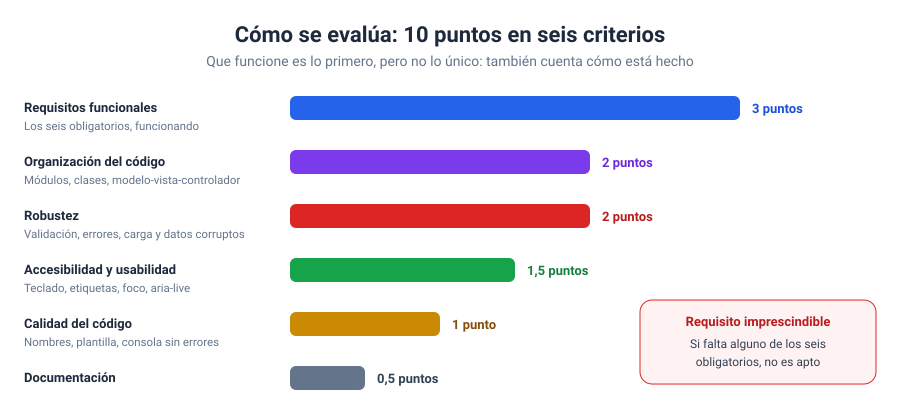
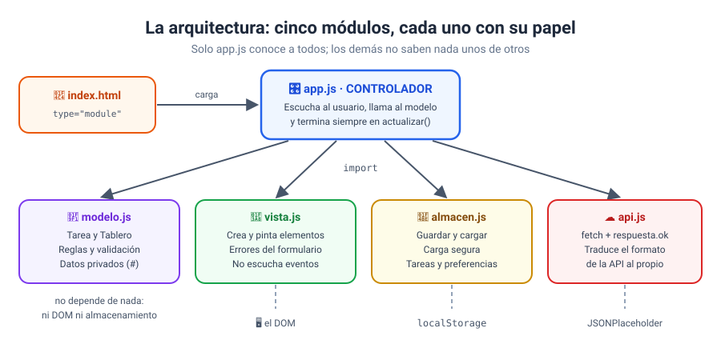
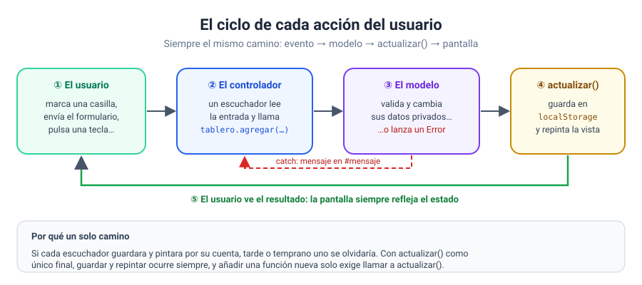
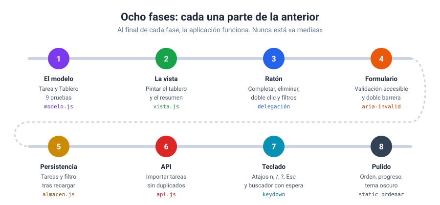

# Bloque 13 · Proyecto final

[← Bloque 12](../12-modulos-y-clases/) · [Volver al temario](../TEMARIO.md) · [Volver al inicio](../README.md)

Llegamos al final. En doce bloques habéis aprendido a escribir JavaScript, a manejar el DOM, a escuchar eventos, a validar formularios, a guardar datos en el navegador, a pedirlos a un servidor y a ordenar todo eso en módulos y clases. Ahora toca demostrarlo construyendo **una aplicación completa**, de las que se pueden enseñar. En este bloque os doy el enunciado, los criterios con los que se evalúa y una aplicación de referencia, un tablero de tareas, construida en ocho fases y explicada paso a paso. Primero la construimos juntos; después os toca hacer la vuestra.

En este bloque encontraréis:

- El **enunciado** del proyecto y sus requisitos obligatorios.
- Los **criterios de evaluación**, con su puntuación.
- La **aplicación de referencia** en 8 fases, cada una con su ejercicio y su solución explicada.
- Una **lista de comprobación** para repasar antes de entregar.

> [!IMPORTANT]
> El proyecto usa módulos y `fetch`: **abrid siempre las páginas con Live Server**.

---

## 1. El enunciado

Construid una aplicación web de una sola página, con el tema que queráis, que cumpla **los seis requisitos obligatorios**:

| Nº | Requisito obligatorio | Bloques |
| --- | --- | --- |
| 1 | Una interfaz generada y actualizada con el DOM | 06 |
| 2 | Eventos de ratón y de teclado | 07 |
| 3 | Al menos un formulario con validación | 08 |
| 4 | Datos guardados en `localStorage` | 09 |
| 5 | Datos obtenidos de una API con `fetch` | 10 y 11 |
| 6 | Código organizado en módulos | 12 |

Algunas ideas, por si os cuesta arrancar: un gestor de lecturas, un diario de entrenamientos, una agenda de contactos, un cuaderno de recetas, un registro de gastos, una lista de películas pendientes… Lo importante no es el tema, sino que la aplicación resuelva algo **de principio a fin**.

### Sobre la API

Necesitáis una API que se pueda usar desde el navegador, es decir, que envíe la cabecera CORS (bloque 11) [1]. Si no encontráis una que encaje con vuestro tema, usad JSONPlaceholder, como la aplicación de referencia: tiene usuarios, publicaciones, comentarios, álbumes, fotos y tareas [2]. Lo que valoro es **cómo** la usáis: traducir sus datos a vuestro formato, mostrar los estados de carga y error, y que la aplicación siga funcionando si la API no responde.

---

## 2. Los criterios de evaluación



| Criterio | Puntos | Qué miro |
| --- | --- | --- |
| **Requisitos funcionales** | 3 | Los seis obligatorios están y funcionan |
| **Organización del código** | 2 | Módulos con una responsabilidad clara; clases para el modelo; el modelo no toca el DOM y la vista no modifica datos |
| **Robustez** | 2 | Validación en el formulario y en el modelo; mensajes de error comprensibles; estados de carga, vacío y error; carga segura de `localStorage` |
| **Accesibilidad y usabilidad** | 1,5 | Se puede usar solo con el teclado; etiquetas en todos los controles; foco en el primer error; avisos con `aria-live` |
| **Calidad del código** | 1 | Nombres que se entienden; la plantilla de comentarios del curso; ningún error en la consola |
| **Documentación** | 0,5 | Un `README.md` del proyecto (ver apartado 6) |

> [!WARNING]
> Los seis requisitos obligatorios son imprescindibles. Si falta alguno, el proyecto no es apto, aunque el resto esté muy bien.

---

## 3. La aplicación de referencia: un tablero de tareas

Para que veáis cómo se hace un proyecto así, he construido uno completo: un tablero donde se crean, completan, editan, filtran y buscan tareas, que se guardan en el navegador y que también se pueden importar de JSONPlaceholder.



| Módulo | Papel | Bloque que lo inspira |
| --- | --- | --- |
| `modelo.js` | Las clases `Tarea` y `Tablero`, con datos privados y validación [3] [4] | 12 |
| `vista.js` | Funciones que crean y pintan elementos | 06 |
| `almacen.js` | Guardar y cargar de `localStorage` [5] | 09 |
| `api.js` | Pedir datos con `fetch` [6] y traducirlos | 11 |
| `app.js` | El controlador: importa todo lo demás [7], escucha y coordina | 07 y 12 |

### 3.1. El ciclo de cada acción



Todo lo que hace el usuario sigue el mismo camino: un escuchador llama al modelo, el modelo valida y cambia sus datos (o lanza un error), y `actualizar()` guarda y repinta. Es el patrón **estado → renderizar** del bloque 07, con cada pieza en su módulo. Si entendéis este dibujo, entendéis la aplicación.

---

## 4. Las ocho fases

Una aplicación así no se escribe de un tirón. Se construye **por fases**, y al final de cada una funciona algo nuevo.



Cada ejercicio de este bloque es **una fase**. Su carpeta contiene la aplicación tal como queda al terminar la fase anterior, más los comentarios `// TAREA:` de lo que tenéis que añadir. Su solución es el punto de partida de la siguiente. Así podéis empezar en cualquier fase, aunque no hayáis terminado la anterior.

| Fase | Ejercicio | Qué añadís | Ficheros que tocáis | Solución |
| --- | --- | --- | --- | --- |
| 1 | [El modelo: Tarea y Tablero](ejercicios/ejercicio_01/) | Clases con validación y 9 pruebas automáticas | `modelo.js` | [Ver](soluciones/ejercicio_01/) |
| 2 | [La vista: pintar el tablero](ejercicios/ejercicio_02/) | Crear los elementos de cada tarea | `vista.js` | [Ver](soluciones/ejercicio_02/) |
| 3 | [Eventos de ratón](ejercicios/ejercicio_03/) | Completar, eliminar, editar con doble clic y filtrar | `app.js` | [Ver](soluciones/ejercicio_03/) |
| 4 | [El formulario con validación](ejercicios/ejercicio_04/) | Tareas nuevas con errores accesibles [8] | `app.js` | [Ver](soluciones/ejercicio_04/) |
| 5 | [Persistencia con localStorage](ejercicios/ejercicio_05/) | Tareas y filtro que sobreviven a la recarga | `almacen.js`, `app.js` | [Ver](soluciones/ejercicio_05/) |
| 6 | [Importar tareas de una API](ejercicios/ejercicio_06/) | Usuarios y tareas de JSONPlaceholder, sin duplicados | `api.js`, `app.js` | [Ver](soluciones/ejercicio_06/) |
| 7 | [Teclado y búsqueda](ejercicios/ejercicio_07/) | Atajos globales [9] y buscador con espera | `app.js` | [Ver](soluciones/ejercicio_07/) |
| 8 | [Pulido final](ejercicios/ejercicio_08/) | Orden, progreso, borrar completadas y tema oscuro | `app.js` | [Ver](soluciones/ejercicio_08/) |

Fijaos en el orden: primero el **modelo**, que no depende de nada y se puede probar solo; después la **vista**; y solo entonces la interacción. Las funciones más vistosas (API, atajos, tema) llegan al final, cuando lo básico ya es sólido. Os recomiendo seguir el mismo orden en vuestro proyecto.

> [!NOTE]
> Las fases 5 a 8 guardan en las mismas claves de `localStorage` (`curso-js:b13:…`). Las tareas que creéis en una fase seguirán ahí en la siguiente. Para empezar de cero, borradlas en las herramientas de desarrollo: **Aplicación** → **Local Storage**.

---

## 5. Cómo organizar vuestro propio proyecto

1. **Elegid el tema y escribid en un papel qué datos tiene** (como `Tarea`: título, prioridad, fecha…) y qué reglas cumplen. Eso será vuestro modelo.
2. **Dibujad la pantalla** antes de escribir HTML: qué se ve, qué se puede pulsar, dónde salen los mensajes.
3. **Seguid las fases** de la aplicación de referencia, adaptadas a vuestro tema. Al acabar cada una, haced una copia de la carpeta: si algo se rompe, podréis volver atrás.
4. **Probad con datos raros**: un campo vacío, un texto larguísimo, sin conexión, `localStorage` estropeado a mano desde las herramientas de desarrollo. Así lo voy a probar yo.
5. **Usad el teclado** para recorrer toda la aplicación al menos una vez, sin ratón.

---

## 6. Qué hay que entregar

Una carpeta con este contenido:

```
mi-proyecto/
├── README.md       ← qué es, cómo se usa, qué API usa y qué ha costado más
├── index.html
├── style.css
├── app.js          ← el controlador
└── …               ← vuestros módulos: modelo, vista, almacén, api…
```

El `README.md` del proyecto no tiene que ser largo, pero sí responder a cuatro preguntas: qué hace la aplicación, cómo se usa (incluidos los atajos de teclado, si los hay), de qué API saca los datos y qué ha sido lo más difícil y cómo lo habéis resuelto.

---

## 7. Lista de comprobación antes de entregar

**Requisitos**

- [ ] La interfaz se genera y se actualiza con el DOM, no está escrita a mano en el HTML.
- [ ] Hay eventos de ratón **y** de teclado.
- [ ] Hay al menos un formulario, y cada error se explica junto a su campo.
- [ ] Los datos se guardan en `localStorage` y sobreviven a una recarga.
- [ ] Hay datos que llegan de una API con `fetch`.
- [ ] El código está repartido en módulos con `import` y `export`.

**Robustez**

- [ ] Se comprueba `respuesta.ok` y hay mensaje de error y botón de reintentar.
- [ ] Mientras se carga algo, el usuario lo sabe.
- [ ] Con `localStorage` vacío o estropeado, la aplicación arranca sin errores.
- [ ] El modelo valida sus datos aunque el formulario ya lo haga.

**Accesibilidad y calidad**

- [ ] Todo se puede hacer con el teclado, y los atajos no estorban al escribir.
- [ ] Todos los controles tienen etiqueta; los mensajes de estado usan `aria-live` [10].
- [ ] La consola no muestra ningún error.
- [ ] El código sigue la plantilla de comentarios del curso y los nombres se entienden.
- [ ] Hay un `README.md` del proyecto.

---

Y hasta aquí el curso. Espero que lo hayáis disfrutado tanto como yo preparándolo. Lo que habéis aprendido es la base sobre la que se construye todo lo demás: los frameworks, las aplicaciones de servidor, las de móvil… Cuando os encontréis con ellos, veréis que por debajo siguen siendo objetos, funciones, eventos y promesas. Ya los conocéis.

[← Bloque 12](../12-modulos-y-clases/) · [Volver al temario](../TEMARIO.md) · [Volver al inicio](../README.md)

### Fuentes y Documentación Oficial

1. [Cross-Origin Resource Sharing (CORS) (MDN Web Docs)](https://developer.mozilla.org/en-US/docs/Web/HTTP/Guides/CORS)
2. [JSONPlaceholder — Guide](https://jsonplaceholder.typicode.com/guide/)
3. [Classes (MDN Web Docs)](https://developer.mozilla.org/en-US/docs/Web/JavaScript/Reference/Classes)
4. [Private elements (MDN Web Docs)](https://developer.mozilla.org/en-US/docs/Web/JavaScript/Reference/Classes/Private_elements)
5. [Window: localStorage property (MDN Web Docs)](https://developer.mozilla.org/en-US/docs/Web/API/Window/localStorage)
6. [Window: fetch() method (MDN Web Docs)](https://developer.mozilla.org/en-US/docs/Web/API/Window/fetch)
7. [JavaScript modules (MDN Web Docs)](https://developer.mozilla.org/en-US/docs/Web/JavaScript/Guide/Modules)
8. [Using HTML form validation and the Constraint Validation API (MDN Web Docs)](https://developer.mozilla.org/en-US/docs/Web/HTML/Guides/Constraint_validation)
9. [Element: keydown event (MDN Web Docs)](https://developer.mozilla.org/en-US/docs/Web/API/Element/keydown_event)
10. [ARIA: aria-live attribute (MDN Web Docs)](https://developer.mozilla.org/en-US/docs/Web/Accessibility/ARIA/Reference/Attributes/aria-live)
