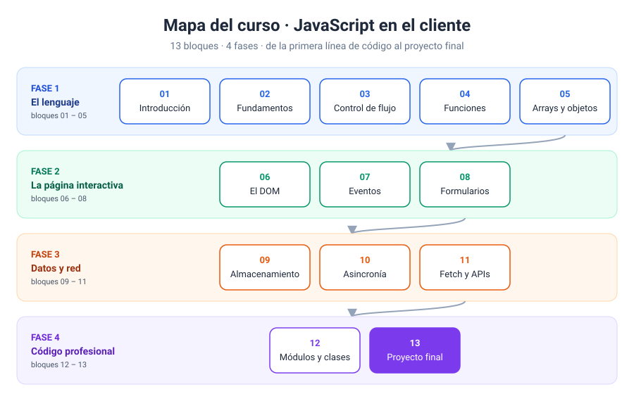
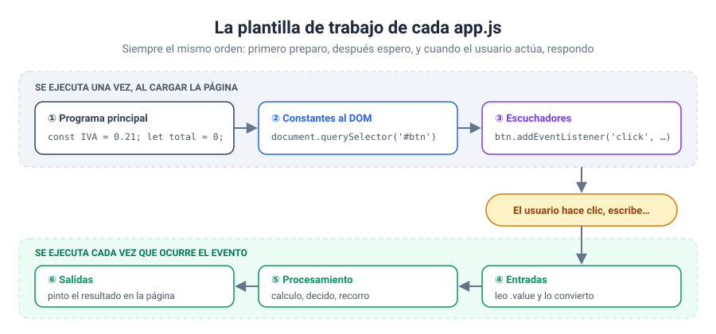

# Curso de JavaScript en el cliente · Confección Web 2026

Buenas, soy Ramón Abramo, profesor con más de 25 años de experiencia docente. En este repositorio os voy a acompañar paso a paso en el aprendizaje de **JavaScript para páginas web**: el JavaScript que se ejecuta en el navegador, el que hace que una página deje de ser un cartel bonito y empiece a responder cuando alguien la toca [1].

Aquí tenéis la teoría de cada bloque, ejercicios para practicar y sus soluciones explicadas. Todo está pensado para que podáis estudiarlo a vuestro ritmo, pero también para usarlo en clase conmigo.



---

## 1. ¿Qué vais a aprender?

Una página web se apoya en tres capas, y cada una tiene su trabajo:

| Capa | Lenguaje | Su trabajo | Analogía |
| --- | --- | --- | --- |
| Estructura | HTML | Decir qué hay en la página: títulos, párrafos, botones, formularios | El esqueleto |
| Presentación | CSS | Decidir cómo se ve: colores, tamaños, posiciones | La ropa |
| Comportamiento | JavaScript | Decidir qué pasa cuando el usuario hace algo | Los músculos |

Con HTML y CSS ya sabéis montar una página. Con JavaScript vais a conseguir que esa página **reaccione**: que un botón calcule algo, que un formulario avise de un error antes de enviarse, que una lista recuerde lo que habéis apuntado aunque cerréis el navegador o que aparezcan datos traídos de un servidor.

Fijaos en un detalle: la analogía del cuerpo sirve para recordar el reparto de tareas, pero no la llevéis más lejos. JavaScript también puede cambiar la estructura y el aspecto de la página. Lo que no debéis hacer es usarlo para lo que HTML y CSS ya resuelven solos.

Al terminar el curso seréis capaces de:

- Escribir programas en JavaScript con variables, condiciones, bucles, funciones, arrays y objetos.
- Leer y modificar cualquier elemento de una página a través del DOM.
- Responder a las acciones del usuario con eventos.
- Validar formularios y dar mensajes claros cuando algo falla.
- Guardar información en el navegador.
- Pedir datos a una API y mostrarlos en la página.
- Organizar el código en módulos y clases para que no se convierta en un plato de espaguetis.

---

## 2. ¿Qué necesitáis antes de empezar?

### Conocimientos previos

Necesitáis manejaros con **HTML y CSS básicos**: saber qué es una etiqueta, un atributo `id` o `class` y cómo se enlaza una hoja de estilos. No hace falta haber programado nunca. Empiezo desde cero.

### Herramientas

1. **Un navegador moderno**: Chrome, Edge o Firefox. Os servirá para ver la página y, sobre todo, para usar las **herramientas de desarrollo** (las abrís con `F12`). La pestaña **Consola** va a ser vuestra mejor amiga durante todo el curso [2].
2. **Visual Studio Code** como editor.
3. La extensión **Live Server** de VS Code (opcional pero muy recomendable). Recarga la página sola cada vez que guardáis.

No tenéis que instalar nada más. Ni Node.js, ni frameworks, ni compiladores. Abrís el `index.html` en el navegador y listo.

> [!NOTE]
> A partir del bloque 12, cuando trabajemos con módulos (`import` / `export`), el navegador ya no os dejará abrir el fichero con doble clic. Ahí sí necesitaréis Live Server. Os lo explico con calma cuando lleguemos [3].

---

## 3. Cómo está organizado el repositorio

```
cursoConfeccionWeb2026/
├── README.md                    ← Este documento: la introducción
├── TEMARIO.md                   ← El temario explicado bloque a bloque
├── img/                         ← Infografías generales del curso
│
├── 01-introduccion/
│   ├── README.md                ← Teoría del bloque, con infografías
│   ├── img/                     ← Infografías de ese bloque
│   ├── ejercicios/
│   │   ├── ejercicio_01/
│   │   │   ├── index.html
│   │   │   ├── style.css
│   │   │   └── app.js           ← Enunciado y plantilla para resolver
│   │   └── ejercicio_02/ …
│   └── soluciones/
│       ├── ejercicio_01/
│       │   ├── index.html
│       │   ├── style.css
│       │   ├── app.js           ← Código resuelto y comentado
│       │   └── README.md        ← La solución explicada paso a paso
│       └── ejercicio_02/ …
│
├── 02-fundamentos-del-lenguaje/
└── … un bloque por carpeta, hasta 13-proyecto-final/
```

Cada carpeta de ejercicio es **independiente**: tiene su propio HTML, su propio CSS y su propio JavaScript. No depende de ningún fichero de fuera. Podéis copiar una carpeta a un pendrive, abrir el `index.html` y funcionará igual.

---

## 4. Cómo trabajar cada bloque

Os propongo este orden. Sin saltaros pasos.

1. **Leed la teoría** del `README.md` del bloque. Mirad las infografías con calma. Están ahí para que veáis de un vistazo lo que el texto cuenta en varios párrafos.
2. **Abrid el ejercicio** en la carpeta `ejercicios/`. Leed el enunciado que aparece al principio del `app.js`.
3. **Resolvedlo vosotros**, siguiendo los pasos marcados y con la consola abierta.
4. **Solo después**, comparad con la carpeta `soluciones/`. Leed el `README.md` de la solución, que os explica el porqué de cada decisión, no solo el código.

Pero ojo aquí. Si abrís la solución a los dos minutos de atascaros, el ejercicio deja de serviros. Atascarse forma parte del aprendizaje. Dadle una vuelta, revisad la consola, releed la teoría… y si aun así no sale, entonces sí, mirad la solución y volved a intentarlo sin ella.

---

## 5. La plantilla de trabajo

Todos los `app.js` del curso siguen la misma estructura de comentarios. Así no empezáis nunca delante de una página en blanco: sabéis qué va primero, qué va después y dónde colocar cada cosa.



```javascript
// estructura del programa principal
const IVA = 0.21;

// constantes al DOM que queremos escuchar
const inputPrecio = document.querySelector('#inputPrecio');
const btnCalcular = document.querySelector('#btnCalcular');
const salida = document.querySelector('#salida');

// colocar escuchadores de eventos
btnCalcular.addEventListener('click', () => {
    // entradas
    const precio = Number(inputPrecio.value);

    // procesamiento
    const total = precio + precio * IVA;

    // salidas
    salida.textContent = `Total con IVA: ${total.toFixed(2)} €`;
});
```

Fijaos en que hay dos momentos distintos:

- Lo que está **fuera** del escuchador se ejecuta una sola vez, cuando la página carga. Ahí preparo el terreno: constantes, referencias a los elementos y escuchadores.
- Lo que está **dentro** se ejecuta cada vez que el usuario pulsa el botón. Ahí va el esquema de siempre: **entradas → procesamiento → salidas**.

En los primeros ejercicios todavía no usamos eventos, así que el programa se ejecuta de arriba abajo y la plantilla se queda solo en entradas, procesamiento y salidas. En cuanto lleguemos a los eventos, la plantilla crece y ya no cambia en todo el curso.

---

## 6. Buenas prácticas que vais a ver en todo el curso

- Uso `const` por defecto y `let` solo cuando el valor tiene que cambiar. `var` no aparece en ningún ejercicio.
- Comparo siempre con `===` y `!==`, que comprueban también el tipo [4].
- Convierto lo que llega de un `input` con `Number()` antes de hacer cuentas. Un `input` siempre devuelve texto [5], y `"2" + "2"` da `"22"`. Ahí suele estar el lío.
- Pongo nombres que se entienden: `precioTotal`, no `pt`; `btnEnviar`, no `b1`.
- Coloco el `<script>` al final del `<body>` o con `defer`, para que el HTML exista cuando JavaScript lo busca [6].
- Separo la estructura (HTML), el estilo (CSS) y el comportamiento (JS) en sus propios ficheros.

---

## 7. El temario

El detalle de cada bloque, con objetivos y contenidos, lo tenéis en **[TEMARIO.md](TEMARIO.md)**.

| Bloque | Carpeta |
| --- | --- |
| 01 · Introducción | [`01-introduccion/`](01-introduccion/) |
| 02 · Fundamentos del lenguaje | [`02-fundamentos-del-lenguaje/`](02-fundamentos-del-lenguaje/) |
| 03 · Control de flujo | [`03-control-de-flujo/`](03-control-de-flujo/) |
| 04 · Funciones | [`04-funciones/`](04-funciones/) |
| 05 · Arrays y objetos | [`05-arrays-y-objetos/`](05-arrays-y-objetos/) |
| 06 · El DOM | [`06-dom/`](06-dom/) |
| 07 · Eventos | [`07-eventos/`](07-eventos/) |
| 08 · Formularios | [`08-formularios/`](08-formularios/) |
| 09 · Almacenamiento en el navegador | [`09-almacenamiento/`](09-almacenamiento/) |
| 10 · Asincronía | [`10-asincronia/`](10-asincronia/) |
| 11 · Fetch y APIs | [`11-fetch-y-apis/`](11-fetch-y-apis/) |
| 12 · Módulos, clases y buenas prácticas | [`12-modulos-y-clases/`](12-modulos-y-clases/) |
| 13 · Proyecto final | [`13-proyecto-final/`](13-proyecto-final/) |

---

### Fuentes y Documentación Oficial

1. [Introducción — Guía de JavaScript (MDN Web Docs)](https://developer.mozilla.org/es/docs/Web/JavaScript/Guide/Introduction)
2. [What are browser developer tools? (MDN Web Docs)](https://developer.mozilla.org/en-US/docs/Learn_web_development/Howto/Tools_and_setup/What_are_browser_developer_tools)
3. [Módulos JavaScript (MDN Web Docs)](https://developer.mozilla.org/es/docs/Web/JavaScript/Guide/Modules)
4. [Expresiones y operadores — Operadores de comparación (MDN Web Docs)](https://developer.mozilla.org/es/docs/Web/JavaScript/Guide/Expressions_and_operators)
5. [HTMLInputElement: value property (MDN Web Docs)](https://developer.mozilla.org/en-US/docs/Web/API/HTMLInputElement/value)
6. [`<script>` HTML script element — atributo `defer` (MDN Web Docs)](https://developer.mozilla.org/en-US/docs/Web/HTML/Reference/Elements/script)
