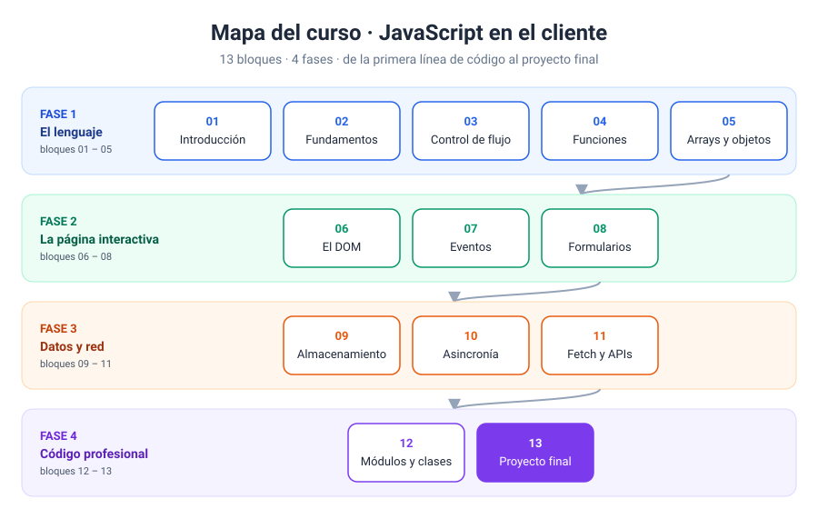
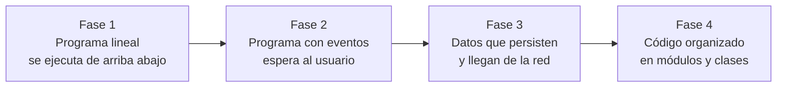

# Temario · JavaScript en el cliente

En este documento os explico qué vamos a ver en cada bloque, en qué orden y por qué. Antes de abrir la primera carpeta, os recomiendo leerlo entero. Así sabréis en todo momento en qué punto del camino estáis y hacia dónde vamos.

[← Volver a la introducción](README.md)

---

## Cómo está pensado el recorrido

El curso tiene **13 bloques** agrupados en **4 fases**. El orden no es caprichoso: cada bloque usa lo que habéis aprendido en los anteriores.

| Fase | Bloques | Qué conseguís |
| --- | --- | --- |
| 1 · El lenguaje | 01 – 05 | Pensar como un programador: datos, decisiones, repeticiones y funciones |
| 2 · La página interactiva | 06 – 08 | Que la página responda a lo que hace el usuario |
| 3 · Datos y red | 09 – 11 | Recordar información y traerla de fuera |
| 4 · Código profesional | 12 – 13 | Ordenar el código y construir una aplicación completa |

Fijaos en el salto entre la fase 1 y la fase 2. En la primera, el programa se ejecuta de arriba abajo, de golpe, y usamos la consola, `prompt()` y `alert()` para probar cosas rápido. En la segunda cambia la forma de pensar: el programa prepara la página y luego **se queda esperando** a que el usuario haga algo. A partir de ahí, `prompt()` y `alert()` desaparecen y trabajamos con interfaces de verdad.

---

## Fase 1 · El lenguaje

### Bloque 01 · Introducción

📁 [`01-introduccion/`](01-introduccion/)

**Objetivo:** entender dónde vive JavaScript, cómo se conecta con una página y cómo comprobar que está funcionando.

**Contenidos:**

- Qué es JavaScript y qué papel juega junto a HTML y CSS.
- JavaScript en el cliente frente a JavaScript en el servidor.
- Las tres formas de incluir código: dentro del HTML, en un fichero externo y en un atributo (y por qué esta última no la vamos a usar).
- Dónde colocar el `<script>`: en el `<head>`, al final del `<body>` o con `defer`.
- Las herramientas de desarrollo del navegador: la Consola, el inspector de elementos y los mensajes de error.
- Primeras salidas: `console.log()`, `alert()` y `textContent`.
- Primera entrada: `prompt()`.

**Al terminar:** sabréis crear un `index.html` con su `app.js`, enlazarlos bien y leer un error en la consola sin entrar en pánico.

---

### Bloque 02 · Fundamentos del lenguaje

📁 [`02-fundamentos-del-lenguaje/`](02-fundamentos-del-lenguaje/)

**Objetivo:** aprender a guardar datos y a operar con ellos.

**Contenidos:**

- Variables y constantes: `let` y `const`. Por qué dejamos `var` fuera.
- Reglas para nombrar variables y la convención *camelCase*.
- Tipos primitivos: `string`, `number`, `boolean`, `undefined`, `null`, y el operador `typeof`.
- Operadores aritméticos, de asignación y de incremento.
- Concatenación con `+` y plantillas de texto con comillas invertidas: `` `Hola, ${nombre}` ``.
- Conversión de tipos: `Number()`, `String()`, `parseInt()`, `parseFloat()` y el caso de `NaN`.
- Comparaciones: `==` frente a `===`.
- El objeto `Math` y el redondeo con `toFixed()`.

**Al terminar:** sabréis pedir datos, convertirlos al tipo correcto, hacer cálculos y mostrar el resultado bien formateado.

---

### Bloque 03 · Control de flujo

📁 [`03-control-de-flujo/`](03-control-de-flujo/)

**Objetivo:** que el programa tome decisiones y repita tareas.

**Contenidos:**

- Condicionales: `if`, `else if`, `else`.
- Operadores lógicos: `&&`, `||`, `!`.
- Valores *truthy* y *falsy*.
- El operador ternario.
- La estructura `switch`.
- Bucles `for`, `while` y `do...while`.
- Contadores y acumuladores.
- Control del bucle con `break` y `continue`.
- Cómo evitar un bucle infinito (y qué hacer si se os cuela uno).

**Al terminar:** sabréis resolver problemas que dependen de condiciones y que exigen repetir operaciones, como calcular notas, tablas de multiplicar o sumar series de números.

---

### Bloque 04 · Funciones

📁 [`04-funciones/`](04-funciones/)

**Objetivo:** dividir el programa en piezas reutilizables.

**Contenidos:**

- Declarar y llamar a una función.
- Parámetros, argumentos y valores por defecto.
- `return`: devolver un resultado y salir antes de tiempo.
- Expresiones de función y funciones flecha.
- Ámbito (*scope*): global, de función y de bloque.
- *Hoisting*: qué se puede usar antes de declararse y qué no.
- Funciones como valores: pasar una función a otra (*callbacks*).
- Introducción a los *closures*.

**Al terminar:** sabréis escribir funciones pequeñas que hacen una sola cosa bien, y reutilizarlas en lugar de copiar y pegar código.

---

### Bloque 05 · Arrays y objetos

📁 [`05-arrays-y-objetos/`](05-arrays-y-objetos/)

**Objetivo:** trabajar con colecciones de datos y con datos que tienen varias propiedades.

**Contenidos:**

- Arrays: crear, leer por índice, `length`.
- Añadir y quitar elementos: `push`, `pop`, `unshift`, `shift`, `splice`.
- Buscar: `includes`, `indexOf`, `find`, `findIndex`.
- Recorrer: `for`, `for...of` y `forEach`.
- Transformar: `map`, `filter`, `reduce`, `sort`.
- Objetos literales: propiedades, métodos y acceso con punto o corchetes.
- Recorrer objetos con `for...in` y `Object.keys()`.
- Arrays de objetos, la estructura que más vais a usar en el mundo real.
- Desestructuración y operador *spread* (`...`).
- Valores frente a referencias: por qué copiar un array no es tan simple como parece.
- JSON: `JSON.stringify()` y `JSON.parse()`.

**Al terminar:** sabréis modelar datos reales (una lista de productos, un listado de alumnos) y filtrarlos, ordenarlos o calcular totales sobre ellos.

---

## Fase 2 · La página interactiva

### Bloque 06 · El DOM

📁 [`06-dom/`](06-dom/)

**Objetivo:** leer y modificar cualquier parte de la página desde JavaScript.

**Contenidos:**

- Qué es el DOM y cómo el navegador convierte el HTML en un árbol de nodos.
- Seleccionar elementos: `querySelector` y `querySelectorAll`.
- `NodeList` frente a array, y cuándo usar `Array.from()`.
- Cambiar contenido: `textContent` frente a `innerHTML`, y el riesgo de meter HTML que viene del usuario.
- Cambiar atributos y los atributos `data-*` con `dataset`.
- Cambiar estilos: `style` frente a `classList` (`add`, `remove`, `toggle`, `contains`).
- Crear y eliminar elementos: `createElement`, `append`, `prepend`, `remove`.
- Pintar listas en la página a partir de un array.

**Al terminar:** sabréis construir partes de la página desde JavaScript, como una lista de tarjetas generada a partir de datos.

---

### Bloque 07 · Eventos

📁 [`07-eventos/`](07-eventos/)

**Objetivo:** que la página responda a lo que hace el usuario.

**Contenidos:**

- La programación dirigida por eventos: preparar y esperar.
- `addEventListener` y `removeEventListener`.
- Eventos de ratón: `click`, `dblclick`, `mouseover`, `mouseout`.
- Eventos de teclado: `keydown`, `keyup` y la propiedad `e.key`.
- Eventos de formulario: `input`, `change`, `focus`, `blur`.
- El objeto `event`: `e.target`, `e.currentTarget`, `e.type`.
- `e.preventDefault()`: cuándo y para qué.
- Propagación de eventos: fase de burbuja y `stopPropagation()`.
- Delegación de eventos: un solo escuchador para muchos elementos.

**Al terminar:** sabréis montar interfaces que reaccionan al ratón y al teclado, como pestañas, contadores, galerías o juegos sencillos.

---

### Bloque 08 · Formularios

📁 [`08-formularios/`](08-formularios/)

**Objetivo:** recoger datos del usuario y comprobarlos antes de darlos por buenos.

**Contenidos:**

- Leer valores de `input`, `select`, `textarea`, `checkbox` y `radio`.
- El evento `submit` y cómo evitar que recargue la página.
- `FormData` para leer el formulario completo de una vez.
- Validación nativa de HTML: `required`, `min`, `max`, `pattern`, `type="email"`.
- La API de validación de restricciones: `checkValidity()`, `validity` y `setCustomValidity()`.
- Validación personalizada con JavaScript.
- Mostrar errores al usuario de forma clara y accesible.
- Limpiar y reiniciar un formulario.

**Al terminar:** sabréis construir formularios que no dejan pasar datos incorrectos y que explican al usuario qué debe corregir.

---

## Fase 3 · Datos y red

### Bloque 09 · Almacenamiento en el navegador

📁 [`09-almacenamiento/`](09-almacenamiento/)

**Objetivo:** que la página recuerde información aunque se recargue o se cierre el navegador.

**Contenidos:**

- `localStorage` y `sessionStorage`: diferencias y cuándo usar cada uno.
- `setItem`, `getItem`, `removeItem` y `clear`.
- Por qué solo se guarda texto, y cómo guardar arrays y objetos con JSON.
- Patrón de trabajo: cargar al empezar, guardar en cada cambio.
- Qué no debéis guardar nunca en el navegador.
- Proyecto guiado: lista de tareas que persiste.

**Al terminar:** sabréis hacer aplicaciones pequeñas que conservan sus datos, como una lista de tareas, unas preferencias de tema o un carrito.

---

### Bloque 10 · Asincronía

📁 [`10-asincronia/`](10-asincronia/)

**Objetivo:** entender que no todo ocurre al instante y trabajar con tareas que terminan más tarde.

**Contenidos:**

- Código síncrono frente a código asíncrono.
- Temporizadores: `setTimeout`, `setInterval`, `clearTimeout`, `clearInterval`.
- El *Event Loop*: pila de llamadas, APIs del navegador y cola de tareas.
- *Callbacks* y el problema de anidarlos demasiado.
- Promesas: estados, `then`, `catch` y `finally`.
- `async` y `await`.
- Gestión de errores con `try...catch`.

**Al terminar:** sabréis crear relojes, cuentas atrás y animaciones con temporizadores, y estaréis preparados para pedir datos a un servidor.

---

### Bloque 11 · Fetch y APIs

📁 [`11-fetch-y-apis/`](11-fetch-y-apis/)

**Objetivo:** traer datos de un servidor y mostrarlos en la página.

**Contenidos:**

- Qué es una API y qué es una petición HTTP: métodos, URL, códigos de estado.
- `fetch()` con `async` / `await`.
- Leer la respuesta con `response.json()` y comprobar `response.ok`.
- Mostrar estados de carga y de error al usuario.
- Pintar en el DOM los datos recibidos.
- Enviar datos con `POST`.
- Qué es CORS y por qué a veces el navegador bloquea una petición.

**Al terminar:** sabréis consumir una API pública y construir con ella un buscador o un listado dinámico.

---

## Fase 4 · Código profesional

### Bloque 12 · Módulos, clases y buenas prácticas

📁 [`12-modulos-y-clases/`](12-modulos-y-clases/)

**Objetivo:** ordenar el código para que se pueda leer, mantener y ampliar.

**Contenidos:**

- Módulos: `export`, `import` y `<script type="module">`.
- Por qué los módulos necesitan un servidor (Live Server).
- Clases: `class`, `constructor`, propiedades y métodos.
- Herencia con `extends` y `super`.
- Propiedades privadas con `#`, *getters* y *setters*.
- Separar responsabilidades: datos, lógica y vista.
- Depuración con *breakpoints* en las herramientas de desarrollo.

**Al terminar:** sabréis repartir una aplicación en varios ficheros con una responsabilidad clara cada uno.

---

### Bloque 13 · Proyecto final

📁 [`13-proyecto-final/`](13-proyecto-final/)

**Objetivo:** construir una aplicación completa que reúna todo lo aprendido.

**Qué tiene que incluir el proyecto:**

- Una interfaz generada y actualizada con el DOM.
- Eventos de ratón y teclado.
- Al menos un formulario con validación.
- Datos guardados en `localStorage`.
- Datos obtenidos de una API con `fetch`.
- Código organizado en módulos.

En la carpeta encontraréis el enunciado completo, los criterios de evaluación y una solución de referencia explicada por partes.

---

[← Volver a la introducción](README.md)

### Fuentes y Documentación Oficial

La documentación de referencia del temario es MDN Web Docs para las API del navegador (DOM, eventos, formularios, Web Storage, Fetch) y la especificación ECMAScript para el lenguaje. Los enlaces directos a cada apartado se incluirán en este documento cuando haya podido comprobarlos uno a uno.
